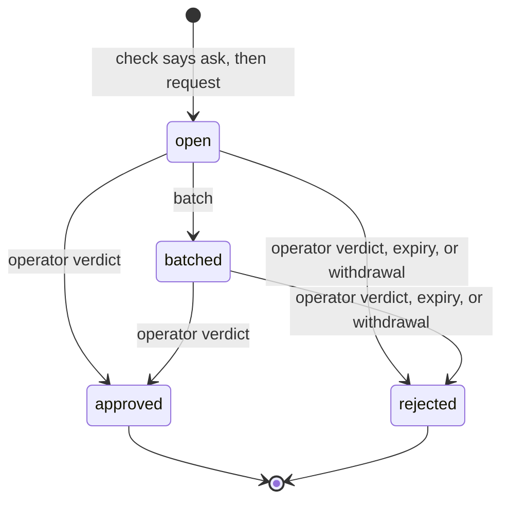
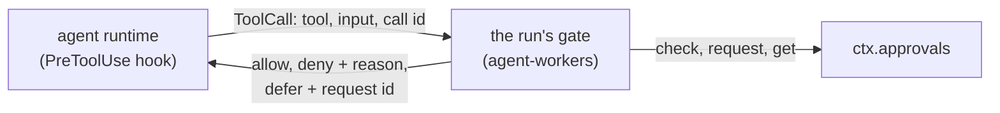

# Approvals

> Target state. Boundary: [routing](../architecture/components.md#routing), core component
> *gate* ([ADR-0036](../decisions/adr/0036-guarantee-core-and-capability-plugins.md)). Proposals:
> [PROP-0010](../proposals/0010-base-version.md),
> [PROP-0008](../proposals/0008-studio-operating-model.md#fewer-approvals-reliable-results).
> Records: [`autonomy-policy@1.0`](../reference/schemas.md#autonomy-policy),
> [`approval-request@1.1`](../reference/schemas.md#approval-request),
> [`policy-change@1.1`](../reference/schemas.md#policy-change), and verdicts
> [`approval@1.0`](../reference/schemas.md#approval). Decisions:
> [ADR-0039](../decisions/adr/0039-base-guarantee-seam-contract-changes.md),
> [ADR-0041](../decisions/adr/0041-policy-changes-through-the-approval-queue.md),
> [ADR-0050](../decisions/adr/0050-the-queue-proposes-a-policy-change-from-repeated-approvals.md).
>
> Implemented in [`approvals`](../../packages/plugins/approvals/README.md) (definition
> [`approvals-core`](../../packages/approvals-core/README.md)); the queue is on `/ui`
> ([`web-ui`](../../packages/plugins/web-ui/README.md), [API](../reference/web-ui.md)). Worker tool
> calls pass the gate of [`agent-workers`](../../packages/plugins/agent-workers/README.md), reached
> through each runtime's hook. The [workflow engine](workflow-engine.md) also asks, for remediation,
> deferred calls, merges, dispatch starts, and plain-run checks ([below](#a-landing)).
> Differs from target: with no queue loaded, remediation falls back to the operator's plan gate
> (`approval@1.0` by `approve`), and a planner's plan gate is still the operator's. A Worker's tool
> calls are judged under the studio policy only, since no trusted envelope names an agent run's
> project yet. A deferred agent run fails as `config_error`, since the workers seam has no waiting
> status ([below](#where-a-workers-gate-leaves-room)).

Every action that needs a person goes through one queue, in batches, and nothing else asks the
operator. The autonomy policy decides which actions those are; an action that is reversible and
verified runs without asking. Code decides, never a model.

## Seam

`ctx.approvals` (`Approvals` in `@tsuuanmi/system-approvals-core`), contract 1.1:

| Method | Does |
|---|---|
| `policy(projectId?)` | the studio policy, the project's, and the effective mode per action class; from 1.1, the set in force (`set`) |
| `check(action)` | classify one action; records an `autonomy` decision. Its `mode` is the mode once the required checks pass ([below](#a-verdict-is-not-yet-a-permission)) |
| `request(request)` | queue a request for an action the loaded policies still say `ask` for, as its recorded verdict says |
| `get`, `list` | read the queue |
| `batch(at)` | group open requests into batches by the policy's batch rule |
| `decide(verdicts)` | the operator's verdicts, each bound to its request's exact subject |
| `decideAsLead(project, verdicts)` | optional ([ADR-0076](../decisions/adr/0076-the-lead-is-a-principal-of-its-own-with-a-closed-list-of-rights.md)): a project's lead's verdicts, held to its closed list of rights ([below](#the-lead-principal)); recorded as `lead:<project>` |
| `devBranches(project)` | optional: the branches the project lists as dev branches, where its lead decides merges and results |
| `withdraw(requestId)` | close a request whose waiting work ended |
| `sweep(at)` | reject every request unanswered at `at`, then withdraw every open one the loaded policies no longer ask for |
| `proposePolicy(proposal)` | 1.1, optional: the operator's proposed record, asked as one `policy-change` request on the hash of the set it makes, applied only on approval ([below](#a-policy-change)) |
| `policyChanges(filter?)` | 1.1, optional: the policy changes, newest first |

`at` is a test seam, here and in `request`, `batch`, `decide`, and `withdraw`. The MCP tools, the
web UI, the board, and the queue's own passes fill it from the wall clock. A provider trusts it: a
caller that passed a time far ahead would make a request that never expires (INV-9).

## The autonomy policy

| Mode | Effect |
|---|---|
| `auto` | the action runs and is recorded, once the rule's required checks pass |
| `notify` | the same, and the operator is shown it afterwards |
| `ask` | an approval request; the action waits for the verdict |
| `forbid` | denied |

- The effective mode is the strictest of the studio policy and the project's, which constrains
  only the classes it names. A class no rule names takes the stricter `default`, which is `ask`
  or `forbid`.
- Irreversible effects (`external-send`, `deploy`, `delete-data`, `spend`), the investor's
  decisions (`charter`, `funding`, `policy-change`), `remediation` (a fix that writes, or a lost
  run going on, waits for a person), `promotion` (a plugin moved to `default` on an accepted
  evaluation, so the feedback loop never approves its own change:
  [ADR-0045](../decisions/adr/0045-feedback-loop-guarantee-seams.md)), and `merge` (always asks the
  operator: [ADR-0060](../decisions/adr/0060-an-accepted-result-lands-on-the-operators-merge-approval.md))
  are never `auto` or `notify` (`ALWAYS_ASK`). The schema refuses a policy that says so (for
  `remediation` and `merge`, which the schema predates, a load-time rule does), and the provider
  raises each of them to at least `ask` whatever a rule says.
- `dispatch` ([ADR-0064](../decisions/adr/0064-system-starts-ready-work-under-the-dispatch-action-class.md)):
  System starting a ready board task's attempt with no person or lead asking for it
  ([below](#a-start-system-proposes)). It is reversible (the run can be stopped, nothing lands
  without `merge`), so it is not in `ALWAYS_ASK`. A policy that names no rule for it takes its
  `default`, which the bundle's studio policy sets to ask. Under `auto` or `notify` the dispatch
  pass does not ask the queue at all.
- A failed required check sends the action back to the lead as work, not to the operator. A
  check nobody reported is not a failure: the board holds such a review for the operator's own
  acceptance ([board](board.md#required-checks-bind-at-acceptance)).
- A wait for a person lasts the shortest `expiresSeconds` of the rules that apply to the class,
  else the stricter `expiry.defaultSeconds`, never more than the stricter `expiry.maxSeconds`
  (`waitSeconds` in `approvals-core`). This sets a request's `expiresAt`, and a review the board
  holds for the operator.
- A `command` is judged by its exact argv. An argv equal, word for word and with nothing more, to a
  line on every applying commands list is judged as `workspace-write` (unless `command` is
  `forbid`); any other is the `command` class. An argv with a word that holds a shell metacharacter
  (`; & | $`, the backquote, `< > ( ) { } [ ] * ? ~`, quotes, backslash, newline, carriage return,
  tab, NUL) is `forbid`, whatever its class: argv is matched, never parsed by a shell. A list entry
  with an empty word or a metacharacter refuses its policy at load.
- On a Claude Code Worker the policy compiles to a PreToolUse hook: `forbid` → `deny`, `ask` →
  `defer`, `notify` and `auto` → `allow`. `canUseTool` is never the gate, because tools allowed by
  a rule or a permissive mode never reach it (B5). How a tool call becomes an action is
  [below](#a-workers-tool-calls).

### A verdict is not yet a permission

> **`mode` is the mode once the required checks pass.** `check` returns `auto` or `notify` for an
> action whose rule allows it, even when its required checks did not pass; `failedChecks` names
> those. A rule's `requires` are checks the **result** must pass before it is accepted, never
> preconditions of each step of the work that produces it:
>
> - A caller that **accepts or applies a result** (the board's `accept`, an acceptance gate)
>   passes the checks it ran (`action.checks`) and treats a non-empty `failedChecks` as **not yet
>   allowed**: a failed check is work for the lead, never a reason to accept the result or to ask
>   the operator. Such a caller that reads `mode` alone fails open. The workflow engine runs the
>   required checks that are commands on the result's exact tree first, and reports those
>   ([a run's required checks](workflow-engine.md#a-runs-required-checks)).
> - A caller that gates the work **while it runs** (a board task becoming ready, a Worker's tool
>   call) cannot have run them: it lets the work go on under `auto` or `notify`, records the
>   checks as pending (the `autonomy` decision's `failedChecks`, and its own record), and they
>   bind when the result is accepted
>   ([board](board.md#required-checks-bind-at-acceptance), [below](#a-workers-tool-calls)).
>
> Everything else still fails closed: `forbid` denies, `ask` waits for the operator, and a
> class no rule names takes the stricter `default`.

## A request



PROP-0010's sketch shows `expired` as a state before `rejected`. Here they are one transaction:
the request becomes `rejected` with cause `expired`, and the decision's outcome is
`denied:expired`.

| From → to | Who | Records | On failure |
|---|---|---|---|
| — → open | `request`, by a core component (board, workflow, a Worker's hook, resources) | the request, with the `autonomy` decision that said ask and `expiresAt`; an `approvals.requested` event (id, class, `expiresAt`, requester component, project; never the summary, consequences, or command), which [notifications](notifications.md) read | refused (`not-asked`) unless the verdict cites an `autonomy` decision that said ask, under the policy it names and the project's policies as loaded now (each at its current version, the set's `decider.hash`); judging the action again (its class, `command`, project) must still say ask. An invalid request, or a subject with no `version` (except an `artifact` subject by its `sha256:` id), is refused (`invalid`) |
| open → batched | `batch`, when the group (one per project) reaches `maxSize` or its oldest request waited `maxWaitSeconds` | `batchId`; an `approvals.batched` event | — |
| open or batched → approved | `decide`, from the operator's channel only: the queue on `/ui` (operator token) or MCP `approvals_decide` (operator scope) | an `approval@1.0` artifact by `operator` on the request's subject, and an `approval` decision (`approved`) | a verdict for a changed subject, an expired or resolved request, or an unknown one is refused and changes nothing. One the provider cannot apply is refused as `failed` and logged; the other verdicts of the call apply. Through `approvals_decide` the output is checked before anything commits: the call's verdicts apply in one transaction, and an output its schema refuses (a defect) applies none |
| open or batched → rejected (verdict) | `decide` | the same, with `rejected` | as above |
| open or batched → rejected (expired) | `sweep`, at `expiresAt` | an `approval` decision `denied:expired` (decider rule `approvals.expiry`) | — |
| open or batched → rejected (withdrawn) | `withdraw`, by the requester, when its work ended | an `approval` decision `withdrawn` (decider rule `approvals.withdraw`) | a resolved request is returned unchanged |
| open or batched → rejected (policy changed) | the provider, at load and on every `sweep`, for an unexpired request whose policy is not current at its version, or whose class (and the class its decision judged it as) the loaded policies no longer ask for | an `approval` decision `withdrawn` (decider rule `approvals.policy`), its reason naming what changed | logged and left for the next sweep |

Every resolution also appends an `approvals.resolved` event in its transaction (request id, state,
cause, option, naming the `approval` decision). The event log is optional to the queue, and an
append that fails is logged: the change stands.

A policy change takes effect through a `policy-change` approval while `system` runs
([below](#a-policy-change)), or by configuration at a start
([the configuration and the stored set](#the-configuration-and-the-stored-set)). Either way, open
requests are judged again under the new set. Cause `withdrawn` covers it, and the decision's rule
(`approvals.policy`, not `approvals.withdraw`) tells it from the requester's own withdrawal. The
requester sees its request rejected with no verdict and puts the action to the new policy again:

- The board does so on its next sweep, as a fresh gate
  ([board](board.md#where-the-tables-leave-room)). A task waiting for approval becomes ready when
  the new policy gives its class `auto` or `notify`, waits on one new request on the same subject
  when it still says `ask`, and is cancelled (`forbidden`) on `forbid`. A spent budget or a lost
  run asks again on `ask` and otherwise waits for input. A charter is asked about again, or refused
  (a first charter abandons its project, an amendment is dropped) when no request can be opened. A
  request the board withdrew itself changes nothing there.
- A Worker's deferred call is denied when its session runs it again, and nothing new is queued for
  that call ([below](#a-deferred-call)). A board task's step waiting on it ends its attempt when the
  new policy forbids the call's class, and otherwise continues its session once, told the call was
  denied. A run outside the board continues nothing.
- A workflow run's remediation gate closes (`plan_rejected`), and the fix does not run;
  `continue` puts the plan to the policy loaded now on a new request
  ([remediation on the queue](workflow-engine.md#remediation-on-the-approval-queue)).

### Where the tables leave room

The store-backed provider settles these cases so that the [fail-closed rules](#fail-closed-rules)
hold. The fake provider does not check them, and the suite does not test them.

- A batch holds at most `maxSize` requests, oldest first: a group with more open requests makes
  several batches, and only its last, smaller one waits for `maxWaitSeconds`. An open request
  already expired is not batched; the sweep rejects it.
- The batch rule of a project's requests is the first policy's that names one, the studio's
  first; with none, each request is its own batch at once. At load, a batch rule whose
  `maxWaitSeconds` is not under the shortest expiry a request it batches can get is refused: a
  lone request would expire before the operator is shown it.
- A malformed verdict, or a named request whose stored record fails its schema, refuses the whole
  `decide` call before any verdict applies.
- At load, two policies with one id, or two for one project, are refused.
- Withdrawal on a policy change needs the request's classes: its own, and the class its decision
  judged it as. A listed command's argv is not kept, so its request is withdrawn unless both
  `command` and the class it was judged as still ask.
- The queue sweeps, then batches, once at start and every `sweepSeconds` (1 to 3600, never off);
  nothing else calls them in production.
- A withdrawn request is not a verdict. A request the requester withdrew itself changes nothing
  more; one the queue withdrew on a policy change is put to the new policy again by the board on
  its next sweep ([above](#a-request)), while a Worker's gate denies the same call again in that
  session ([a deferred call](#a-deferred-call)).

## A Worker's tool calls

Every tool call of an agent run passes the run's gate before it runs:



- **The contract** is runtime-neutral, in
  [`agent-runtime-core`](../../packages/agent-runtime-core/README.md): `RunSpec.toolGate` answers
  `allow`, `deny` with a reason, or `defer` with a reason and the request id. A runtime reports
  `gatesToolCalls` only if it asks the gate before every tool call; the `agents` source admits no other
  Worker. The runtime plugin never reads `ctx.approvals`: the source that owns runs builds each run's gate.
- **On Claude Code** the gate is one PreToolUse hook with no matcher: every tool, subagents'
  included. `deny` and `defer` hold in every permission mode. `allow` returns no decision: a hook's
  `allow` would skip the workspace-scoped pre-approvals, so the runtime's own policy still decides,
  and a call outside the workspace stays refused. A gate that throws, answers with an unknown
  verdict, or takes longer than 30 s is a deny.
- **On Codex** the gate is one PreToolUse hook on every tool (`*`), a command Codex runs, which
  reaches the run's gate through a private channel ([Codex's gate](agent-runtimes.md#codexs-gate)).
  `deny` and `defer` block the call with the reason; `allow` prints no decision, so Codex's own
  sandbox still decides. The hook blocks on any failure of its own, since Codex runs the tool when a
  hook fails, and the probe proves the hook answers before any Codex Worker is admitted.
- **On the Antigravity CLI** the hook is a command agy runs before each tool call, which the runtime
  bridges to the run (a socket in an owner-only directory, a per-run token; any failure on the way is
  a deny). The runtime's own rules come first, since agy has no workspace-scoped permission of its
  own; then the gate. `allow` is the hook's allow (the rules already held the call to the workspace);
  `deny` its deny; `defer` is a deny too, since agy cannot wait on a call. agy runs the tool when a
  hook exits 0 printing nothing, so the hook prints a deny itself whenever the run's hook gives no
  answer. The runtime gates only on an agy version a supervised live check verified
  ([ADR-0043](../decisions/adr/0043-antigravity-cli-workers-gated-on-a-version-verified-live.md),
  [its README](../../packages/plugins/runtime-antigravity-cli/README.md)).

### How a call is classified

By code, from the tool's name and input only, never by a model's judgment; a call the table does not
cover is denied. The table is keyed by the tool names each runtime reports (Claude Code's built-in
tools; Codex 0.164; agy 1.4.6, recorded in a supervised live check). Each tool takes only the input
fields its declared type names, of the declared type. An unknown field, or a known one of another
type, is denied, its reason naming the field.

| Tool | Action |
|---|---|
| `Read`, `NotebookRead`, `LS`, `Glob`, `Grep`, `view_image` | `read`, for a path inside the run's workspace (absent for `Glob` and `Grep`: the workspace); a `Glob` pattern whose literal leading directory is outside it, or that climbs with `..`, is denied |
| `mcp__workspace__read_file`, `mcp__workspace__list_dir`, `mcp__workspace__search` | `read`: the three tools of System's own [workspace reads server](agent-runtimes.md#the-workspace-reads-server), which run no program. They are `read` only for a run whose runtime reports it gives its agent that server (`workspaceReads`); elsewhere every `mcp__workspace__…` tool is denied, `unclassified-tool`. For the `path` they name inside the workspace (absent or empty for `list_dir` and `search`: the workspace), with no `..` segment and not in git's own data. Their other fields are the server's: `read_file`'s `startLine` and `endLine` (numbers), `search`'s `pattern` (text) and `regex` and `ignoreCase` (booleans). Any other tool of that server is denied by name (`unclassified-tool`) |
| `read_file` | `read`, for the file `Path` names inside the workspace; its other fields are `StartLine`, `EndLine`, and `ByteOffset` (numbers) |
| `Write`, `Edit`, `MultiEdit`, `NotebookEdit` | `workspace-write`, for a file inside the workspace; outside it is denied (and refused by the runtime), and so is a file in git's own data (`.git` anywhere in its path, as written or on disk; the same for `write_file`, `edit_file`, and `apply_patch`), whose configuration a git command would run |
| `write_file`, `edit_file` | `workspace-write`, for the file `Path` names inside the workspace; `write_file`'s other fields are `Content` (text), `Append`, and `Overwrite` (booleans), `edit_file`'s `Target` and `Replacement` (text); `ArtifactMetadata`, which writes one of agy's own artifacts, is denied |
| `apply_patch` | `workspace-write`, when its patch (`command`) reads strictly in the patch grammar (`*** Begin Patch`; `Add File` with `+` lines, `Delete File`, `Update File` with an optional `Move to`, `@@`, ` `, `+`, `-`, and empty lines, and `*** End of File`; `*** End Patch`) and every file a header names is inside the workspace. A `***` line the grammar does not allow where it stands, a carriage return, or a name with surrounding spaces denies the whole patch |
| `Bash` | Only where the runtime starts every call's shell non-login and non-interactive, with no startup file or variable, in a shell the agent cannot choose (`cleanShells`, [agent runtimes](agent-runtimes.md#an-agents-shells-read-no-startup-code)), can a `Bash` call be a `read`. Otherwise a startup-defined function could stand in for the program a word names, and every form below is a `command`. Codex (each call picks its shell) and Claude Code (each command sources its shell snapshot) do not enforce it. Under a runtime that does, `read` covers `echo`, `pwd`, `true`, and `false` (builtins that read no file and change nothing), and a fixed read-only inspection inside the workspace, each word matched exactly: `cat`, `head`, `tail`, `wc`, `ls`, `stat`, `file`, `sed -n <range>p`, `rg`, `grep`, and `find` without actions, with absolute paths and at least one named. A relative path, a form with no path, and `git` history reads stay `command`. Otherwise the argv (the command split on single spaces) is judged under the [exact-argv rule](#the-autonomy-policy): a listed argv is `workspace-write`. A shell inspection command whose reading tool the run's agent has is denied at once, never asked, and opens no request (`use-read-tool`), recognised by its first word whatever its other words: `cat`, `head`, `tail`, or `sed -n` (use `Read`, or `read_file`), `wc` (`Read` numbers a file's lines, so its last line number is the count), `grep` or `rg` (`Grep`, or `search`), `ls` or `find` (`Glob`, or `list_dir`). The reason names the tools the agent has. A `sed` other than `sed -n <a>[,<b>]p <path>…`, or a `find` with an action (`-exec`, `-delete`, …), is no inspection and stays `command`; so does every inspection command under a runtime with no reading tool for it. **The git history reads**, each word an exact option or a fixed pattern: `git log` with at most one revision (a ref or a range `a..b`), `--oneline`, `-n <k>`, `--format=<placeholders>` (one word), and paths absolute and inside the workspace (bare or after `--`); `git show <rev>[:<path>]`, exactly one, its path relative to the root with no `..` or `.git` segment; `git diff <a> <b>`, exactly two revisions, `--stat` the only option; `git branch --list system/run/<runId>`, one run branch by name (no wildcard). A revision is a ref name, a hex id, or a range of two, with segments of letters, digits, `_ . -`, no `..` (the range operator aside), and optional `^` suffixes. So it never names a path that climbs out of the directory git runs in, and a word that starts with `/` is no revision. Any other option or subcommand (`-c`, `--git-dir`, `--output`, `--ext-diff`, `-p`, `commit`, `push`, `reset`) leaves it a plain `command`. Under clean shells a history read is a `read`. Elsewhere it is the `command` it is, marked a history read: a forbidden `command` class denies it, and where that verdict is `ask`, the gate judges it `workspace-write`, the class the operator's listed `git log --oneline -20` and `git diff --stat` already run under. `git`'s configuration comes from the working directory, which the operator controls, as for any listed `git` command. A word with a shell metacharacter, or an empty word, is denied before the policy is asked. Its input fields are `command`, `description`, `timeout`, and `run_in_background`; `dangerouslyDisableSandbox` is denied. Codex reports its `exec_command` as `Bash` with `command` alone |
| `WebFetch`, `WebSearch` | `external-send`, which always asks; but a [research role's](#a-research-roles-web-calls) call runs unasked under an approved web access grant (ADR-0074) |
| any other tool (the Antigravity CLI's `run_command` among them: no confinement of its commands is proven), or an input that is not an object | denied by the gate's own rule |

A path is inside the workspace when it is both as written and on disk: its real location, every
symlink followed and `..` resolved on disk, is inside the workspace's real path. A path that does
not exist yet (a write target) is placed by its deepest existing ancestor's real path, the rest
appended, which must hold no `..`. A path that cannot be resolved (a dangling symlink, a loop, a
permission error) is not inside, and a home path (`~`) never is. A `file:` URI is the path it names,
checked the same way; one that names no local path (another host, an encoded slash) is not inside.
A symlink created after the check is [the runtime's confinement's to bound](#where-a-workers-gate-leaves-room).
The runtime's pre-approvals still bind each tool to the workspace on disk.

### What each verdict does

`check` judges the action under the studio policy, and records the `autonomy` decision.

| Verdict | The call | Recorded |
|---|---|---|
| `forbid` | denied; the agent is told the decision's reason | the `autonomy` decision |
| `auto` | allowed | the `autonomy` decision |
| `notify` | allowed, and an `agent-workers.tool.notified` event names the decision, the run, and the tool; the operator reads it in the event log (MCP `events` by type) and the decision (`system explain <decision>`, MCP `artifact`) | the `autonomy` decision |
| `auto` or `notify` with `failedChecks` | allowed: the rule's required checks are the result's, and no tool call carries them ([a verdict is not yet a permission](#a-verdict-is-not-yet-a-permission)). They stay pending and bind when the result is accepted. The first such call of a class in a run appends `agent-workers.tool.checks-pending` naming them (a `notify` event names them too); a pending check no rule can require is a deny | the `autonomy` decision, its `failedChecks` the pending checks |
| `ask` | one approval request on the exact call, then `defer` | the `autonomy` decision, then the request |

A gate outcome the policy did not give (no `ctx.approvals`, a call the gate does not classify, a run
that already stopped, an `ask` in a run with no session, a gate that failed) is a deny, recorded as
a `gate` decision of rule `agent-workers.tool-gate`. A denied or deferred call also appends an
`agent-workers.tool.denied` or `agent-workers.tool.deferred` event; events carry ids, never the
call's input.

### Why a call was denied

Every `agent-workers.tool.denied` event carries a stable `reason` code, so a repeated denial is seen and
fixed rather than asked again. It also carries `explanation` (the code's fixed sentence, at most 300
characters, never the call's input), `workerKind`, `actionClass` once classified, and `decision`. A
`gate` decision's outcome names the code too. The codes ([events reference](../reference/schemas.md#event)):

| Code | The call |
|---|---|
| `metacharacter`, `empty-word` | a `Bash` word holds a shell metacharacter, or is empty; denied before the policy is asked |
| `outside-workspace` | names a path outside the workspace, as written or on disk, or a `Glob` pattern that reaches out |
| `git-data` | writes git's own data (`.git`), or reads it through the workspace reads server |
| `unclassified-tool` | a tool the gate does not classify (a workspace reads server tool under a runtime that gives no such server among them) |
| `unsupported-field` | an input field the gate does not classify, or one of another type |
| `invalid-input`, `invalid-patch` | an input that is no object or names nothing where it must; a patch outside the grammar |
| `policy-forbid` | the policy forbids its class |
| `not-listed` | a command no line of the studio policy's commands list matches, under a policy that forbids every other command |
| `request-rejected`, `request-expired`, `request-withdrawn`, `workflow-denied` | its request for exactly this call was rejected, expired, or withdrawn, or the engine denied it: denied for good in its session |
| `request-mismatch`, `request-unreadable` | the request recorded for it is for another call, or cannot be read |
| `no-session`, `run-stopped`, `review-member`, `no-approvals` | an `ask` with no session to resume; a run already stopped at a deferred call; a review member's run; no queue |
| `unknown-checks`, `unknown-mode`, `gate-error` | a verdict the gate does not know, or a gate that failed |
| `use-read-tool` | a `Bash` shell inspection command (`cat`, `head`, `tail`, `sed -n`, `wc`, `grep`, `rg`, `ls`, `find`) whose reading tool the run's agent has: denied at once, never asked; the agent is told the tool to use |
| `research-role` | a write or a command in a [research role's](#a-research-roles-web-calls) run: such a run reads and searches the web only; denied at once |

### A research role's web calls

A research role ([agent runtimes](agent-runtimes.md#a-research-role), ADR-0074) is read-only and
searches the web. `WebSearch` and `WebFetch` stay `external-send`, which no rule makes `auto`. The
studio's autonomy policy (`autonomy-policy@1.3`) may instead carry a **web access grant** that lets
*this role's* calls run unasked, bounded and checked per call:

```json
"webAccess": { "version": 1, "rules": [
  { "profile": "research", "tools": ["WebSearch", "WebFetch"], "maxWebCallsPerRun": 40,
    "maxClassification": "operator-shared", "note": "literature reviews" } ] }
```

- **It moves no mode.** `check` still answers `ask`; the gate's web rule (`agent-workers.web-access`)
  applies to a research run's `WebSearch` or `WebFetch` after that answer. Everything else asks as before.
- **A call is `auto` only when** the grant names the tool; its query or URL names no local path; the
  egress check (`egress.classification-and-secrets`, class `agent`) allows it at a classification
  within `maxClassification` (never `local-private`: a query with a credential pattern or local
  content is refused); and the run has made fewer than `maxWebCallsPerRun` (1 to 200, default 40)
  unasked calls. Otherwise it asks, as any `external-send`, with the reason recorded (`bound`,
  `local-path`, `egress`, `tool-not-granted`, `no-grant`).
- **One at a time.** A run's web calls are judged in sequence, so concurrent calls cannot pass the bound together.
- **A project only narrows it.** Only the studio's grant grants; a project's can lower the tools, the bound,
  and the classification, never raise them. A project's `forbid` of `external-send` binds first.
- **A session's denial stands.** A call the operator rejected in the session is denied again, recorded
  as `deny` (`session-denied`), and is not counted as unasked or against the bound.
- **Recorded.** Every call judged is a `gate` decision of rule `agent-workers.web-access` (the tool, the
  query or URL, the call's number and the bound, the egress outcome, and why it asked). The event
  `agent-workers.tool.web` carries the counts and the verdict, never the query.
- **Taking effect.** The grant is in force only after the operator approves a
  [policy change](#a-policy-change) carrying it. `policies/system.json` ships it for the system project,
  and the runbook's [turn on the research Worker](../operations/runbooks.md#turn-on-the-research-worker)
  proposes it. The research Worker's `web-search` probe is one real search the same rule judges; it
  proves nothing while the grant is not in force.

A code is never renamed or reused; a new cause gets a new code. Health's `tool-denials` check counts
the denials of its window (`driftWindowHours`, default 24) by reason code per Worker kind per UTC
day, an event from before the codes as `unrecorded`; it is a notice, never degraded. The event's data
is declared by `agent-tool-event@1.1` (1.1 adds `use-read-tool`; [schemas](../reference/schemas.md#event)).
An entry that is not a valid denial (a code the schema does not list, an explanation past 300
characters, a field no denial carries) is counted apart, never by reason.

### Command rules

`autonomy-policy@1.4` adds `commandRules` (`@1.6` adds `enforce` and path options). The routine
commands a lead used to approve with judges of its own scripts are policy, decided at the gate, so
they never ask. A rule names the `program`, the literal `words` after it, the `flags` and
`flagLetters` it allows, the `options` that take a value (a number with its `atMost`, a `oneOf`
list, or a `pattern`), the `required` flags and options, and the `positionals`: groups of words of a
`kind` (`any`, `word`, `number`, `revision`, `revision-path`, `path`), each with its count bounds.

- **Parsed, never guessed.** The gate has already split the command on single spaces and refused every
  empty word and metacharacter, including a `~` where bash expands it. No rule allows a word that starts
  with `#`: the shell drops it and every word after it, so `vitest run #a.spec.ts` would run the whole
  suite. A rule allows a command only when every word is one it names, an option has its value, and the
  counts are met. Anything else (an unknown option, a cut-short argument, an extra word, `git commit`)
  leaves it a `command`, which asks.
- **Path scopes.** `run-worktree`: relative to the worktree or absolute inside it, no `..`, never `.git`
  or `.system`, never the worktree's top. `repository-read`: the same inside the worktree or under the
  run's repository, read only, `.system` included, `.git` never. `scratch-file`: `run-worktree`, and an
  untracked regular file (`git ls-files`), never a link or a directory (so `rm` of a tracked file
  asks). `test-target`: `run-worktree`, an existing test file or a tests directory (`tests`, `test`,
  `__tests__`, or inside one) that the test runner's filter selects alone. vitest takes the word as a
  substring of each test file's path, not as a path, so the gate lists the worktree's test files
  (`git ls-files`) and requires that every one the word selects is that file or under that directory:
  `tests`, `a.spec.ts`, or `packages/p` (which also selects `packages/p-core`) ask. Every symlink is
  followed on disk.
- **Only the studio grants.** A rule is in force when the studio policy holds it and every project
  policy that carries `commandRules` holds a rule of the same id with the same definition: a project
  policy can drop a rule, never add or widen one.
- **Decided by the policy, recorded.** The gate's matcher (`agent-workers/src/command-rules.ts`) finds
  the rule; the policy accepts it only if the rules in force hold that id, and judges the command as
  `workspace-write`. The `autonomy` decision's detail names the `commandRule`. A `command` mode of
  forbid still forbids; a `workspace-write` mode that asks still asks. A run with a reading tool for
  `cat`, `grep`, or `ls` is still told to use it (`use-read-tool`) before any rule is read.
- **A run's own tests.** `corepack pnpm [exec] vitest run <files or tests directories>` (at most 20,
  `--reporter=dot|default|verbose|basic`) and never the whole suite with no path: that runs in the
  checks. `corepack pnpm [-s] lint|typecheck|check|check:<name>`, `test:related`, `git mv`,
  `git rm [-r] [-q]`, `corepack pnpm install --offline [--frozen-lockfile]`, and `rm` of scratch files
  are rules too.
- **Options with a path, and `enforce` (`autonomy-policy@1.6`).** An option of `kind: path` names a
  `scope`, as a positional path does: `--outputFile=<file>` and `--exclude=<path>` are judged like any
  path word, so one outside the worktree, with a `..`, or in `.git` or `.system` leaves the command
  asking. A rule's `enforce` is `on` (the default) or `warn`. A `warn` rule grants nothing, so the gate
  reads it from any policy of the set without the studio holding it: when it would have allowed a
  command, the gate records a `gate` decision (`agent-workers.tool-gate`, option `ask`, `warnedRule`,
  `command`) and the command asks as before. A project policy that holds a rule as `warn` keeps the
  studio's copy of that rule, `on` or not, out of force for its project.
- **The rules of `autonomy-policy@1.6`** (shipped `enforce: warn` in `policies/system.json`, version 4,
  so they record and ask). They are in force for project `system` only after two operator-approved policy
  changes: the studio policy holds them without `enforce`, and `policies/system.json` is approved as
  version 5 with the same copies. The rules:
  `corepack pnpm [exec] vitest run <spec files or tests directories>` and
  `corepack pnpm [-s] test:related <paths>`, at most 60 paths, all inside the one worktree, with only
  these options: `--reporter=` of `dot`, `default`, `verbose`, `basic`, or `json`; `--silent`,
  `--silent=true`, `--silent=false`; `--exclude=<relative path>`; and `--outputFile=<file>` or
  `--outputFile.<reporter>=<file>`, the file inside the worktree. For `test:related`, the options
  follow `--` (the script refuses one before it). Put the paths before `--silent`: vitest reads a word
  after a bare `--silent` as its value. An unknown option (`--watch`, `--coverage`, `--config=`, `-u`),
  another reporter, a command after `;` or `&&` (refused before any rule), or a path outside the
  worktree asks. `corepack pnpm [-s] lint|typecheck|check|check:<name>` are the read-only checks
  (`check-script`). The rules live in the policy, never in the gate; once they are in force, the lead
  keeps no list of them (`ownTests` leaves its script).
- **Taking effect.** Rules are in force only after the operator approves a
  [policy change](#a-policy-change) carrying them; the lead never approves it. `policies/system.json`
  (version 4) holds the standard rules for the system project, each in force once the studio policy
  holds the same rule through its own change. The project template
  (`system project new`) writes the template's rules (the first of them, not those of `@1.6`) into
  every new project's policy, and into the studio change it files when the studio lacks them, as it
  does for missing commands.

### The sandboxed-command rule

`autonomy-policy@1.7` adds `sandboxedCommands`
([ADR-0080](../decisions/adr/0080-a-sandboxed-bash-call-the-policy-does-not-name-runs-without-the-operator.md)):
the policy, not the sandbox, decides ([ADR-0038](../decisions/adr/0038-confined-commands-for-claude-code-workers.md)),
and it may say that a Bash call it does not name runs without the operator.

```json
"sandboxedCommands": { "id": "sandboxed-bash",
  "forbid": [ { "id": "no-sudo", "program": "sudo", "note": "never as another user" } ],
  "ask": [ { "id": "git-push", "program": "git", "words": ["push"], "note": "a push leaves the machine" },
           { "id": "outside-worktree", "anyWord": "^(/etc/|/home/)", "note": "a path outside the worktree" } ],
  "note": "…" }
```

- **When.** A `command` call that no commands-list line and no command rule allows, in a
  `workspace-write` run whose runtime reports `sandboxedCommands` with `readsConfined` (Claude Code:
  the host's read confinement and the SDK sandbox with writes to the worktree only, no network, and
  `allowUnsandboxedCommands: false`, both proved by the probe). Never in a read-only run, an unproved
  run, a review member's or research run, or a Codex Worker (which reports none and keeps
  `approvalPolicy: never` inside its sandbox).
- **Order.** `forbid` shapes, `ask` shapes, the rule (`auto`), the class default. A shape is a program's
  base name, the literal words after it, and an `anyWord` pattern; the shapes of every policy in the set
  count, so a project only adds. A call asking to run unsandboxed is never allowed by it: the gate denies
  `dangerouslyDisableSandbox` before the policy is asked.
- **Recorded.** The gate passes `sandboxed: true` to `check`; the `autonomy` decision's detail names
  the rule: `sandboxedCommand: { rule, outcome, by? }`. A call an `ask` shape asked for opens its
  request as any other, even where the `command` mode alone is laxer. The queue judges the request
  again in the context that decision names (read from the decision, never from the caller), keeps it
  open while that shape is still an ask shape of the rule in force, and never counts it toward a
  commands-list proposal, which would put the call past its shape.
- **The switch** `agent-workers.enforce.sandboxedCommands` ([configuration](../reference/configuration.md),
  default `warn`): `on` applies the rule; `warn` records a `gate` decision (`agent-workers.tool-gate`,
  option `ask`, `sandboxedWould`, `sandboxedRule`, `sandboxedBy`, `command`) and the call asks as
  before; `off` ignores it.
- **Taking effect** takes a [policy change](#a-policy-change) that adds the rule to the studio policy,
  and the switch `on`: the operator's, never the lead's ([how](../operations/runbooks.md#change-the-autonomy-policy)).

### A deferred call

- **The request** binds to the exact call (INV-5): subject `{ type: content, ref:
  agent-tool-call:<agent run>:<tool>, version: <content id of the canonical tool input> }`; requester
  `worker`, with the agent run, its session, and the runtime's call id (`toolUseId`). The summary and
  consequences say what runs if approved, and that the call is denied if rejected or unanswered. For a
  command, the consequences hold the whole command (at most 1,500 characters; a longer one is refused by
  the gate, never cut) and the summary its first 500. The operator's note on a rejection comes back to
  the Worker in the denied call's tool result. Its classification is the run's.
- **The run stops there.** The runtime runs no further tool call (each is denied) and the run fails as
  `config_error` naming the request, whatever the runtime reported; `config_error` is never retried. On
  Claude Code a `defer` ends the headless query with the call kept in the session's transcript. On
  Codex the call is blocked, its output naming the request, and the runtime stops; in the later run the
  model makes the call again.
- **Resume.** The workflow engine continues the same session (by its native handle) in a later run,
  once per approval. A board task's step waits on the request in its live run meanwhile: a `command`
  call at most `deferredCommandMinutes` (default 10; 0 waits until the request expires), then the engine
  withdraws the request and treats that call alone as denied. The bound comes from the request's class
  and creation. If the queue cannot be read as the step starts to wait, `gateTimeoutHours` bounds it,
  and the first read that finds the request records a second `wait` decision with `boundMinutes` and
  the deadline on the node's row, in one transaction, so a restart keeps it. A denied call does not end
  the attempt: the session continues once, its brief saying the call was denied and why, and the gate
  denies that exact call there. The attempt ends for the operator only when the policy now forbids the
  call's class or the session cannot resume ([a deferred tool call](workflow-engine.md#a-deferred-tool-call)).
- **A denied call stays denied in its session.** Before it allows any call, `auto` and `notify`
  included, the gate looks up the request it last opened for that exact call in that session. A
  request rejected, expired, or withdrawn denies the call, and so does one the engine denied. The
  engine keeps its denial on the gate's row of the request (the `recovery` decision `deny`, written in
  the transaction that records it, through `ctx.agentWorkers.denyToolCall`; with nothing to keep it,
  the attempt ends instead). The gate reads it from the store, never from the event log, whose retention
  may drop events. So no later change, approval, attempt, or chained task runs a call the session was
  told was denied, across restarts too. The gate checks the request in full before using it: subject
  type `content`, ref `agent-tool-call:<the agent run that opened it>:<tool>`, version the input's content
  id, the action class, and requester `worker` with that agent run and this session. Any difference is a
  deny, never a new request. While the request is open, the call defers again on it. Approved, the call
  runs once, and the approval is then used. Rejected, expired, or withdrawn, the call is denied. A
  different input is a different call, with a request of its own.
- **A run with no session** cannot be continued, so an `ask` there is denied, not deferred, and nothing
  is queued: the operator is never asked for an approval no run could use.
- **Asking less.** Every Worker but a review member (whose gate allows no call) gets, with every turn's
  prompt, a Tools section built from its gate, its sandbox, its runtime's evidence, and the policy as it
  stands (`ctx.approvals.policy()`). It names the workspace path; the reading tools when `read` runs
  unasked (the workspace reads server's where the runtime gives it, else the runtime's own), so the agent
  reads with them and never with a shell; the writing tools when `workspace-write` runs unasked (never in
  a read-only sandbox); the git history reads in one line wherever the gate runs them unasked (never for
  a research role); the read-only inspection commands only under a runtime that enforces clean shells,
  where the gate takes them for reads (elsewhere it says no `Bash` command is a read); and the studio policy's commands list, its exact lines (at most 50), when
  `workspace-write` runs unasked and `command` is not forbidden, or that none runs unasked. It says that a
  shell inspection command a reading tool serves is denied at once, and that a word with a shell
  metacharacter or an empty word is refused. It also says whether an approval resumes the step (the run
  has a session) or a call that would ask is denied at once (it has none). The section is at most 4,000
  characters; the commands list is cut first, its rest counted. Nothing it names as unasked is a call the
  policy asks about now; the gate still judges every call. With no queue, or a policy that cannot be
  read, the prompt goes without it.
  For `Bash` the section follows the rule that a command on the commands list is judged as
  `workspace-write`, unless `command` is forbidden, and any other command as `command`:
  - `command` `auto` or `notify`: every other command runs unasked; when `workspace-write` does not, the
    listed commands are named as the exception (at most 50 lines);
  - `command` `ask`: the listed commands' exact lines (at most 50) when `workspace-write` runs unasked;
    any other command waits for the operator;
  - `command` `forbid`: no list; any other command is denied.

  With a list (and `command` not forbidden) the section says that a listed command is judged as a
  workspace write, and what that does now: runs unasked, waits for the operator (so with
  `workspace-write` `ask` it still asks, even where other commands run unasked), or is denied. Under
  `command` `auto` or `notify` it never says that other commands wait.

### Where a Worker's gate leaves room

- **Symlinks after the check.** The gate resolves a path when the call comes. A symlink the agent creates
  or changes after that check (by a `Bash` command, say), or one a recursive `Glob` or `Grep` walks into,
  is not the gate's to see. The runtime's own confinement bounds it: the host read confinement
  ([ADR-0024](../decisions/adr/0024-agent-workers-confined-for-reads.md)) and the SDK sandbox
  ([ADR-0038](../decisions/adr/0038-confined-commands-for-claude-code-workers.md)).
- **Project.** Every call is judged under the studio policy. A project policy only narrows it, so a
  project's stricter rule does not reach a Worker's tool calls until a trusted envelope (the run's
  `WorkerStart`) names the run's project.
- **Waiting.** The workers seam's statuses are `queued`, `running`, `completed`, and `failed`; a run that
  waits on the operator is `failed` (`config_error`, naming the request). A waiting status would change
  that seam's contract.
- **The later run.** Whoever owns the work starts the run that continues the session; the gate does not.
  The workflow engine does for its runs, once per approval, with a `recovery` decision
  ([a deferred tool call](workflow-engine.md#a-deferred-tool-call)). A board task's step waits in its live
  run, so the attempt is not spent on the wait. A run outside the board fails until the verdict, and a
  denial continues nothing there. When a board task's attempt ends without a verdict, the engine withdraws
  the requests its Workers left open.
  The engine finds the request from the gate's `agent-workers.tool.deferred` event and checks it through
  `ctx.approvals`, so `WorkerStart` and the workers seam stay as they are.
- **Where pending checks bind.** The bundle's studio policy gives `workspace-write` `auto` with `tests`
  and `lint` required, so a Claude Code Worker writes inside its workspace with those checks pending.
  They bind at the board's acceptance of the task's result. Before it, the run runs those that are
  commands on the result's exact tree, with the commands the operator configured for the repository
  ([a run's required checks](workflow-engine.md#a-runs-required-checks)); a Worker's own account of a
  command never counts. A check sees the result read-only. A check never executed, or a nonzero exit whose
  command reports its nested bubblewrap refused, is an infrastructure `error`, pending for the operator,
  never a failed check sent back as another attempt (any other nonzero exit is `failed`). Each outcome is
  stored on its subject and reused, never run again to replace it
  ([a run's checks](agent-runtimes.md#a-runs-checks)). A run outside the board applies nothing, so its
  checks never block it: its completion records them on an `acceptance` decision (rule
  `workflow.run-acceptance`) for the operator ([a plain run's acceptance](workflow-engine.md#a-plain-runs-acceptance)),
  and they bind wherever its result is applied.

## A worktree's setup

A repository's [worktree setup](agent-runtimes.md#a-worktrees-setup)
([ADR-0058](../decisions/adr/0058-a-run-worktree-is-set-up-offline-before-its-agent-starts.md))
runs commands the operator declared in a workflow run's new worktree, before its agent starts. The
`agents` source judges each as the gate judges a Worker's `Bash` call: `check` with class `command` and
the command's exact argv, under the studio policy.

| Verdict | The command | Recorded |
|---|---|---|
| `forbid` | the setup is refused, and the run fails at start | the `autonomy` decision, then the setup's `gate` decision (`refuse`) |
| `auto`, `notify` | runs; a rule's required checks stay pending, bound when the run's result is accepted (a pending check no rule can require refuses) | the `autonomy` decision, the setup's `gate` decision (`start`, naming them) |
| `ask` | one request for this command of this setup in this worktree; the run fails at start, waiting on it | the `autonomy` decision, the request, the setup's `gate` decision (`refuse`, naming the request) |

- **The request** binds to exactly that (INV-5): subject `{ type: content, ref:
  agent-worktree-setup:<repository key>/<workflow run>:<n>, version: <the setup's hash> }`, class
  `command`, its argv the command's, requester `worker` with the agent run that needed the setup (and its
  session, if any). Its summary names the repository, the workflow run, and the command; its
  consequences say how it runs (confined, no network) and what approving or not does. The setup's hash
  covers its whole definition (repository, commands, views, deadline), so a changed setup is another
  subject.
- **Approved**, the next run of that workflow run (the operator's `system continue <runId>`, or a task's
  next attempt) takes it, once: an approval covers one setup of one worktree, under one definition. While
  open, a run waits again on the same request, and nothing new is queued. Rejected, expired, or
  withdrawn: that worktree's setup is refused, and nothing new is queued; a new workflow run's worktree,
  or a changed setup, asks again. Several commands that ask are asked together, and their approvals are
  taken together, only when all are approved.
- **A standing permission** is the policy's, as for any command: list the command line in the studio
  policy's `commands` ([a policy change](#a-policy-change)), and it runs as `workspace-write`. These
  requests are studio `command` requests of one argv, so the queue may
  [propose that line itself](#the-queue-proposes-a-policy-change) after repeated approvals.
- With no queue loaded, no setup command runs (fail-closed rule 5). The requests are kept with the gate's
  (`agent_tool_requests`, scope the worktree, tool `worktree-setup:<n>`, the setup's hash).

## A landing

The workflow engine [lands](workflow-engine.md#landing-an-accepted-result) a board task's accepted result
made in a run's worktree ([ADR-0060](../decisions/adr/0060-an-accepted-result-lands-on-the-operators-merge-approval.md)):
once the result is committed on the run's branch, it judges `merge` with `check` for the task's project.
A merge always asks the operator, whatever the policy's mode for `merge`, so the verdict is `ask` or
`forbid`.

| Verdict | The merge | Recorded |
|---|---|---|
| `forbid` | refused; nothing is asked | the `autonomy` decision, the landing's `gate` decision (`refuse`) |
| `ask` | one request; merged once it is approved | the `autonomy` decision, the request, the operator's `approval` decision, the `gate` decision (`merge`) |
| `auto`, `notify` | never given (`ALWAYS_ASK`); a provider that gave one is refused, and nothing is merged | the `autonomy` decision, the landing's `gate` decision (`refuse`) |

- **The request** binds to exactly that (INV-5): subject `{ type: git-head, ref: system/run/<runId>,
  version: landing:merge:<base head>:<branch head> }`, class `merge`, requester `workflow` with the run,
  its final step, the task, and the project. Its summary names the task and the base branch; its
  consequences give the SHAs, what approving and denying do, that a merge always asks the operator, and
  the `git diff --stat`.
- **Approved**, the branch is merged only while both heads are still the version's; a base that moved is
  refused and asked again on a new request. Rejected or expired: nothing is merged. Withdrawn on a policy
  change: put to the policy in force again, as the board does.
- `merge` is in `ALWAYS_ASK` by the operator's decision of 2026-10-24, which answers
  [PROP-0013](../proposals/0013-feedback-from-work.md#open-questions)'s open question 5: a policy that
  gives `merge` `auto` or `notify` is refused when loaded, and a proposed change that would is refused too.

## A start System proposes

The workflow engine's [dispatch pass](workflow-engine.md#dispatch-starting-ready-work-by-itself)
([ADR-0064](../decisions/adr/0064-system-starts-ready-work-under-the-dispatch-action-class.md))
judges `dispatch` with `check` for the task's project before it starts a ready task on the free Worker
it chose.

| Verdict | The start | Recorded |
|---|---|---|
| `forbid` | not dispatched in that project; the lead and the operator still start its tasks by hand | the `autonomy` decision; the pass's reason for the task |
| `ask` | one request; started once it is approved, exactly as asked | the `autonomy` decision, the `dispatch.select` and `dispatch.choice` decisions, the request, the operator's `approval` decision |
| `auto` | started with no request (PROP-0014 D2, D70): the queue is not asked, and nothing enters it; the start is shown on Home under *Started by itself* | the `autonomy` decision (the start's go), the `dispatch.select` and `dispatch.choice` decisions |
| `notify` | the same, and a notice of the start (`workflow.dispatch.notice`, told by the notifier as `dispatch.started`) | the same, and the notice |

- **The request** binds to exactly that start (INV-5): subject `{ type: content, ref:
  dispatch:<taskId>:attempt:<n>, version: quota-score@2:<sha256 of the Worker and the score's inputs> }`
  (`n`, the attempts already made), class `dispatch`, requester `workflow` with the task and project. Its
  summary names the task, attempt, Worker, and each window it draws on, and why that Worker.
- **Approved**, the run starts on that Worker while the task is still ready at that attempt and the
  Worker free, within `dispatch.approvedHoldMinutes`; otherwise the approval is used for nothing and a new
  choice asks again. Rejected or expired: nothing starts, and dispatch never asks again for that attempt.
  Withdrawn on a policy change: put to the policy in force at the next pass. The engine withdraws a request
  itself when the task moves on or dispatch is paused.
- **The board's gate counts** (D62): an attempt the operator approved through the board's own request on
  `board-task:<id>:attempt:<n>` starts with no `dispatch` request, a `gate` decision (rule
  `dispatch.approval`) naming that approval.
- With no queue loaded, nothing is dispatched (fail-closed rule 5).

## A policy change

The operator changes the autonomy policy while `system` runs, through the queue itself
([ADR-0041](../decisions/adr/0041-policy-changes-through-the-approval-queue.md)): the safety layer never
changes itself, and what the operator approves is exactly what comes into force.

```mermaid
stateDiagram-v2
  [*] --> asked: the operator proposes one record; the set it makes loads; the policy asks
  asked --> applied: the operator approves its request, its base still in force
  asked --> declined: rejected, expired, or withdrawn
  applied --> retired: a configuration supersedes it at a start
  declined --> [*]
  applied --> [*]
  retired --> [*]
```



| From → to | Who | Records | On failure |
|---|---|---|---|
| — → asked | `proposePolicy`, from the operator's channels only: the policy page on `/ui` or MCP `approvals_policy_propose` (operator scope) | the `autonomy` decision for `policy-change`; in one transaction, the `policy-change@1.0` record (the proposed record, the record it replaces, the whole set and its hash, the base and configured set hashes, and every effective mode it moves) and an `approval-request@1.1` on `{content, autonomy-policy-set, <hash>}`, requester `approvals` | an invalid record, a version not above the one in force, a changed scope or project, a new studio policy, or a set the load-time rules refuse is refused (`invalid`) and nothing is stored; `forbid` refuses it (`not-asked`); another change in force meanwhile refuses it (`invalid`); a defective MCP output stores nothing |
| asked → applied | `decide`, the operator's approval of its request, while the set it was proposed on is still in force | in the verdict's transaction: the `approval` artifact and decision, a `decision@1.6` `policy-change` (decider rule `approvals.policy-change`), and the change `applied`; then every open request is judged again as at load | the base no longer in force: refused (`subject-changed`) and changes nothing; a set that no longer loads: refused (`failed`), logged |
| asked → declined | `decide` (rejected), `sweep` (expired, or withdrawn: its base no longer in force, or its set no longer loads), `withdraw` | the request's `approval` decision, named on the change with its cause | — |
| applied → retired | the provider at a start, when the configuration's `supersedes` names the stored set's hash and that set no longer applies | a `decision@1.6` `policy-change` (decider rule `approvals.configuration`), the change `retired` | — |

- **The whole set is the subject.** A proposal names one record, but the request binds to the hash of the
  whole set it makes (the studio policy, then the project policies by project id), and the change applies
  only onto the set it was proposed on. A second proposal on the same base is withdrawn when the first
  comes into force, so an approval never reverts a change it did not show.
- **After the change**, open requests are put to the new set exactly as at load: one whose policy version
  or class no longer asks for is withdrawn (decider rule `approvals.policy`), and its requester puts the
  action to the new policy, as [above](#a-request).
- **History:** `policyChanges` lists the changes, newest first; `policy()` names the set in force (`set`).
  The policy page on `/ui` shows both, a proposed record's diff, and each change's diff in its queue entry
  ([web UI API](../reference/web-ui.md#autonomy-policy)).

### The queue proposes a policy change

The queue can propose, never apply, a policy change itself, from approvals the operator gave the same
exact shape again and again ([PROP-0008](../proposals/0008-studio-operating-model.md),
[ADR-0050](../decisions/adr/0050-the-queue-proposes-a-policy-change-from-repeated-approvals.md)). It is
off unless the row's `repeatedApprovals.enabled` is true, and the bundle leaves it off.

- **The shape.** Only a studio `command` request (no project) that is not `local-private`, judged as the
  `command` class, has one: its exact argv, as a commands line (words joined by single spaces; no empty
  word, no shell metacharacter, at most 200 characters). The provider stores it with the request, in the
  transaction that writes it (`request_shapes`). No other request is counted: the policy can say nothing
  narrower than a class for them, and a class-wide change would widen beyond what was approved.
- **The rule.** On each of the queue's own passes (after the sweep, before the batch), when no policy
  change is asked and the policy asks for `policy-change`: a shape the operator approved at least
  `approvals` times (default 5, 3 to 100) among the requests made in the last `windowSeconds` (default
  604800, a week; 3600 to 7776000), none of whose requests there was rejected by a verdict or expired
  (withdrawn and open ones count neither way), is proposed. The one approved most often goes first, at
  most one per pass.
- **The change.** The studio policy in force at its next version with that one line appended to its
  `commands`, nothing else. It is proposed only when the argv then runs as `workspace-write` under `auto`
  or `notify`, no class's effective mode moves, neither class is in `ALWAYS_ASK`, and the set loads. It
  goes through [a policy change](#a-policy-change): a `policy-change@1.1` with its `origin` (the rule, the
  shape, the approvals counted, the window, and the decision) and an `approval-request@1.1` on the exact
  hash of the set, whose summary and consequences say the queue proposed it and why. Only the operator's
  approval applies it.
- **Never again.** A shape whose queue proposal was asked, applied, retired, rejected, or expired is never
  proposed again; the operator can still propose it on the policy page. A withdrawn one (another change
  came into force first) may be proposed again on the set in force.

| From → to | Who | Records | On failure |
|---|---|---|---|
| — → asked | the queue's own pass (`proposeRepeated`), when the rule holds | in one transaction: the `policy-change` request, a `decision@1.6` `policy-change` (decider rule `approvals.repeated-approvals`; candidates the proposed set's hash, selected, and the set in force, kept until the operator approves; inputs the `autonomy` decision that said ask and the operator's approvals it counted, the newest 100), and the `policy-change@1.1` with its `origin` | a change asked meanwhile, the shape barred, or its requests in the window no longer read as counted (one rejected, expired, or approved since) refuses it under the write lock and nothing is stored; a failed pass is logged and the next pass tries again |

The pass is deterministic from the store: a restart, or a second process over the same store, proposes
nothing twice. A stored request that fails its schema leaves its shape out.

### The configuration and the stored set

An applied change is kept in the store, so a restart keeps it. At a start the provider decides which set
is in force:

| The latest applied change | In force |
|---|---|
| none, or retired | the configured set |
| derived from the configuration as it is now (its `configHash` is the configured set's hash), or its set is the configured set | the stored set |
| derived from another configuration, or its set no longer loads, and `supersedes` names its hash | the configured set; the change is retired, recorded |
| derived from another configuration, or its set no longer loads, and no `supersedes` names it | none: the plugin is refused, naming both hashes and the remedy, so every action that needs a person waits |

Neither set wins silently (INV-2): the operator approved both, so only the operator chooses, either by
restoring the configuration the change was derived from, or by naming the stored set in `supersedes`
([runbook](../operations/runbooks.md#change-the-autonomy-policy)). Every call reads which change is in
force from the store, so a provider never judges under a set another process replaced.

### Where a policy change leaves room

- Only the operator and the queue's own pass propose. A lead that wants a policy change asks the operator.
  The queue turns repeated identical approvals into a proposal only for a studio command's exact argv
  ([above](#the-queue-proposes-a-policy-change)). A project's command, and any other class, keep asking,
  since the policy cannot say anything that narrow for them.
- A rejected or expired queue proposal bars its command for good, not for a cooldown.
- An approved queue proposal raises the studio policy's version, so open requests made under the old one
  are withdrawn and asked again, as for any studio change.
- `system check` cannot see the store, so a configuration that no longer matches the stored set is
  reported at the start that refuses it, in the log, not before.
- An upgrade whose bundle changes the default policy refuses the queue where the operator applied a
  change, until the operator chooses one of the two sets.
- A provider at contract 1.0 (none in the bundle) takes no proposal: its policy changes by configuration
  and a restart.

## The lead principal

Each project's lead acts on its own token, not the operator's
([ADR-0076](../decisions/adr/0076-the-lead-is-a-principal-of-its-own-with-a-closed-list-of-rights.md),
PROP-0016 §7 and I2). What it decides is recorded as `lead:<project>`, and what only the operator may
decide is refused for it by System, never left to the lead's scripts.

- **The token.** `system lead-token issue <project>` writes `lead-<project>.token` beside `operator.token`,
  owner-only like it; `revoke` removes it, and the host reads the files on each request, so a revoked
  token is refused at once ([CLI](../reference/cli.md)). It is a `client` token that names its project.
- **What it reaches.** The client tools (the board moves, answers to Workers), `approvals_decide`, and in
  `/ui` the approval queue and the reviews of its own project. Every other tool and route is refused with
  the reason (`403`; MCP `insufficient_scope`).
- **Its rights, a closed list** (`leadMayDecide`; the lead decides these alone, PROP-0016 §7):

  | It may | When |
  |---|---|
  | approve or deny a `command` or a `dispatch` start | the request is its project's: its `requester.projectId`, else, for a Worker's command (judged under the studio policy), the board project of the task its `requester.taskId` names, which the gate and the worktree setup record from the run's brief |
  | approve or deny a `merge` | its project's, and the landing's base branch is one of the project's `devBranches` |
  | accept or reject a result | its project's, and the run's own acceptance recorded a landing on one of its `devBranches` (`outcome.detail.landing.branch`, written by System) |
  | approve or deny a `remediation` of two kinds | its project's, and by the request's own fields: the workflow's fix of a review's blocking findings (requester `workflow` with a run and gate node; the subject is a `plan` artifact of that run, which the action's one ref names, grown by its review's `workflow.remediation` `append` decision of the same run, with one step after that gate), or the board's retry of a run its host stopped (requester `board` with a task; subject `board-task:<id>:attempt:<n>` at version `reconciliation-failed:host-stopped`, `HOST_STOPPED_RECONCILIATION`, which the board writes only when the lease was still live at the previous board's recorded clean stop and had expired by its next start, with no other holder). A lost run without that mark (a lease that lapsed while the host ran, even if the host restarted before a sweep found it; a lost run after a crash, with no clean stop recorded), and every other remediation, stays the operator's |
  | move the project's tasks and answer Workers | its token reaches the board and Worker-session tools as a client |

  `devBranches` is a map of project id to branch names in the `approvals` row's configuration; `main` and
  `master` cannot be listed, and a project not listed has none, so its lead decides no merge or
  acceptance. A branch that cannot be read is not a listed branch.
- **What stays the operator's.** A policy or charter change, a merge or push to a protected branch, a
  deploy beyond the dev live update, a security alert dismissal, an external send, issuing tokens, and
  every other action class. A call with one verdict off the list is refused whole (`forbidden`, with the
  reason, `403` on `/ui`): nothing of it is decided. A lead's acceptance carries over what the run's own
  acceptance recorded of the result (`checks`, `checkRun`, `risk`, `review`, `landing`, and that acceptance
  with its inputs), so the board judges it on those facts. A result whose required checks passed is
  accepted on the lead's word; one whose checks did not pass, and a heavy-tier one, stay the operator's.
  The board's auto-accept rule, which accepts only the run owner's decision, does not hold a lead's
  acceptance.
- **Recorded.** The `approval` decision of a lead's verdict has the decider `{ type: client, id:
  lead:<project>, version: 1 }`, and its artifacts have the producer `system`, `lead:<project>`. The
  approval artifact's `by` stays `operator`, as `approval@1.0` allows no other value, and its note starts
  `[lead:<project>]`. The operator's verdicts have the decider `operator` at **version 2**: a record at
  version 1 is from before the lead principal, when the lead's scripts used the operator's token. It is not
  migrated, and `/ui` and the metrics say "before the lead principal".
- **Read.** The [metrics](maturity-metrics.md) count a lead's verdicts and acceptances as lead touches, and
  operator decisions per day for the operator principal only. `/ui` shows who decided each accepted result
  and its merge approval: the operator, a lead, or System.

## Fail-closed rules

1. Only an operator verdict approves, or a project's lead's within the closed list of its rights
   ([above](#the-lead-principal)). Expiry and withdrawal only reject.
2. A verdict binds to the exact subject the operator was shown; the request's subject, action, and expiry
   never change after it is created ([INV-5](../architecture/invariants.md#inv-5-exact-subject-binding)).
3. A verdict comes only from the operator's channel or a lead's own token, never from model text
   ([INV-6](../architecture/invariants.md#inv-6-authority-comes-from-trusted-envelopes)).
4. Every request expires, and an unanswered request is denied.
5. With `ctx.approvals` unavailable, an action that needs a person waits; one that does not still needs its
   `autonomy` decision, so nothing runs: a Worker's gate denies every tool call, reads included.
6. The policy set changes only by the operator: an approved `policy-change` request on the exact set, or the
   configuration at a start. A stored set the configuration no longer matches is never used and never
   dropped silently.

## Conformance

[`approvals-core/conformance/approvals.ts`](../../packages/approvals-core/conformance/approvals.ts), 20
scenarios at contract 1.1 (five of them since 1.1: a policy change asked, applied, declined, refused, and
withdrawn on a stale base), run against the fake provider and the store-backed provider. The board's suite
also runs over the store-backed provider, as the bundle composes them, and changes its policies there: the
fake's `reload` stands for the new configuration and a restart, after which its sweeps withdraw what the
policies no longer ask for, as the store-backed provider's do.
