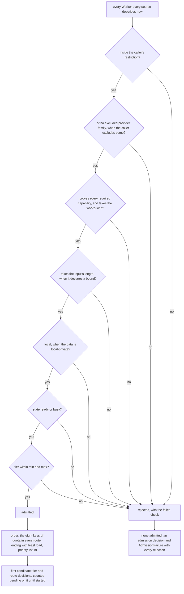

# Routing

> Target state. Boundary: [routing](../architecture/components.md#routing).
> Purpose: [P1–P4](../requirements/purpose.md). Requirements: REQ-WRK-1..10, REQ-WRK-12.
>
> Implemented in [`workers`](../../packages/plugins/workers/README.md) (admission, order,
> decisions, acceptance) and [`workflow`](../../packages/plugins/workflow/README.md) (tier
> escalation); differs from target: `connector:<name>` is not proven by any Worker; usage is
> reported per run step, not estimated per account; there is no resume conformance test behind
> `persistent-conversation`, and no egress exception naming exact artifacts.

Routing turns a **work requirement**
([`work-requirement.v1.json`](../../schemas/work-requirement.v1.json)) into exactly one admitted
Worker, or a typed admission failure. Every outcome (admission, route, tier, escalation, egress,
acceptance) is a decision artifact listing every candidate and why it was rejected
([artifacts](artifacts.md#decision-artifacts)). Routing is deterministic
([INV-2](../architecture/invariants.md#inv-2-fail-closed)).

## Work requirement

```ts
WorkRequirement {                    // work-requirement@1.3
  objective: string;
  capabilities: Capability[];        // all must be proven
  prefers?: Capability[];            // ranks Workers that prove all; never a refusal (@1.3)
  scope?: "review-member";           // scoped offers (below)
  kind?: WorkKind;                   // e.g. "code" (work kinds, below)
  data: { classification: "public" | "operator-shared" | "local-private";
          refs: ArtifactRef[] };      // what the work must read
  egressPolicy: string;              // policy id from a trusted envelope (INV-6, INV-12)
  boundaries?: string[];             // what the Worker must not do or touch
  effort?: { maxToolCalls?, maxSubWorkers?, maxMinutes? };
  writes?: { type, ref, version? };  // the subject the work writes, if any
  tier: { min: Tier; max?: Tier;     // "economy" | "standard" | "frontier"   (P4)
          source: "profile" | "caller" | "decision" | "default"; decision?: ArtifactRef };
  budget?: { maxTokens?, preferQuota?: QuotaClass[] };
  acceptance: { contract: string; resultSchema?: string; maxEscalations?: number };
}
```

## Capability vocabulary

Capabilities are named semantics, never tool names
([INV-11](../architecture/invariants.md#inv-11-no-tool-lock-in)). A Worker proves each one with
evidence from the sources below.

| Capability | Meaning | Typical evidence |
|---|---|---|
| `reason` | general reasoning and synthesis | provider driver conformance (website Workers); a route probe (model Workers, [models](models.md)); for review-member steps only, a read-only agent Worker under the enforced profile ([scoped offers](#scoped-offers)) |
| `web-search` | search the live web with citations | feature probe on the account; for a [research role's](agent-runtimes.md#a-research-role) agent Worker, its web probe's real search of a fixed query, through its gate |
| `deep-research` | provider-native multi-step research report | plan + feature probe (P2) |
| `connector:<name>` | a website connector or app enabled on the account, e.g. `connector:github` | connector probe on the account (P2) |
| `persistent-conversation` | resumable multi-turn identity | driver conformance (website Workers); the runtime probe's `resume` flag (agent Workers); the source's replay (model Workers; review-member steps of an agent Worker whose runtime cannot resume: an exact, recorded replay); target for agent Workers: a resume conformance test |
| `local-data` | can read local files and datasets in place | runs on this machine; sandbox policy allows the paths |
| `develop`, `validate` | edit code, run tests in a workspace | agent-runtime probe + writable sandbox; `validate` also needs `executes` |
| `review` | assess a provided subject against criteria | a read-only agent Worker (runtime probe + read-only sandbox) |

Profiles express each node as capabilities: a research node requires `deep-research` or `web-search`
with `reason`; research's second review needs `reason` and prefers `web-search`
([research's second review](#researchs-second-review)); an agent review node requires `review` and
`local-data`. Only agent Workers prove `local-data`, `develop`, `validate`, and `review`. The Claude
Code rows are on by default, with no Worker until the operator names a repository
([agent Workers](../operations/runbooks.md#agent-workers)).

### Scoped offers

A Worker may offer a capability for one kind of work only
([ADR-0049](../decisions/adr/0049-read-only-agent-workers-as-review-members.md)). A capability offer
carries `scope` (`capability-descriptor@1.4`), and a work requirement names its kind of work (`scope`,
`work-requirement@1.1`). The only scope is `review-member`, which the workflow engine names on every
member step of a `review` team (proposal, ballot, debate) from the admitted spec, never from template or model text (INV-6).

- A scoped offer proves its capability only for a requirement naming its scope; an unscoped offer
  proves it for every requirement. Routing compares the two for equality only.
- A refusal says so: `does not prove reason (it proves reason only for review-member work)`. With no
  Worker left, admission fails closed and names the capability no Worker proves for that work.
- A descriptor below `@1.4`, or a requirement below `@1.1`, carrying a scope is refused.
- Only an agent Worker under the enforced review-member profile scopes offers: `reason` while the profile
  is enforced, and `persistent-conversation` (kept by an exact, recorded replay) when its runtime cannot
  resume. Both are for review-member steps only ([agent runtimes](agent-runtimes.md#review-members)).
- A caller reading descriptors itself (a board task deciding whether to resume a session) counts unscoped offers only.

### Work kinds

> Decision: [ADR-0057](../decisions/adr/0057-route-work-by-kind.md). Requirement: REQ-WRK-11.

Capabilities say what work needs, not what it is about: a code change and a docs change both need
`develop`. The operator routes them apart by **kind**, an opaque label (`^[a-z][a-z0-9-]{0,31}$`, such as
`code`, `docs`, `tests`):

- **A step names its kind.** A template step may set `kind`, and a variant may change it
  ([templates](../reference/workflow-templates.md)). The engine copies it into the requirement
  (`work-requirement@1.2` `kind`) from the admitted spec, never from model text (INV-6). A planner's
  step has none; a remediation fix has the kind of the step whose change it fixes.
- **The operator gives Workers kinds.** A descriptor may list `kinds` (`capability-descriptor@1.6`),
  taken from the operator's configuration ([agent runtimes](agent-runtimes.md#workers--account--role)).
- **The rule** (`takesKind`, part of the `capability` check). A Worker given kinds takes only work that
  names one of them: never another kind, never work that names none (`takes code work only; this work
  is docs work`). A Worker given none takes any work. A kind proves no capability. With no Worker left,
  admission fails closed: `no Worker that proves develop takes docs work`.
- **Equality only.** Kinds are never ordered or preferred; among Workers that take a kind, the order below
  decides. No routing, workflow, or profile code names a tool, model, or family for a kind (INV-11); which runtime or account takes a kind is configuration.
- **Nothing changes without kinds.** With no Worker given kinds, every Worker takes every step. Once a writer
  is given kinds, a step that names none (a planner's step, `agent-review`) needs a Worker given none
  ([route work by kind](../operations/runbooks.md#route-work-by-kind)).

## Algorithm



The checks, in order: `restricted`; `excluded` (Workers an earlier attempt failed on unsent,
[ADR-0034](../decisions/adr/0034-unsent-failover-to-a-sibling-account.md)); `diversity`; `capability`
(with the work's kind); `cooldown` (a usage limit on a capability the work needs); `assignment` (another
account of an assigned group holds the work, [below](#assigned-accounts)); `input`; `locality`; `state`;
`tier`. A rejected Worker carries each check it failed, with its reason.

**Input length** ([ADR-0032](../decisions/adr/0032-admission-refuses-input-longer-than-a-worker-takes.md)).
A descriptor may declare `maxInputChars` (`capability-descriptor@1.2`): the longest input it takes, in
characters of what is sent. The caller passes `input: { chars }` in the route options, measured on what
it rendered; the workflow engine measures a node's prompt, including a review's shown source. A longer
input fails `input`. A source that replays history bounds it itself. With no Worker left for its length,
a node fails unsent as `invalid_input`, and the engine names the bound that sized it (a review's
`repositories.maxSourceChars`).

**Load** ([ADR-0033](../decisions/adr/0033-least-busy-routing.md)). A descriptor may carry `load`
(`capability-descriptor@1.3`): the turns `running` in its runtime's `slots`, `queued`, and routed to it
but not started (`pending`). Workers of one account report the same numbers. Among Workers equal in
tier, quota class, and quota headroom ([quota in every route](#quota-in-every-route)), the least loaded
(running, queued, and pending together) comes first; then the `priority` list, then id. A source
reporting no load reads 0. A Worker at its limit reads `busy`, stays admissible, and only orders later.

- **Pending.** The router asks the chosen Worker's source to `reserve` it, so the admission counts in
  `pending` until the caller calls `release()` on what `route` returned: once the work starts, or on any
  path that will not start it. The workflow engine releases it with its routing turn, on every path.
  Starting is synchronous, so the work is queued by then. A restart drops pending counts; the schedulers
  hold the real load.
- **One route at a time.** `route` runs under one lock for every caller, so two routes never read the same
  counts: two nodes of a run, or two runs started together, land on two accounts.
- **Recorded.** The route decision gives the chosen Worker's load ("load 1 of 2, 1 queued, 1 pending"), and a
  Worker that lost on load says so ("w:b is less busy (load 0 of 2; this one load 2 of 2)"). The load read is
  part of the decision's input (REQ-WRK-2).

### Sources that do not answer

`describe` runs on every route, inside the routing lock
([ADR-0033](../decisions/adr/0033-least-busy-routing.md#amendment-2026-10-19-where-pending-admissions-are-counted)).

- **Silent.** Each source gets 5 s. A source silent that long counts as describing no Workers for that
  read, and the decision names it as a candidate it could not offer (`source agents`: `did not describe
  its Workers within 5 s`). One stuck source never holds every route; a step routed then sees none of its Workers.
- **Failed.** A source whose `describe` throws fails the read with its error: no route is taken until it
  answers.
- **Its last read.** The router keeps each source's last answer (`sources()`: `described`, `silent`, or
  `failed`, when the read started, and why). Health names every silent or failed source after listing the Workers. It is degraded while
  one is, and down when no Worker answered or the read failed ([runbook](../operations/runbooks.md#a-worker-source-does-not-answer)).
- **Describing.** A silent read of a source none of whose describes has landed since it registered says
  so (`describing`, an optional field of the read): its first describe is still running (the `agents` source's
  first probe of its runtimes, right after a start), so its Workers are not known yet, never known to be none. A describe that lands past the bound still lands; later silent reads are plain `silent`.
  Health and the roster say the source is describing, and their counts are so far, never a count that
  reads as every Worker.
- **A source keeps its own describe fast.** The `agents` source refreshes its runtimes' probes in the
  background and never waits for one in a describe once a runtime's first probe has finished
  ([admission evidence](agent-runtimes.md#admission-evidence)).

### Assigned accounts

> Decision: [ADR-0052](../decisions/adr/0052-accounts-are-assigned-unless-pooling-is-recorded.md).

A descriptor may carry the account its Worker runs on (`capability-descriptor@1.5`):
`account: { id, group, mode, limitUntil? }`. Every Worker of one account (a website account's tiers, an
agent account's roles) carries the same `id`. `group` is what accounts are compared with (a website's
provider, an agent runtime). `mode` is that group's setting, `assigned` by default or `pooled`
([configuration](../reference/configuration.md)). The router compares `id` and `group` for equality only,
never naming one ([INV-11](../architecture/invariants.md#inv-11-no-tool-lock-in)). A Worker with no
`account` is routed as before.

- **The `assignment` check.** A Worker is *at its limit* when every check it fails is a `cooldown` on a
  capability the work needs, or its state `quota-exhausted`. While a Worker of an `assigned` account is at its
  limit, every Worker of another account in its group is refused that work: "w:a is at its limit until 18:40;
  assigned accounts do not take another account's work at its limit". Workers of other groups, and the limited
  account's other Workers, are admitted as before. Work the limited account could not take anyway (another
  capability, a tier it lacks) is not held. Under `pooled` nothing is held
  ([ADR-0034](../decisions/adr/0034-unsent-failover-to-a-sibling-account.md)).
- **When it is back.** A Worker at its limit is back once every limit it fails lapses: its latest cooldown
  on what the work needs, and its account's `limitUntil` when its state is the limit; unknown when either
  is unknown. When nothing is admitted and every limited Worker is on an assigned account, the
  `AdmissionFailure` carries `limitUntil`, the earliest known reset, and the decision says so. A caller may
  wait for it ([`wait`](workflow-engine.md#waiting-for-an-accounts-limit)). It carries none when a limited
  Worker has no assigned account, or no reset is known.
- **Staying on an account.** A caller may pass `assignment: { group, account, reason }`: no Worker of
  another account of that group takes the work. The engine passes it after an unsent failure on an
  assigned account, so the next attempt never moves inside the provider.
- **One account per group**: nothing is held, every Worker is chosen as before, and a refusal for a known
  limit still carries `limitUntil`.

Quota and health are inputs **before** admission. A started turn never moves to another Worker. Running out
of quota mid-turn is a classified failure (`USER_ACTION` or `BACKOFF`), not a silent switch of provider.

### Candidates without a reservation

> Decision: [ADR-0064](../decisions/adr/0064-system-starts-ready-work-under-the-dispatch-action-class.md).
> Requirement: REQ-WRK-12.

The optional `candidates(requirement, options)` tells a caller, before anything starts, what admission says of
every Worker: the checks `route` runs, in the same order and under the same lock, `assignment` included.
Each Worker comes with the checks it fails (empty when admitted), the sources that did not answer, the stored
requirement, and the router's order after tier (its quota classes, its priority list). It reserves nothing (no
`load.pending` moves) and records no decision; its caller records its own (INV-13). The workflow engine's
dispatch pass is its one caller ([dispatch](workflow-engine.md#dispatch-starting-ready-work-by-itself)).

**The quota score** (`quotaScoreOf`, `quota-score@2`, pure, in [`libs`](../../packages/libs/README.md))
orders the Workers `candidates` admits for a dispatched task's writing step, by the headroom order
[below](#quota-in-every-route) around tier and quota class (metered last). The chosen Worker is the first
**free** one: every pool available, every window known with headroom above the reserve, not metered, and
whatever the caller adds (idle enough, within its bounds). Each candidate carries its reasons: why it won or
lost (the first key that differs), why it is not free, or why routing refused it.
Among assigned accounts it chooses by headroom for new work only; `assignment` still holds a limited
account's work.

### Quota in every route

> Decision: [ADR-0066](../decisions/adr/0066-every-route-orders-workers-by-their-accounts-quota-headroom.md).
> Requirements: REQ-WRK-8, REQ-WRK-12.

Every route, for every step of every run (dispatched, or started by the lead or operator), orders admitted
Workers by their accounts' quota. There is **one** implementation of a pool's headroom and order
(`accountQuotaOf`, `headroomOrderOf` in `libs`), which the quota score, routing, and the roster's
[capacity now](roster.md#capacity-now) all call. Once per route, inside the routing lock, the router reads the
ledger's `pools()` and the quota settings (`quota()`, [resources](resources.md#quota-settings)):

| A window is | When |
|---|---|
| known | a reading at most `staleReadingSeconds` old, `ok`, with a used share, and a reset (if named) still ahead |
| its headroom | `100 − used − reservePercent` (the reserve: 20 % of each window by default) |
| its reset | the later of `resetsAt` and `cooldownUntil` |
| over the reserve | read `limited`, or known with used above `100 − reservePercent` % |

An unread window (no reading, stale, `unknown`, no used share, or from before its reset) never counts as
headroom ([INV-2](../architecture/invariants.md#inv-2-fail-closed)). Which windows an account has is the
operator's pool configuration: its **canonical gauge** is the windows its pool lists. A Claude Code plan's
pool lists only its five-hour window; a Codex plan's lists the windows it reports. A multi-tier Worker is read,
ranked, and scored at the tier it would serve, by that tier's pools only, its account's and its model's own ([quota per model](agent-runtimes.md#tiers-per-role)).

The order, each key compared only when every key before it is equal:

1. **Over the reserve, last.** A Worker whose account is over its reserve ranks after every other admitted
   Worker while another's account is free (every window known with headroom). So it gets no new step,
   writing or not, while one has headroom. When none has, this key ties.
2. **What the work prefers** (`work-requirement@1.3` `prefers`), only when it names any: a Worker proving
   every preferred capability first. It never refuses ([research's second review](#researchs-second-review)).
3. **Tier**, lowest admissible first.
4. **Quota class**, `budget.preferQuota`, then `quotaPreference`.
5. **Known** before configured-available (`unknown: available`) before unknown or stale: an unknown reading
   is never preferred to a known one.
6. **Use it or lose it**: a window resetting within `useSoonMinutes` with at least `minHeadroomPercent`
   headroom in the binding window (the one with the least headroom) first, the earlier reset first.
7. **Headroom** in the binding window, most first, in `headroomBucketPercent`-point buckets.
8. **Load**, then the priority list, then **id**.

- **Recorded.** The route decision (`workers.route.deterministic` version 2; version 3 for multi-tier Workers,
  [ADR-0073](../decisions/adr/0073-agent-workers-offer-tiers-per-role-with-quota-per-model.md)) gives every
  admitted Worker's score in one line, `quota (quota-score@2): known, 5 h: used 10 %, resets in 3 h 59 min,
  headroom 70`. A Worker that lost on a quota key says which: "w:b's account has headroom; this one's 5 h
  window is used 85 %, above 80 % (the 20 % reserve), so it ranks last while another has headroom".
- **No ledger.** With no resource ledger mounted, every quota key ties, the order is routing's own, and the
  decision has no quota line. An unreadable ledger leaves every quota unknown, never headroom; settings it
  cannot tell are the defaults.
- **Never a refusal.** The order only ranks: a Worker over its reserve is still admitted and runs if it is
  the only one.

## Provider diversity

A step can be required to run on a different provider from other steps of its run, such as `research`'s
second literature review ([templates](../reference/workflow-templates.md#research)) or each later member of a
[team](teams.md#membership-model-a). [ADR-0027](../decisions/adr/0027-provider-diversity-in-routing.md)
decides how, without naming a provider ([INV-11](../architecture/invariants.md#inv-11-no-tool-lock-in)).

- **Provider family.** A capability descriptor may carry `family` (`capability-descriptor@1.1`): an opaque
  string for who ultimately serves the work, set by its source. A website Worker's is its account's provider;
  an agent Worker's is its configuration's `family`, by default its runtime (a review member must name it,
  [ADR-0049](../decisions/adr/0049-read-only-agent-workers-as-review-members.md)); a model Worker's is its
  catalog entry's `family`, by default its route ([models](models.md#the-catalog-and-the-routes)). Admission
  checks it apart from capabilities: a Worker proving every needed capability is still refused for `diversity`.
- **Exclusion.** A caller passes `exclude: { families, reason }` in the route options. `diversity` rejects a
  Worker of an excluded family (`same provider family (<reason>)`), and a Worker that declares no family,
  which cannot be shown to differ (`declares no provider family, so it cannot differ (<reason>)`). With no
  Worker left, admission fails closed ([INV-2](../architecture/invariants.md#inv-2-fail-closed)).
- **Inequality only.** Routing compares families only for inequality, and never names, ranks, or prefers
  one. The `reason` names the steps to differ from (`differs from node literature:1`), never a family, so
  decisions carry no family value. An architecture test refuses a family literal in routing, workflow,
  profile, and models code.
- The workflow engine builds the exclusion from a node's `differentFrom`
  ([workflow engine](workflow-engine.md#different-provider-families)). Routing never lifts it. An operator
  opt-in lets the engine route again without it, recorded ([ADR-0029](../decisions/adr/0029-opt-in-same-family-fallback.md)).

### Research's second review

`research`'s `literature:2` needs `reason`, **prefers** `web-search` (`work-requirement@1.3` `prefers`,
[ADR-0074](../decisions/adr/0074-a-research-roles-web-calls-run-under-a-bounded-egress-checked-grant.md)),
and differs in family from `literature:1`:

- **`prefers` is an order, not a check.** A Worker that proves every preferred capability ranks before one
  that does not, after the quota reserve and before the tier. A Worker that does not prove it is never refused
  for it, so work no Worker can prefer routes as before. Candidate reasons say so (`proves web-search, which
  the work prefers`; `<worker> proves web-search, which the work prefers, and this one does not`) and name no
  family. A requirement's `prefers` never repeats a needed capability.
- **The order of choices.** With `literature:1` on ChatGPT's website Worker (`reason` and `web-search`),
  `literature:2` takes, among Workers of another family, one that also proves `web-search` (the
  [research role's](agent-runtimes.md#a-research-role) Claude Worker); failing that, one that only reasons
  (Gemini's website Worker); and when no other family is left, the single-family fallback, marked
  single-family, last. Nothing here names a vendor: the configuration and evidence decide which Worker it is.

## Data locality policy

- Work whose `data.classification` is `local-private` is admitted only to Workers that run locally, unless
  the egress policy names the exact artifacts that may be sent, and to which Worker classes.
- Before content reaches a remote Worker, the egress check runs on the **actual payload** (the rendered prompt
  plus attachments), each artifact ref against the policy. A payload not permitted fails closed
  ([INV-12](../architecture/invariants.md#inv-12-data-egress-is-explicit)). The check runs in the Worker source,
  after `workers.route`, before anything is sent.
- An **agent Worker** runs locally, so routing admits `local-private` work to it, but its model is remote.
  Its source checks egress for the Worker class `agent`, which by default receives `public` and
  `operator-shared` only. An operator whose agent model runs on this machine widens that class.
- A **model Worker** ([models](models.md)) checks egress for class `model` (an API model: `public` and
  `operator-shared` by default) or `model-local` (a model on this machine, which may also receive
  `local-private`). Its catalog entry's `locality` decides both the class and the locality routing sees.
- **Phase separation.** A Worker that browses the web or calls remote connectors never holds local-private
  content in the same execution (untrusted web content can carry prompt-injection payloads). Research and
  private-data processing are separate nodes, joined only through artifacts. Results flow back freely: website
  Workers' results reach local Workers as cited artifacts.

## Intelligence tiers

- Each Worker *configuration* declares its tier. A tier belongs to a Worker plus its mode: one website account
  can offer an `economy` Worker (instant mode) and a `frontier` Worker (highest effort or Deep Research). The
  provider driver verifies the mode before every send (REQ-PRV-3), so the declared tier is the tier that runs.
- **One Worker, several tiers** ([ADR-0073](../decisions/adr/0073-agent-workers-offer-tiers-per-role-with-quota-per-model.md)).
  An agent Worker whose role declares a model per tier offers them all (`capability-descriptor@1.10`
  `tiers`, its lowest as `tier`; [tiers per role](agent-runtimes.md#tiers-per-role)). Every check but `tier`
  reads it as before. Routing serves it at the **lowest offered tier within the requirement's bounds whose
  model's pool is open** (`servedTier` in `workers-core`). No tier in bounds fails `tier` ("none of its tiers
  economy, frontier is from standard to standard"); in-bounds tiers all closed by their models' limits fail
  `cooldown` ("tier frontier limit until …"), so the caller may wait for an assigned account's reset
  ([assigned accounts](#assigned-accounts)). The tier key, quota keys (the served tier's pools only), `tier`
  decision, and route reasons all use the served tier: "serves tier frontier of the tiers it offers (economy,
  standard, frontier)", then "draws on its model's own window beside its account's" or "has no window of its
  model's own: its tiers share its account's windows" (a provider with no window per model, such as Codex).
  `AdmittedWorker.tier` and each candidate's `tier` carry it; the caller passes it to the start
  (`WorkerStart.tier`), so the run uses that model (`workers.route.deterministic` version 3). A one-tier
  Worker is routed as before.
- **A refusal that waits is never "proves nothing".** Only a requirement no configured Worker proves, at any
  tier, is a configuration problem: a Worker that proves it but has no tier in bounds fails `tier`, and the
  engine fails the step as `config_error` ([recovery](workflow-engine.md#admission)). A busy Worker that
  proves it is admitted (it queues, ordered after idle ones). One at its limit or out of quota fails
  `cooldown` or `state`. An agent Worker whose runtime probe is late (the last one past `probeTtlMs` and the
  next unfinished, or one timed out) still lists what its last available probe proved (its role's offers if
  its first probe is the late one), reads `unavailable`, and gives when its next probe is due
  (`capability-descriptor@1.12` `expectedBack`, one `probeTtlMs` on), so it fails `state` alone, never
  `capability`. A failed or weaker probe, a signed-out account, or an unreadable pool still proves nothing.
  When no Worker is admitted and a proving Worker is refused only for a while (checks only `state` or
  `cooldown`, never `assignment`, which its own account's refusal decides; out of quota, or unavailable with
  an `expectedBack`), the `AdmissionFailure` carries `retryAt`: the earliest time one of them is back: its
  account's `limitUntil`, the latest limit on what the work needs, its closed tiers' first reset, or its
  `expectedBack`. With no known time it is a look five minutes on, and absent when an assigned account's
  `limitUntil` already says when. The workflow engine waits for it, bounded by `maxLimitWaitHours`
  ([recovery](workflow-engine.md#admission)). A Worker unavailable with no `expectedBack`, or needing a
  sign-in, gives none: someone must act.
  A `describing` source ([above](#sources-that-do-not-answer)) may hold the proving Worker. Its Workers are
  not known yet, never known to prove nothing. The reason says so ("agents has not described its
  Workers yet since it started"), and `retryAt` is at most 30 s on. A source silent after one of its describes
  has landed gives none.
- **What a failure's message keeps.** An `AdmissionFailure`'s message lists the refusals of the Workers that
  prove the work's capabilities first, then those refused for the fewest checks, then the rest, each in id
  order, at most 700 characters (a longer line clipped with `…`), then "and N more refused Worker(s), listed in
  the decision". `rejections` and the `admission` decision keep every Worker, whole, in id order.
- Profiles declare each node's minimum tier, for example triage → `economy`, research → `frontier`, compacting
  a handoff → `economy`.
- **Escalation:** if acceptance rejects a result, the engine opens a *new* execution of the node at the next
  tier above the one that served it, at most `maxEscalations` times (per node, default 1, at most 3). The
  rejected result stays as evidence. Either way the choice is an `escalation` decision (`workflow.escalation`
  version 2), never applied to a running turn. A node held to its Workers (a team member, which keeps one
  logical Worker, REQ-TEAM-2) escalates only if one of them, listed once the result is rejected, serves the next
  tier or above. Otherwise the decision is `fail`, and the node fails as `acceptance_rejected` with the contract's
  reasons and why it was not escalated, never as an admission failure. If that listing fails, the decision is
  `fail` ("held Workers unknown", with the listing's error), and the step never fails for the listing itself. A
  rejected answer cut at its output bound (`model-answer` `finish: max-tokens`) says so among the reasons. Only a rejected result escalates: a Worker refused at admission
  (its input bound, say) never raises the tier. Routing takes the lowest admissible tier at or above the node's
  own; a held Worker offering several tiers serves the next one when any is at or above it.
- **Tier by risk** ([ADR-0073](../decisions/adr/0073-agent-workers-offer-tiers-per-role-with-quota-per-model.md)).
  A board task's step may take its minimum tier from the task's risk tier
  ([ADR-0071](../decisions/adr/0071-a-changes-risk-tier-comes-from-the-policys-path-map.md)). The autonomy
  policy's `tierByRisk` (`autonomy-policy@1.2`, versioned) maps, under `light`, `normal`, or `heavy`, a step's
  capability or kind of work to a tier, such as `heavy: { develop: frontier, review: frontier }` and
  `light: { validate: economy, docs: economy }`. Before routing, the engine reads the task's latest risk-tier
  decision (its run's, else an earlier attempt's). When an entry names the step (the highest of several, across
  the studio's and the project's policies), it records a `tier` decision of policy `workflow.tier-by-risk`
  version 1, with the risk decision as input and the maps' versions and the entries that matched, raised,
  lowered, or kept as detail. Its requirement names it as the tier's source. A step an escalation set is
  never lowered, and its maximum bounds it. Dispatch scores a task's writing step at the same tier. With no map,
  steps keep their templates' tiers. If the policy or the board task cannot be read, the step's tier is unknown,
  so it is not routed at its template's tier (INV-2): it fails unsent, is retried with back-off, and fails once
  its attempts are spent. Dispatch neither starts nor scores the task meanwhile.
  A review step does not wait for an earlier decision: on a first attempt none exists before develop ran. So
  when an independent review (not a second review, a verification, or the author's own) is first routed, the
  engine decides the risk tier of develop's tree from the policy's path map, as a `workflow.risk-tier` decision
  under the review, once per review step (a retry or a restart finds it again), and takes the step's tier from it ([process tiered by risk](workflow-engine.md#process-tiered-by-risk)).
- Planning may use a higher tier than the steps it coordinates ("spend intelligence where intelligence matters").

Inferring the tier for work that declares none, using a decision model, is out of scope here (PROP-0002).

## Quota and cost policy

- Each account and runtime declares a **quota class**: `subscription-chat` (website accounts), `agent-plan`
  (Claude Code and Codex plans), `metered` (API models), or `local` (models on this machine). The order is
  configuration (`quotaPreference`, REQ-WRK-8); the default composition prefers `subscription-chat`, then
  `local`, `agent-plan`, and `metered`. Agent Workers never offer plain `reason`, so `agent-plan` quota goes
  only to what only they prove (`develop`, `review`, `local-data`, P1) and to review-member steps
  ([scoped offers](#scoped-offers)); a website Worker comes first there. A research role's agent Workers
  offer `reason` too and take only research work (their `kinds`)
  ([research's second review](#researchs-second-review)). Tier comes before quota, so a model Worker declared
  at a lower tier than every website Worker serves `economy` work (P4).
- The `api-first` preset ([ADR-0025](../decisions/adr/0025-api-first-composition.md)) orders `local`, `metered`,
  `agent-plan`, `subscription-chat`, and mounts no website Worker. Work needing a capability only website Workers
  prove (`web-search`, `deep-research`) then fails admission, naming each required capability no Worker proves.
- Usage is recorded per account from observable signals (turn counts and estimated tokens), an estimate
  (CON-4). A site's own usage-limit text, recognized by a UI-map error rule, puts a **cooldown** on the
  account's Workers ([ADR-0034](../decisions/adr/0034-unsent-failover-to-a-sibling-account.md)):
  - on one feature (the rule's `feature`): the Workers list it in `cooldowns` (`capability-descriptor@1.3`);
    work needing it fails the `cooldown` check ("deep-research limit until …"), other work is admitted;
  - on the whole account (no feature): its Workers read `quota-exhausted`;
  - for `featureLimitCooldownMs` (6 h) or `accountLimitCooldownMs` (1 h). It ends when its time passes, when a
    turn that used the feature succeeds, or by the operator (`system account clear-cooldown`); a feature probe
    never ends it. A cooldown is Worker state, never the account's status: the account stays `ready`, keeps its
    checks, and health does not ask the operator to act. A node refused only for it fails `quota_exhausted`,
    unless the account is [assigned](#assigned-accounts), when it waits for the reset, bounded.
- **Accounts are assigned by default**: a limit on one account never moves its work to
  another account of that provider ([assigned accounts](#assigned-accounts)). A provider is `pooled` only on the
  operator's recorded decision (`pooledTerms`: who, when, which terms on what basis); for a personal
  subscription it records that the operator accepts the risk under its terms
  ([ADR-0055](../decisions/adr/0055-personal-accounts-may-be-pooled-on-the-operators-recorded-acceptance.md)).
- **Context economy.** Handoffs carry the synthesized, hash-bound result, not the research transcript. Retained
  conversations receive only new suffixes, and node results are reused by input hash.
