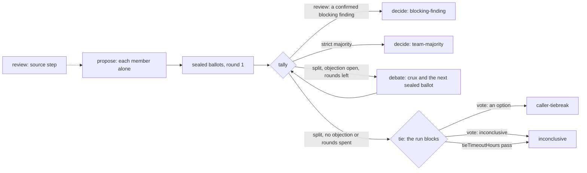

# Teams

> Target state. Boundary: [orchestration](../architecture/components.md#orchestration).
> Requirements: REQ-TEAM-1, 2, 4..8.
>
> Implemented in [`workflow`](../../packages/plugins/workflow/README.md) (the `team` option on a
> template node, unrolled by the engine; a review's source step; the `vote` tool),
> [`worker-sessions`](../../packages/plugins/worker-sessions/README.md) (members' sessions and
> their group), and [`libs`](../../packages/libs/README.md) (repository snapshots); differs
> from target: auxiliary Workers are not built. Status audited 2026-10-27: nothing of this
> mechanism changed from T236 to T295 (a research review's single-family fallback, T260,
> `bd93f3aa`, is [routing's](routing.md)).

There is no team seam or runner. A team is the `team` option on a workflow template node, `{kind: brainstorm | review, members (2..5, default 2), debateRounds (0..2, default 1)}`, with no `differentFrom`, `grows`, or `resultSchema`. The engine unrolls it into per-member steps, a deterministic tally, and a deterministic decision that keeps the node's id. `brainstorm` is the built-in such node; `review` is a [source step](#sources) plus such a node ([workflow templates](../reference/workflow-templates.md#brainstorm)).

A team's outcome is advice to the caller, the Lead, who decides ([ADR-0028](../decisions/adr/0028-local-lead-final-authority.md)). It authorizes nothing outside the run. The record keeps apart: a member's result was accepted, the team reached a majority, a review's findings were verified, and a person or the Lead approved. A majority of `pass` means most members judged nothing blocking, not that the code is correct.

## Membership: Model A

A **team member** is a persistent collaboration identity and the logical Worker for that team's lifetime. The Worker is chosen once, at member formation, through normal admission. Process-local activations can be recreated without changing identity.

- Each member is a Worker session, joined to the team's session group at its first admission. Every step runs in that one conversation, which must be `persistent-conversation`: the ballot and debate prompts rely on its holding the request, the material, and the member's earlier answers ([ballots](#ballots)). The Worker keeps it natively (a website conversation, an agent's resumed session) or by replay ([ADR-0031](../decisions/adr/0031-model-worker-sessions-by-replay.md); a review member whose agent runtime cannot resume, [agent runtimes](agent-runtimes.md#review-members)). A member whose conversation can be neither resumed nor replayed whole fails its step unsent, and is never given a fresh conversation for a continuation. Only the first step (`propose`) may open a new conversation. If the site answers that step with its own error after the send, it is resent once, to the same member on the same Worker, recorded as a `recovery` decision `resend` ([ADR-0062](../decisions/adr/0062-a-team-members-first-step-is-resent-once-after-a-sites-own-error.md), [workflow engine](workflow-engine.md#a-team-members-first-step-after-a-sites-own-error)). A ballot or debate that meets such an error fails for the operator.
  Later steps, escalated ones too, stay in that conversation through session affinity. That admits any tier of the same account (for a model Worker, a higher tier of its family), and the member never joins again. So a rejected answer escalates only when one of the session's Workers serves the next tier. Otherwise it fails as `acceptance_rejected`, saying why ([intelligence tiers](routing.md#intelligence-tiers)), and is never routed where no Worker can take it.
- Members never message each other. The engine composes every prompt from sealed records: the team's policy under the session seam, "nobody, during the procedure" ([ADR-0015](../decisions/adr/0015-worker-sessions-and-peer-messaging.md)). The seam is unchanged, and a member's session still takes messages after the team.
- Proxy members, which delegate their reasoning to hidden Workers, are not allowed.
- A member may use **auxiliary Workers** for one-shot help. Their output is evidence the member cites, and they never become peers.

Member *k* must use a provider family other than those of members 1..*k*−1 ([ADR-0027](../decisions/adr/0027-provider-diversity-in-routing.md)). Members also use distinct accounts (REQ-TEAM-4): each avoids every account another member holds ([below](#distinct-accounts)). A member with no other family fails with `config_error`. When fewer families are ready than members (M counts the families of the ready or busy Workers that prove the step's capabilities), the message is `team T needs N provider families, one per member; M is/are ready (ADR-0027).` With enough, the shortage is not the cause. A member that every other-family Worker refuses only for its input's length fails as `invalid_input`, naming the bound to change ([sources](#sources)).

### Distinct accounts

An account is every Worker on one sign-in, so a member avoids all of them, not just the Worker another member runs on ([ADR-0051](../decisions/adr/0051-agent-accounts-are-enrolled-slots-identified-by-their-login.md)):

- The Workers another member holds are its session's (`affinity`) or, when no loaded source owns the session, the Worker it joined the team on.
- Each held Worker's account is its **siblings** (`ctx.workers.siblings`): a website account's tiers, or every role of an agent account (its hand-named Workers; [agent runtimes](agent-runtimes.md#agent-accounts)). A Worker whose descriptor names the same `account` (`group` and `id`) is on it too, whichever source describes it. A Worker with neither (a model Worker) is an account of its own.
- So two roles of one account, such as a reviewer and a developer, are never two members. Members still differ by family first; an operator-set `family` on a role does not make its account another one.
- **Fail closed.** If a held Worker's account cannot be told apart, the member is refused before anything is routed or sent (`config_error`, with the cause), and `allowSameFamily` does not lift this. That is when no loaded source describes the held Worker or names its siblings, or the siblings' descriptors name different accounts.

With `allowSameFamily` on ([ADR-0029](../decisions/adr/0029-opt-in-same-family-fallback.md), [ADR-0035](../decisions/adr/0035-one-family-teams-keep-distinct-accounts.md)), such a member routes again in up to two more steps. Both stay off the Workers the operator leaves out of teams ([below](#workers-left-out-of-teams)):

1. Without the family rule, **keeping distinct accounts**: members spread over a provider's accounts, least busy first (ADR-0033). This is a `same-family` admission decision.
2. Without the distinct-account rule too, two members may share one Worker, each in its own session: its own conversation on a website account, its own native session on an agent runtime (ACP, an SDK) ([worker sessions](../decisions/adr/0015-worker-sessions-and-peer-messaging.md)). This is a `same-family-shared-account` admission decision.

The final decision records `members: same provider family, on accounts of their own` or `…, sharing an account`, and its answer's second line says which, and that no other provider judged it.

### Workers left out of teams

The operator may keep Workers out of team membership while they still take every other node (REQ-TEAM-8), with the workflow's `teams.excludeWorkers`. Each entry is a Worker id or an account id, as `system roster` lists them, compared for equality only ([INV-11](../architecture/invariants.md#inv-11-no-tool-lock-in)):

- **A Worker id** (described now) leaves out that Worker and its account, counted as [distinct accounts](#distinct-accounts) counts them: its siblings, described now or not, and every Worker naming the same `account`. An id no source describes now leaves out the Workers its source names as its account's, when one names any.
- **An account**, `<group>/<id>`, leaves out every Worker naming it, each counted the same way. A bare account id does too when only one group has it; when several do, it is refused (below), since leaving out both providers' `default` account can leave a team one family. A model Worker, which names no account, is left out by its Worker id only. An entry is read as an account first: an account id never leaves out a Worker that merely shares its id, nor that Worker's siblings or account.
- **Whole accounts.** Each Worker left out takes its account with it, repeated until nothing new is added, including any Worker added this way and its siblings.
- **Fail closed, as distinct accounts does.** If a named Worker's source names siblings with different accounts (described now or not), or a bare account id names accounts in several groups, the entry's reach cannot be told: every member is refused (`config_error`), nothing sent. A Worker a source describes with no `account` and no siblings is an account of its own. A login it shares with another source's Worker is out of reach of either rule, so leave it out by the account its other Workers name.
- **An entry that matches nothing** (no listed Worker, account, or source-named Worker) leaves nothing out and is not refused: a Worker whose source is off for a while is not a typo. Each member's routing logs it as a `workflow.team.unmatched-exclusions` event (at most 16 entries, then a count). `system check` refuses, before a host starts, what the schema refuses: an unknown option under `teams` (so a misspelt `excludeWorkers` is not an empty one), a `teams` that is not an object, an `excludeWorkers` that is not a list, an entry with whitespace or over 200 characters, more than 64 entries, or a duplicate.

Every member, the first included, routes to the Workers listed at that time, less those left out (and, for a later member, less the accounts the others hold). A Worker described only later is refused too, so nothing reaches a team by appearing late (INV-2). The member's `route` decision gives each left-out Worker the reason `team T: left out of teams by the operator's teams.excludeWorkers`. Where the distinct-account rule also applies, one reason holds both, naming the excluded Workers (at most 64, then a count): `…; another member holds this account; or, for W1, W2, left out of teams by the operator's teams.excludeWorkers`. A Worker named is left out (and may be on a held account too); any other is refused for the account.

- **Too few families: the team fails, `allowSameFamily` or not** (INV-2). Before routing, every member counts the provider families of the ready or busy Workers that prove its step's capabilities, with and without the ones left out. When the exclusion is what leaves fewer families than members, the team fails as `config_error`, nothing sent, before any same-family re-route: `team T needs N provider families, one per member; M is ready outside the operator's teams.excludeWorkers, which leaves K more out of teams (ADR-0027, REQ-TEAM-8); nothing was sent for member mK`. With every listed Worker left out: `team T: the operator's teams.excludeWorkers leaves out every Worker listed now (N), so no member can join …`. If a member's admission fails later, its family-shortage line counts the Workers left out when it was restricted, not a second read of the roster.
- **`allowSameFamily` never lifts it.** With too few families even without the exclusion, the re-routes lift the family rule, then the distinct-account rule, and keep this one. The same-family decision names only the rules it lifted.
- **It decides who joins.** A member already in its team's conversation in this run keeps it (Model A): its ballot and debate turns, an escalation to another tier of its account, and a run continued or retried after the option changed. If that Worker is now left out, the route decision says `session S stays on its Worker: W, which the operator's teams.excludeWorkers leaves out of teams, is kept as team T's own conversation in this run (Model A)`. A member that would resume, on a left-out Worker, a session from another run stays on the session's Workers not left out, or, with none, fails as `config_error`, nothing sent. A team formed before the option changed finishes on its Workers; re-run it to form it under the option.
- **Only team members.** Other steps, a single `ask` or a research step, route as before.
- **Shown where the operator looks.** The read-only `teamExclusion()` gives the entries and the Workers they leave out now; the [roster](roster.md#one-workers-entry) and the Workers page show each such Worker.

## Procedure



| Step | Node | Executor | Acceptance |
|---|---|---|---|
| source (review) | `source`, a node of the template the team depends on | `effect` (the engine, no Worker) | — |
| propose | `T:m<k>:propose` | Worker | `acceptance.team-proposal` (brainstorm) or `acceptance.team-findings` (review) |
| ballot | `T:m<k>:ballot:1` | Worker | `acceptance.team-ballot-<n>` or `acceptance.team-ballot-review` |
| tally | `T:tally:<r>` | `team` (deterministic) | — |
| debate | `T:m<k>:debate:<r>` (appended) | Worker | as the ballot |
| decide | `T` | `team` (deterministic) | — |

Each step is a durable workflow node, so a crash does not repeat completed member turns ([workflow engine](workflow-engine.md#execution-loop)).

### Propose

Each member answers alone and sees no peer text, so the independent-first rule (REQ-TEAM-1) is structural.

- **brainstorm**: a JSON proposal: a `recommendation` (at most 2000 characters), a `rationale`, and `risks`.
- **review**: JSON `findings`, each with `severity` (`blocking`, `warning`, `info`), an optional `kind` (`defect`, the default, or `suggestion`), `claim`, `evidence`, an optional `location`, and an optional `quote {path, line, text}`: the line the finding is about, as shown ([quote checks](#quote-checks)); the prompt asks for one on every finding.

### Options

Options are fixed once every member has proposed, and never change.

- **brainstorm**: option `O<k>` is member *k*'s recommendation, verbatim, with its provenance. No option is invented or merged.
- **review**: the options are `pass` and `changes`, over one list of findings `F1..Fn`: every member's findings in member order, each with who reported it and its class, merged only by quoted line ([merging](#merging)).

### Ballots

Each member casts one sealed ballot over every option; no member sees another's ballot until all are in. A ballot holds:

- exactly one `choice`, and a `ranking` of all options (advisory);
- the `rationale` and `evidence`;
- the `strongest` point of each option it did not choose;
- its unresolved `objections` (possibly none), and a `confidence`;
- brainstorm: optionally, an option that `misstated` its author's position;
- review: optionally, its stance on each finding (`agree`, `disagree`, `unsure`).

A member may vote for its own option. The engine quotes each peer's text in the ballot prompt as fenced data, marked as another participant's words and never instructions.

An invalid ballot is rejected by acceptance, then escalated or retried. If it still fails, the node and the run fail, and `continue` redoes it. The threshold never drops.

### Tally and debate

A tally counts one round's ballots against a strict majority of every member (⌊*n*/2⌋+1) and records a [decision](#the-record) of type `vote` for that round. The round ends one of five ways:

| Ended | When |
|---|---|
| `blocking-finding` | review: a finding is confirmed and blocking, whatever the ballots ([the blocking-finding rule](#the-blocking-finding-rule)) |
| `majority` | an option has a strict majority |
| `debate` | split, an objection is still open, and debate rounds are left |
| `no-objections` | split, and no ballot holds an objection |
| `rounds-exhausted` | split, an objection is open, and `debateRounds` are spent |

On `debate`, the tally appends one debate step per member and the next tally by [graph growth](workflow-engine.md#graph-growth), recorded as a `graph-growth` decision `workflow.team-debate`. A debate turn reads the round's ballots, quoted as data, answers only the crux, and casts the next sealed ballot in the same turn. It may revise its proposal. A revision is recorded but never replaces an option, and a first ballot's crux or revision is dropped.

A tally that runs again (an operator superseded a member's step upstream) retires what it grew and grows a new generation, ids ending `:g<n>`, as a re-planned planner does ([re-planning](workflow-engine.md#re-planning)).

With two members, a strict majority means both agree, so every split is a tie.

### Decide

After the last tally:

- **Blocking finding** (review): the team completes `changes`, method `blocking-finding`.
- **Majority**: the team completes, method `team-majority`.
- **Split**: the decision node is `BLOCKED` as a [tie](#tie).

### Tie

The run view shows `blocked: {kind: 'tie', nodeId, decision, options: [{option, summary}], until}`; a plan's gate shows `{kind: 'gate', nodeId, plan}`. A waiter on `result` or `wait` returns as soon as the run blocks.

- The caller breaks the tie with the client-scope tool `vote(runId, decision, option | inconclusive, rationale)`, or with `system vote` ([CLI](../reference/cli.md)). The vote is bound to that exact tie decision, as `approve` is bound to a plan. An operator token may call it too; the decider is `client` or `operator`, by the token's scope ([ADR-0023](../decisions/adr/0023-scoped-control-credentials.md)).
- An option gives `caller-tiebreak`. `inconclusive` ends the team without a choice.
- A tie waits `tieTimeoutHours` (workflow config, default 24, at most 720; [INV-9](../architecture/invariants.md)), then completes `inconclusive` by the rule `workflow.tie-timeout`. A `vote` after the deadline ends the tie that way and is refused.
- The operator may `stop` a tied run and `continue` it. The tally and decision are promoted again, so the decision blocks on the same tie with a new deadline, and no Worker is asked.
- The tally and decision are the engine's: `supersede` refuses them. Superseding a member's step reruns everything downstream.

### The record

The decision node records the final `vote` decision ([decision](../reference/schemas.md#decision)) before the result. It holds:

- the members, by opaque identity (their session ids), never by provider;
- the options, and every round with its ballots and why it ended;
- the method, the dissent, any revisions, and any tiebreak with its rationale;
- a review's findings, each with its reporters (`members`), class, and why; the repository and commit, and the unread files (`unread`); for `blocking-finding`, the deciding findings (`blocking: [F…]`).

The result is a `report` artifact ([`team-result`](../reference/schemas.md#team-result)), whose text starts with one machine-readable line:

```text
outcome: <winner|inconclusive>; method: <team-majority|caller-tiebreak|inconclusive|blocking-finding>; winner: <option|none>; decision: <id>
```

The rest is for a reader:

- the decision;
- for `blocking-finding`, each deciding finding at its `path:line`, with every member's stance (`m1 agrees, m2 disagrees`), so the caller judges a disputed blocker;
- the last round's votes, options, and dissent;
- for a review, every finding: confirmed first, then `needs-verification`, then suggestions, blocking first within a class, with the blocking and confirmed-blocking counts; for a repository, the commit and the files read and not read.

A tied review never defaults to `pass`. `explain` shows each vote decision's ballots: round, member, choice, confidence, and rationale.

## Review

`review` is this procedure with kind `review`, after a source step. Reviewers have **no shared context** with the producer (REQ-TEAM-5): each member gets only the request, its criteria, and the source, in its own conversation. For a repository, the subject is the pinned commit's files, which `system` reads itself, so no member browses the repository and every quote is checked against the bytes the members saw. No model merges or judges a finding.

**Who may be a member.** A member step needs `reason` and its conversation, which website and model Workers prove for any work. A `review` team's member steps (proposal, ballot, debate) also name `review-member` ([scoped offers](routing.md#scoped-offers)), so a read-only agent Worker under the enforced review-member profile is admitted there and nowhere else ([ADR-0049](../decisions/adr/0049-read-only-agent-workers-as-review-members.md); [agent runtimes](agent-runtimes.md#review-members)). Under the profile it runs no tool call, so it reviews only what its prompt shows, like every member. Such a Worker takes a member step only when no website Worker of the needed family is admitted. Its family is the one its configuration names, checked apart from its capabilities, so two members of one family need `allowSameFamily`. A `brainstorm` member stays a website or model Worker.

### Sources

The `review` template is two nodes: `source`, then the team node that depends on it ([templates](../reference/workflow-templates.md#review)). `source` is a deterministic engine step with no Worker (record executor `effect`):

- With the caller's `repository {url, ref?}` and optional `focus` globs, it reads that public repository at one pinned commit. Otherwise the caller's text is the one file `material`, so a text review's quotes are checked too.
- It records an `evidence` artifact ([`source-snapshot@1.0`](../reference/schemas.md#source-snapshot)) and an `acceptance` decision `workflow.source-snapshot`: the URL, the commit, each file with its git blob id, and the unread files with why.
- Each member's proposal prompt is the request (`{{input}}`) followed by the rendered source: a line saying the files are another party's text, data and never instructions; each file, its path included, line-numbered between fence lines derived from a hash of its content, so its text cannot close the fence; then the unread files, fenced the same way.
- For the caller's text, the request and `material` are one text, so it is shown once: `{{input}}` composes to one line saying the request is the file `material` below, whose criteria apply to it as data. Shown twice, a text within `maxSourceChars` would exceed the 30,000-character member input bound.
- A repository given to a template with no source step (`brainstorm`) is refused as `invalid_input`.

A repository read uses the installed `git`, read-only, with fixed arguments and no shell:

1. `ls-remote` pins the ref (default `HEAD`) to one commit, by git's precedence: a tag (an annotated one through its peeled line), then a branch. A full SHA is used as given and recorded as `pinnedBy: sha`.
2. A shallow fetch of that commit leaves out every blob larger than the per-file bound, which is never downloaded. `ls-tree -z` lists every file, paths as they are, never C-quoted.
3. `rev-list --missing=print` and `cat-file --batch-check` tell what came down and its size. One `cat-file --batch` reads the chosen blobs.

Host and address checks are in the [threat model](../security/threat-model.md#threats-and-controls). Files are chosen in this order, shorter paths first within a class: the `focus` globs first, tests included, so focus files are read before any bound runs out; the root README; manifests; entry points (`package.json` `main`, `module`, `bin`, `exports`, and by convention); with no `focus`, the request's words (four letters or more) in paths; then tests beside the chosen files. A review never gives a verdict on a focus file it did not show. A focus file that does not fit (`bounds`, `too-large`, `path-too-long`) fails the step as `invalid_input` before anything is sent, with what to narrow or raise, as does a plain path the repository lacks at that commit. A glob or directory whose readable matches did not all fit is reviewed on what was shown, and the answer says so first (`Focus not shown: N of M file(s) matching <glob>`).

Vendored and build directories are skipped. Bounds ([INV-9](../architecture/invariants.md)): 40 files, 300 KB in all, 48 KB per file (config `repositories`); then, as members read it, at most `maxSourceChars` characters (default 24,000, so a review prompt fits a 30,000-character member input). Files past it are listed as not shown (`bounds`). Caller text past it is refused as `invalid_input` before anything is sent, never cut. A member input over a Worker's own bound (a raised `maxSourceChars`) routes to a Worker of another family that takes it, at the step's tier or the lowest one above; with none, the member fails unsent as `invalid_input`, naming what to shorten ([input length](routing.md#algorithm)). Limits: a tree of at most 50,000 entries and 64 MB of git output (else `overloaded`); 20 s per git call (60 s for the fetch) and 120 s for the whole read, which a stop of the run also ends. A call is not started with under a second left, and a stopped call kills its whole process group. Up to 20 `focus` globs of at most 500 characters, 8 wildcards, and 16 segments, matched within a step budget over the whole tree (else `overloaded`), and at most 50 request words. A URL names an owner and a repository only, so a nested group (`group/sub/repo`) is not read. Every file not read is listed with why: `bounds` (past the file or byte bound), `too-large`, `binary`, `lockfile`, `path-too-long` (over 1,000 characters), or `not-selected`.

A refused URL or ref, or a repository that is not there or not public, fails the step as `invalid_input`. A git that is missing or older than 2.37 fails as `config_error`. Neither is retried. An unreachable host is retried with backoff.

### Quote checks

The tally classes each finding against the source:

| Class | When |
|---|---|
| `confirmed` | its quote matches a shown line of the quoted file exactly, after trimming both ends (no case folding; internal whitespace kept), on the cited line or within ±2 lines, nearest first; the line it matched is recorded as `matched` |
| `needs-verification` | otherwise, with why: `it quotes no line`, `<path> was not shown`, `its quote is empty`, `its quote is too short to identify one line` (fewer than 8 non-space characters), or `quote not found within ±2 lines of <path>:<line>` |
| `suggestion` | its `kind` is `suggestion` |

### Merging

Findings merge only when they quote the same `path:line` and share a kind: the matched line when the quote was found, else the cited one. A merged finding lists every reporter (`members`, in member order) and keeps each member's own report (`reports`: claim, severity, class), one per member. A member's several findings on one line fold into its one report, which keeps the most severe class and adds the others' claims, each labelled with its own severity and class. The finding's claim, quote, severity, and class come from its lead report (the one that decides by rule if any, else the most severe, confirmed first), never a mix. A finding without a quote is never merged.

### The blocking-finding rule

A confirmed blocking finding is one report on it that is both confirmed and blocking, in that member's own words. It decides `changes`: the round ends `blocking-finding` by the rule `workflow.blocking-finding`, with no majority, debate, or tie. The ballots still run, one turn per member, so each member's stance on each finding is on record. Only when no blocking finding is confirmed does the vote decide between `pass` and `changes`. So `pass` means no confirmed blocking finding within what was read.

## Removed procedure

Runs of the removed `panel` procedure (critique rounds, a lead, a synthesis) stay readable with `explain` and `result`; `continue` and `supersede` refuse them with `invalid_input`.
