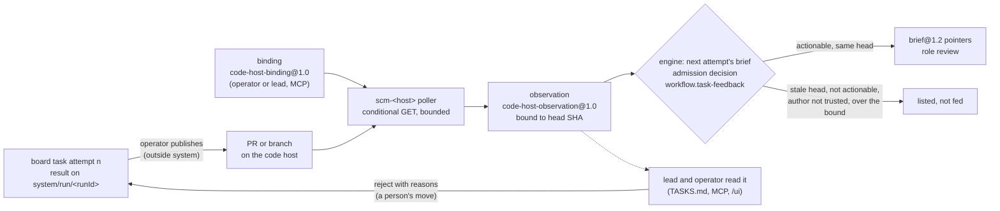

# Proposal: Feedback from work — code-host observations, a completion gate, and a liveness verdict

## Problem

The [`algorithm-development`](../reference/workflow-templates.md#algorithm-development) template (PROP-0010 B8) gives a board task's attempt one `develop:1`, an exact-subject `review:1`, and a final `validate:1`. A rejected attempt goes back to the lead, and the next attempt is briefed from the previous result and the decision behind it ([a board task's brief](../design/workflow-engine.md#a-board-tasks-brief)). Three kinds of feedback the work itself produces never reach that loop:

- **Nothing reads the code host.** An attempt ends on a retained branch `system/run/<runId>`, never merged or pushed ([workspaces](../design/agent-runtimes.md#workspaces)). When the operator publishes it as a PR, its CI checks, review comments, and merge conflicts stay on the host unless a person copies them in. The `merge` action class exists, but no step performs a merge.
- **A Worker reports "done" before its checks run.** The autonomy policy requires `tests` and `lint` for `workspace-write`, but they bind only at acceptance ([required checks bind at acceptance](../design/board.md#required-checks-bind-at-acceptance)). `validate:1` runs the tests after the review, and its report is the model's account, so the engine never reports `tests` from it. A develop step that breaks the tests still spends a review and a validation before anyone sees it.
- **A failed probe is treated as death.** A durable runner holds its lease through `ctx.leases.hold`, which aborts `lost` on any failed renewal ([lease generations](../design/scheduling-and-leases.md#lease-generations)), so a transient store error stops a live agent. Nothing states when a run another process holds is really gone, and nothing stops automation from resuming a session waiting on an approval.

## Goals

1. **Code-host feedback as facts.** CI, review, and mergeability of a bound PR or branch are recorded as observations bound to its head SHA; the actionable ones reach the next attempt as brief pointers. The observer never moves a task, comments, pushes, or merges.
2. **Landing on an exact approval.** Merging into the base, or applying for the operator to commit, happens only on a `merge` approval bound to the mode, the base SHA, and the head SHA; never a force or a push.
3. **Checks before "done".** A writing step's required checks run at its stop boundary in its own confinement; a failure goes back into the same session, bounded by rounds, turns, and the run's deadline. Nothing is claimed passed without evidence.
4. **Death only on evidence.** A run is dead only when its holder and its runtime are both positively gone and no activity was seen within a bound. A failed probe, a failed renewal, or a missing signal is `unknown`, never death.
5. **No automated input to a blocked session.** A session waiting on an approval takes no input but that approval's resolution.

## Non-goals

- `system` pushing branches or opening PRs: publishing is `external-send` and stays the operator's; a publish step is [later](#phased-plan).
- Acting on the code host: no comment, label, approval, CI re-run, or merge.
- Webhooks: they need an inbound listener the host can reach ([what not to adopt](#what-not-to-adopt)).
- Nudges: no automated message to a stalled session; a stall is reported.
- A judge of completion by a model. Checks are commands with exit codes; a model's account of a
  command stays evidence, never a check.
- Changing an invariant. Every rule here applies existing invariants.

## Evidence and research

- **Research notes** (in the coordination repository, not yet under [research](../research/README.md); [open question 1](#open-questions)): `paseo-superorchestrator-2026-10-23` (a review gate running CI, PR-thread, and orchestrator-only checks, resuming the same session on rejection; a land step that refuses on a moved base, a dirty tree, a hook failure, or a conflict) and `orchestrators-survey-2026-10-24` (polling PRs and CI with ETags; failed probes are not proof of death; no automated input into a blocked session; the `merge` and `apply` landing modes). agent-orchestrator's internals were read only through its documentation.
- **External projects** (ideas only; licences in the notes): [agent-orchestrator](https://github.com/OrchestratorInc/agent-orchestrator) (Apache-2.0), [superorchestrator](https://github.com/datamonsterr/superorchestrator/blob/main/docs/guide/review.md) (MIT), [container-use](https://github.com/dagger/container-use) (Apache-2.0). Claude Code's `Stop` hook can block a stop with a reason the agent continues from ([hooks](https://docs.claude.com/en/docs/claude-code/hooks)); that the SDK version `system` pins honours it is to be shown live ([phase C1](#phased-plan)).

## Proposed design

The three ideas share one rule, the one [ADR-0036](../decisions/adr/0036-guarantee-core-and-capability-plugins.md)
draws: the core decides *that* something happens, plugins decide *how*. An observation, a check
result, and a liveness signal are facts. Only the core's existing decision points (the engine's
briefs and acceptance, the board's moves, the approval queue, reconciliation) act on them, each by
a recorded decision ([INV-13](../architecture/invariants.md#inv-13-every-decision-is-an-artifact)).

| Idea | Facts from | Acts on them | Binds to |
|---|---|---|---|
| work feedback | a code-host plugin (`scm-<host>`, capability) | the engine's next-attempt brief; the approval queue for landing | the head SHA, and for landing the base SHA too ([INV-5](../architecture/invariants.md#inv-5-exact-subject-binding)) |
| completion gate | the agent runtime, at its stop boundary (capability: Worker) | the `agents` source (feedback in-session); the engine's acceptance (a reported check) | the working tree's git subject at each stop |
| liveness | leases, the runtime's process, activity events | reconciliation in the source and the engine; session resume | the lease generation ([INV-4](../architecture/invariants.md#inv-4-restart-is-reconciliation-not-replay)) |

### 1. Work feedback from the code host

**The seam.** A new capability seam `codeHost` (definition `CodeHost` in `code-host-core`, the
verification family: it brings evidence and judges nothing), with a fake and a conformance suite
([ADR-0037](../decisions/adr/0037-schema-and-protocol-first.md)). Providers are named
`scm-<host>`; the first would be `scm-github`, and a second (`scm-gitlab`) must be plausible
([INV-11](../architecture/invariants.md#inv-11-no-tool-lock-in)). Routing, templates, and the
engine name the seam, never a host.

| Method | Does |
|---|---|
| `bind(input)` | record a binding of one attempt's result to a host ref; refused unless it binds ([below](#binding)) |
| `unbind(bindingId, reason)` | stop observing |
| `bindings(filter)`, `observations(filter)` | read |
| `poll(at)` | one bounded pass over the live bindings; a test seam, as `sweep(at)` is on the board |

#### Binding

- **Who.** The operator, or the lead through the MCP tool `scm_bind` at lead scope: a structured call, never text a Worker wrote ([INV-6](../architecture/invariants.md#inv-6-authority-comes-from-trusted-envelopes)). A Worker cannot bind.
- **What.** `{taskId, attempt, subject, host, repository, ref: {kind: pull | branch, id}}`, where `subject` is the result's exact subject as the board holds it.
- **Bound to the head.** The provider reads the ref's head commit once and records the binding only when that commit's tree, in the local repository, is the tree of the result's exact subject. Otherwise it is refused (`stale_subject`), with nothing recorded. A head that later moves is itself an observation (`head`), and every later observation names the new head, which feeds nothing ([INV-5](../architecture/invariants.md#inv-5-exact-subject-binding)).
- **Bounded** ([INV-9](../architecture/invariants.md#inv-9-everything-is-bounded)): at most `maxBindings` live (default 32); a binding ends when its task is done or cancelled, when the next attempt starts, or after `bindingMaxDays` (default 14).

#### Observing

- **Polling with conditional requests.** Every `pollSeconds` (default 60, at least 30) the provider sends, per binding, the fixed read requests its host needs (the PR, its check runs on the head, its reviews and review comments, its mergeability), each with the `If-None-Match` of the last answer. A `304` records nothing; a changed answer records one observation per changed item. A rate-limit answer backs off until the reset the host names, capped at `maxBackoffSeconds`; an unknown reset backs off to the cap, never to a guess.
- **Egress** ([INV-12](../architecture/invariants.md#inv-12-data-egress-is-explicit)). The requests carry the repository, the ref, and a token. The provider checks the exact request set once per binding with `ctx.egress.check` for the Worker class `code-host`, at the project's classification. The default policy has no such class, so the plugin sends nothing until the operator adds `code-host` to `workerClasses` ([egress](../reference/configuration.md#egress)). A binding's requests never change while it lives, so one recorded `egress` decision covers them.
- **Credentials** ([INV-8](../architecture/invariants.md#inv-8-credentials-never-cross-upward)): the token is a credential reference resolved in the provider through `ctx.credentials`; nothing above it sees it, and it is never in an observation.
- **Each observation is a fact**: an `evidence` artifact `code-host-observation@1.0`, at the project's classification, naming the binding, the head SHA, the time, and one item:

| `kind` | Holds | Actionable when |
|---|---|---|
| `check` | name, conclusion, URL, a summary cut at `maxSummaryChars` | conclusion `failure`, `timed_out`, or `action_required` |
| `review` | state, author, author association, body cut at the bound | state `changes_requested`, by a trusted author |
| `comment` | path, line, body cut at the bound, author, association | on the bound head, by a trusted author |
| `mergeability` | mergeable `true`, `false`, or `unknown` | `false` (a conflict with the base) |
| `head` | the new head SHA | never: it ends what the binding can feed |

"Actionable" is a pure function of the record, pinned by version (`actionableOf` in `code-host-core`), never a model's view. A trusted author is one whose association the operator's configuration lists (default: owner, member, collaborator); anyone else's text is recorded and never fed.

#### Feeding the next attempt

When the engine composes the brief of a task's next attempt ([a board task's brief](../design/workflow-engine.md#a-board-tasks-brief)) and `ctx.codeHost` is loaded, it reads the previous attempt's observations and records an `admission` decision (`workflow.task-feedback`), with each candidate selected or not, and why: actionable on the head the previous result is bound to, or stale, not actionable, untrusted, or past the bound. The selected ones become pointers, role `review` ("findings to address"), naming the kind, the item, and the head, within the brief's pointer bound, after `prior` and the attempt's decision.

- **`ask` stays the Worker's.** A review comment that asks a question is a finding like any other. If the Worker cannot go on without a person's answer, it asks through the brief's `ask`, as today ([a question from a run](../design/workflow-engine.md#a-question-from-a-run)).
- **Data, not instructions.** The rendered brief says the pointers are text from the code host. Nothing in them widens the Worker's sandbox, tools, or egress (INV-6).
- **Nothing moves by itself.** The observer never rejects a review or starts an attempt. The lead or the operator rejects a held review, citing what it saw. A done task stays done: feedback after acceptance is a new task the lead proposes.
- **Fails open** (ADR-0036): with no provider loaded, an egress denial, or a host that does not answer, the brief is composed as today and the decision says why.

A later, separate step ([phase W4](#phased-plan), its own ADR) may let the engine report a CI check at acceptance, when the host reports `success` or `failure` on exactly the result's head. That changes what the core accepts, so it is not part of the observer.

#### Landing: merge or apply

Landing is the irreversible end of the loop, so it is an approval, not an observation.

| Step | Records | On failure |
|---|---|---|
| asked | the lead or the operator asks to land a done task's result (MCP `land`, or `system land <taskId> --mode merge\|apply`): `ctx.approvals.check` on `merge`, then one request on the subject `git-head` of `system/run/<runId>`, version `landing:<mode>:<baseSha>:<headSha>`, the base being the configured branch at its current head | a task not done, a result with no git subject, or a policy that forbids `merge`: refused, nothing asked |
| approved | the operator's verdict, bound to that exact version: a moved base or head refuses it ([a request](../design/approvals.md#a-request)) | rejected or expired: nothing lands |
| landed | under a lease on the base branch ([INV-15](../architecture/invariants.md#inv-15-one-writer-per-subject)), an effect classified reconcile-before-repeat ([INV-4](../architecture/invariants.md#inv-4-restart-is-reconciliation-not-replay)): the base is still `baseSha` and the main working tree clean; then `merge` makes a merge commit of the head into the base, or `apply` stages the change in the main working tree and commits nothing. A `delivery` artifact `landing@1.0` names the mode, both SHAs, the commit made (merge), and the outcome | a moved base, a dirty tree, a failing hook, or a conflict: refused, a conflict aborted so the tree is as before, the refusal recorded; never a force, a reset, or a push |
| restart | reconcile before repeating ([INV-4](../architecture/invariants.md#inv-4-restart-is-reconciliation-not-replay)): a base that already contains the head (merge), or a tree already holding the change (apply), is the landing done | anything else unknown goes to the operator, never repeated |

- The `merge` class already exists, and the studio policy asks for it. A project policy cannot make it `auto` ([open question 5](#open-questions), answered by D56).
- Landing is done by the plugin that owns the run's worktrees and branches (`agent-workers`, which already commits at retention), through a method its definition gains; the engine asks and records. A separate plugin is the alternative ([open question 6](#open-questions)).

### 2. A completion gate at the Worker's stop boundary

**Where it runs.** `RunSpec` gains an optional `completion` gate, as it has `toolGate`, and `RuntimeEvidence` an optional `gatesCompletion`. The gate comes from the `agents` source, never from the agent (INV-6). A runtime reports `gatesCompletion` only when it can ask the gate at its stop boundary and run commands confined ([confined commands](../design/agent-runtimes.md#confined-commands)); one that cannot refuses a run that carries the gate (`config_error`), as for the tool gate ([tool gate](../design/agent-runtimes.md#tool-gate)). Claude Code compiles it to a `Stop` hook. Codex and the Antigravity CLI report `gatesCompletion: false` until a probe proves an equivalent on a version checked live ([ADR-0043](../decisions/adr/0043-antigravity-cli-workers-gated-on-a-version-verified-live.md)).

**Which steps, which checks.** A step gets the gate when it writes (`workspace-write`) and its Worker's configuration names commands for the check names the policy can require: `tests`, `typecheck`, `lint` (the `requires` names of [`autonomy-policy`](../reference/schemas.md#autonomy-policy) that are commands). Each command is an exact argv from operator configuration on the studio commands list, judged `workspace-write` like any listed command ([a Worker's tool calls](../design/approvals.md#a-workers-tool-calls)). No required checks, no gate.

**The loop.**

| Step | Records | On failure |
|---|---|---|
| the agent stops | the git subject of the working tree, then each check's argv, run in the run's own confinement (workspace only, no network), each bounded by `checkTimeoutSeconds` and `maxOutputBytes` | a check that cannot start, times out, or has unreadable output is `error`, never passed |
| a round is judged | a `completion@1.0` `evidence` artifact (the round, the subject, per check: name, argv hash, exit code, duration, output tail and hash) and a `gate` decision (`agent-workers.completion`, outcome `done` or `continue`), recorded before the hook answers (INV-13) | a store that cannot record it: the hook answers `done`, and the result carries no completion evidence |
| fed back | on `continue`: the failed checks and their output tails, cut at `maxFeedbackChars`, checked with `ctx.egress.check` for the `agent` class at the run's classification, then returned as the hook's block reason; the agent goes on in the same session | an egress denial sends only the failed checks' names and exit codes, and the decision says why |
| bounded | at most `maxRounds` (default 2, at most 5); `maxTurns`, `runTimeoutMs`, and the task's budget ([ADR-0047](../decisions/adr/0047-a-run-stops-at-a-boundary-once-its-task-budget-is-spent.md)) still bound it | rounds spent with checks failing: the hook answers `done`; the last round's evidence says `failed` |

`agent-result@1.4` names the last round's evidence (`completion`).

**Fails closed** ([INV-2](../architecture/invariants.md#inv-2-fail-closed)). The gate claims a check passed only with a recorded exit code 0 on the subject the result names. A gate that throws, answers late, or cannot run a check lets the stop happen, since trapping the agent would be unbounded ([INV-9](../architecture/invariants.md#inv-9-everything-is-bounded)), and leaves the checks failed or unknown, never passed. A result with no completion evidence is today's result.

**What a failed gate does to the step.** When the last round failed, the engine fails the step (`checks_failed`, disposition `NONE`) instead of spending the review and validation on a subject known to fail. The next attempt goes through the board's gate as for any failed run, and its brief points at the step's result and evidence (`prior`). The alternative is [below](#alternatives-considered).

**How it relates to `validate:1` and acceptance's required checks.**

- **Checks bind to the exact subject** ([INV-5](../architecture/invariants.md#inv-5-exact-subject-binding)). The engine reports `tests`, `typecheck`, or `lint` at acceptance only from completion evidence on the result's exact subject. A fix step carries its own gate; with no evidence on the final subject, the check is not reported and the board holds the result for the operator ([a verdict is not yet a permission](../design/approvals.md#a-verdict-is-not-yet-a-permission)).
- **This changes what the core accepts.** Under the studio policy, a result whose `tests` and `lint` passed on its exact subject, and whose review approved it, would be accepted without the operator. That needs the operator's decision and an ADR. Until then (phase C2) the evidence is recorded and shown, and the engine reports neither.
- **`validate:1` stays.** It changes no file, and its report stays evidence, never a check. With the gate, the tests pass before the review, so `validate:1` measures rather than discovers.
- **A plain run** records its pending checks on its acceptance decision ([a plain run's acceptance](../design/workflow-engine.md#a-plain-runs-acceptance)); with completion evidence on its subject they are recorded as passed or failed. It still never blocks the run.

### 3. A liveness verdict

**Signals**, each recorded durably:

| Signal | Source | Recorded |
|---|---|---|
| holder | the `agent-run:<id>` lease, and the holding process (host, pid, start time) on the run's row | at acquire; the lease's heartbeat |
| runtime | the confined agent process the runtime started (pid and start time), reported by a new optional `onProcess` callback beside `onHandle` | once, at start |
| activity | native events (stream messages, tool gate asks, stop hook calls), reported by an optional `onActivity` callback | the latest time, at most once per heartbeat |

A runtime that reports no process or no activity leaves that signal `unknown`; a missing signal is never read as gone.

**The verdict** is a pure library function (`livenessOf`, beside the reconciliation decision function in [what is not a plugin](../architecture/plugin-model.md#what-is-not-a-plugin)), pinned by version, over the signals and two configured bounds, `stallSeconds` and `deadAfterSeconds`:

| Verdict | When |
|---|---|
| `alive` | the holder's lease is live and the runtime's process is present, with activity within `stallSeconds` |
| `stalled` | the process is present, with no activity for `stallSeconds` or more |
| `unknown` | any probe failed (a store error, an unreadable `/proc`, a holder on another host), or a signal was never reported |
| `dead` | the holder is positively gone (its lease expired and its recorded process no longer exists, or exists with another start time), and the runtime's process is positively gone, and no activity was seen within `deadAfterSeconds` |

Only `dead` is death. A failed probe is `unknown`, and so is every combination the table does not name as `dead`.

**What each verdict does.**

- `alive`: nothing.
- `stalled`: an `agent-workers.run.stalled` event once per stall, shown in `status`, `system explain`, and the report. Nothing is sent to the session or stopped; the run's own deadline and turn limit end it.
- `unknown`: looked at again with a bounded backoff. After `maxUnknown` verdicts in a row, the run goes to the operator (`USER_ACTION`), with a `reconciliation` decision naming the failed probes; it is never declared dead.
- `dead`: reconciled as INV-4 requires, by a `reconciliation` decision recording the verdict and its signals. The started run fails as `reconciliation_failed` and is never run again; only then are its session and worktree free for another writer (INV-15).

**Leases and heartbeats.** A failed renewal is not a lost lease. `hold` aborts `lost` only on positive loss: `LeaseLost` from `renew`, or the lease's own expiry passing unrenewed. Any other error is retried at a bounded interval while the lease is live. Fencing is unchanged ([lease generations](../design/scheduling-and-leases.md#lease-generations)): a holder that lost its lease commits nothing. `--die-with-parent` in the read confinement takes a gone holder's agent with it on that host; the verdict records that rather than assuming it.

**No input to a session blocked on an approval.** A session is blocked when its latest run stopped on a deferred tool call whose approval request is still open (derived when read from `agent_tool_requests` and the queue, never stored as a flag). Then:

- a board task's next attempt starts a fresh session given the brief, with the `admission` decision (`workflow.task-session`) saying why ([resume from a brief](../design/workflow-engine.md#a-board-tasks-brief));
- a peer message is kept durable, undelivered until the request is resolved ([sessions](../design/sessions-and-messaging.md), REQ-SES-5);
- the only input is the resolution's own: on approval, the engine's single continuation of the run ([a deferred tool call](../design/workflow-engine.md#a-deferred-tool-call)); on rejection, expiry, or withdrawal, the session is free again.

A session whose latest run is not yet `dead` or finished is not resumed either, so two processes never drive one native session.

**Restart** ([INV-4](../architecture/invariants.md#inv-4-restart-is-reconciliation-not-replay)). At start, a started agent run whose lease lapsed gets a verdict, not an assumption. On one host the usual answer is `dead`, and the run fails as `reconciliation_failed`, now with its evidence. A run held by a live process elsewhere is left to that process. The verdict does not apply to website turns ([provider turns](../design/provider-turns.md)).

### Seams and records touched

Each change is additive under [ADR-0036](../decisions/adr/0036-guarantee-core-and-capability-plugins.md): a guarantee seam changes only by optional fields, new values, and rules that apply when the new facts exist.

| Seam (class) | Change | Additive |
|---|---|---|
| `codeHost` (capability: verification), new | `CodeHost`, fake, conformance suite; `scm-<host>` providers; MCP `scm_bind`, `scm_observations` | yes: new, off by default |
| `egress` (core: gate) | a Worker class `code-host`, absent from the default policy | yes: configuration |
| `agentRuntimes` (capability: Worker) | optional `RunSpec.completion`, `RuntimeEvidence.gatesCompletion`, `onProcess` and `onActivity` on `run` | yes: versioned definition and suite |
| `agentWorkers` source (capability: Worker) | the completion gate; rounds, holder, process, and activity records; the liveness verdict before reconciling; `land` for its branches | yes |
| `workflow` (core: work state machine, runner) | `workflow.task-feedback` pointers; no resume of a session blocked on an approval; a failed gate fails the step (`checks_failed`); later, completion evidence as checks; the `land` effect | rules for the new facts only (an amendment of [ADR-0040](../decisions/adr/0040-briefs-on-the-workers-and-workflow-seams.md) for the brief; an ADR for the step failure); checks at acceptance: an ADR |
| `leases` (core: work state machine) | `hold` aborts `lost` only on positive loss | a narrower existing rule: an ADR |
| `approvals` (core: gate) | none: `merge` exists, and the landing version is a subject version | yes |
| `board` (core: work state machine) | none: landing reads a done task; feedback moves nothing | yes |
| `workerSessions` (core: work state machine) | delivery holds a message for a session blocked on an approval | an amendment of [ADR-0015](../decisions/adr/0015-worker-sessions-and-peer-messaging.md) |
| `mcp` (surface) | `scm_bind`, `scm_observations`, `land`, each with its schema and scope | yes |

### Schemas

Following the [versioning rules](../reference/schemas.md#versioning):

- new `code-host-binding@1.0` (the provider's record): binding id, task, attempt, subject, host, repository, ref, head SHA, egress decision, state, revision;
- new `code-host-observation@1.0` (an `evidence` body): binding, head SHA, observed at, `kind` and its item, `actionable` and the rule version, the answer's ETag;
- new `completion@1.0` (an `evidence` body): run, round, subject, checks (name, argv hash, exit code or `error`, duration, output tail and hash), outcome;
- new `landing@1.0` (a `delivery` body): task, mode, base before, head, commit made, outcome or refusal;
- `agent-result@1.4`: optional `completion`;
- `mcp-code-host@1.0` and the `land` tool's input and output;
- unchanged: `brief@1.2` (pointers with role `review`), `approval-request@1.1` (the landing tuple is the subject's version), `decision` (new rule ids only), `lease@1.0`.

### Invariants and requirements

- **No invariant changes.** The design applies [INV-2](../architecture/invariants.md#inv-2-fail-closed), [INV-3](../architecture/invariants.md#inv-3-completion-boundaries-are-distinct), [INV-4](../architecture/invariants.md#inv-4-restart-is-reconciliation-not-replay), [INV-5](../architecture/invariants.md#inv-5-exact-subject-binding), [INV-6](../architecture/invariants.md#inv-6-authority-comes-from-trusted-envelopes), [INV-8](../architecture/invariants.md#inv-8-credentials-never-cross-upward), [INV-9](../architecture/invariants.md#inv-9-everything-is-bounded), [INV-11](../architecture/invariants.md#inv-11-no-tool-lock-in), [INV-12](../architecture/invariants.md#inv-12-data-egress-is-explicit), [INV-13](../architecture/invariants.md#inv-13-every-decision-is-an-artifact), [INV-14](../architecture/invariants.md#inv-14-every-record-has-a-versioned-schema), and [INV-15](../architecture/invariants.md#inv-15-one-writer-per-subject).
- **Requirements** ([SRS](../requirements/SRS.md)), proposed on acceptance:
  - new REQ-WF-12: a board task's next attempt is briefed with the actionable code-host observations
    on its previous result's exact head, recorded with why each was or was not fed;
  - new REQ-WF-13: an accepted result lands in its base only on an approval bound to the mode and
    the base and head SHAs, never forced or pushed;
  - new REQ-WRK-15: a writing agent step's required checks run at its stop boundary in its own confinement, a failure fed back in the same session within bounds; a check is never reported passed without its exit code on the result's subject;
  - new REQ-WRK-16: a run is declared dead only when its holder and its runtime are both positively
    gone and no activity was seen within a bound; a failed probe is not death;
  - REQ-SES-5 and REQ-SES-7: a session blocked on an approval takes no automated input.

## Phased plan

Each phase ends with its suites passing and its canonical documents updated, and starts on the operator's go-ahead. The proposed order is by value for cost.

| Phase | Delivers | Depends on |
|---|---|---|
| **C1** Evidence | a supervised check that the pinned Claude Agent SDK honours a `Stop` hook's block with its reason, and that a blocked stop continues the same session within `maxTurns`; the record of what Codex and agy offer | — |
| **C2** Completion gate | `RunSpec.completion`, `gatesCompletion`, the Claude Code `Stop` hook; the `agents` source's rounds, evidence, decisions, and egress check; `agent-result@1.4`; the step failing as `checks_failed`; evidence shown, no check reported | C1 |
| **C3** Checks at acceptance | the engine reports `tests`, `typecheck`, `lint` from completion evidence on the result's exact subject; the ADR and the operator's decision; the board's suite | C2 |
| **W1** Specification | the code-host schemas, `CodeHost` and its suite passed by a fake; `actionableOf`; the ADR-0040 amendment | — |
| **W2** Observer | `scm-github` (polling, conditional requests, backoff, egress class, credentials), `scm_bind`, `scm_observations`; observations in `TASKS.md` and `/ui`; nothing fed yet | W1; B8 producing branches the operator publishes |
| **W3** Feedback in briefs | `workflow.task-feedback` and the `review` pointers | W2 |
| **W4** CI as a check (optional) | a required CI check on the exact head reported at acceptance, its own ADR | W3, C3 |
| **W5** Landing | `land` with `merge` and `apply`, its refusals, the restart rule, the runbook | B8; the operator's go-ahead |

A publish step (push the run's branch, `external-send`, always asked) is not part of this proposal.

**ADRs on acceptance:** a failed lease renewal is not a lost lease, and death needs a verdict (L1);
a completion gate at the stop boundary and the failed step (C2); completion evidence as checks at
acceptance (C3); code-host observations in briefs, as an ADR-0040 amendment (W1); landing on an
approval bound to the base and head SHAs (W5).

## Alternatives considered

1. **Webhooks instead of polling.** Fresher, but the host must reach the machine: a hosted relay or an open port. Rejected for now; polling with conditional requests costs little.
2. **The observer moves the task** on a red check. It would put a plugin's report into a core decision with no person or ADR. Rejected; W4 is the reviewed path.
3. **Comments as the agent's next turn in a live session** (vibe-kanban, AO). It sends automated input into a session that has ended when its PR exists. Rejected; the next attempt resumes through the brief.
4. **The agent runs the checks and reports them.** A model's account of a command is not a check. Rejected.
5. **A source-level loop that resumes the native session after each failed check run.** Each round would be a new run, and two mechanisms for one gate. Rejected as the design; a candidate for a runtime with resume and no stop hook.
6. **An `exec` seam to run checks.** Not in the [seam catalog](../architecture/plugin-model.md#seam-catalog): runtimes run commands in their own proven sandbox, and the gate uses it.
7. **Complete the step and let acceptance reject** a failed gate. It spends a review and a validation on a subject known to fail. Rejected.
8. **Nudges for a stalled run** (superorchestrator). They send automated input and guess at the cause. Rejected; a stall is reported.
9. **Declare death on a lapsed lease.** A transient error would stop a live agent, and a paused holder's agent may still be writing. Rejected.

### What not to adopt

From the research's "do not adopt" lists, the points that bear on this proposal:

- automatic approval of permission prompts, by a model or a blanket flag: authority from model output, not the tool gate (INV-6, ADR-0038, ADR-0042);
- full-permission children, and terminal screen-scraping state detectors where SDK and hook events exist;
- hosted relays, a hub, and unauthenticated loopback listeners: third-party egress, and a weaker control credential than ADR-0023's;
- account failover on a stall or a quota failure: PROP-0012 keeps personal accounts `assigned`;
- step caches that replay results (INV-4: reconcile, never replay), and fixed stall constants: every bound here is validated configuration;
- any code from AGPL, ELv2, BUSL, or closed projects: ideas only.

## Validation plan

- **`codeHost` conformance** (fake and `scm-github` on a recorded host): a binding whose head differs from the subject is refused; a `304` records nothing; a moved head makes later observations unfeedable; the token never appears in a record.
- **Engine:** feedback selects only actionable, trusted, same-head observations, each candidate with a reason.
- **Landing** (a scratch repository): merge and apply on an approved exact version; refusals leave the tree unchanged; no push in any path.
- **Completion gate** (a scripted runtime, then Claude Code): a passing round stops; a failing round continues the same session; a throwing or late gate passes nothing; rounds spent stop the step as `checks_failed`.
- **Liveness:** `livenessOf` over its table and every probe failure; a transient renewal error does not abort a live run.
- **Live, short first:** C1's `Stop` hook check; then one pilot task with the gate on; then one published branch observed for a working day.

## Rollout and rollback

- New rows (`code-host` providers) and behaviours (the completion gate, landing) are off by default and turned on by the operator; with them off, runs, briefs, and the board behave as today.
- L1 changes behaviour on by default, only where today's outcome is wrong. Rollback is a release downgrade; no record changes meaning.
- C3 and W4 change what the core accepts: each lands behind its ADR and the operator's decision, and is reversed by configuration.
- Records already written stay readable when a feature is turned off.

## Observability and operations

- `system explain` shows a brief's `workflow.task-feedback` decision and observations, a result's completion rounds, and a reconciled run's liveness verdict and signals.
- `status` lists bindings and their last poll, stalled runs, and runs waiting on an `unknown` verdict. Health reports a code-host provider denied by egress or backing off.
- **Runbooks:** bind a published PR to a task; land an accepted result and what each refusal means; a step failed as `checks_failed`; a run reported `unknown` to the operator.

## Security and privacy

- Code-host text is untrusted data: fed only from trusted authors, rendered as data, and never widening what a Worker may do (INV-6).
- The host token stays in the vault and the provider (INV-8). The plugin sends only its fixed read requests, after an egress check; it has no write call.
- Check output goes to the agent's remote model only after an egress check at the run's classification (INV-12), cut to a bound.
- Check commands are operator configuration on the studio commands list, run in the run's sandbox with no network.
- Landing writes the operator's main tree only on an approval bound to exact SHAs, under the base branch's lease, and never forces or pushes.

## Compatibility and migration

New schemas start at `@1.0`; `agent-result@1.4` is a minor addition. `RunSpec` and
`RuntimeEvidence` gain optional fields, so existing runtimes pass their suites unchanged and report
no completion gate. The lease rule narrows when `lost` fires and changes no record. No migration.

## Open questions

1. **Promote the research.** Proposed: copy the two notes under [research](../research/README.md) before acceptance.
2. **Family of `codeHost`.** It brings evidence and never judges, so the verification family fits only in part. Keep it there, or give evidence sources a family of their own (an ADR-0036 change)?
3. **Who may bind.** The lead at lead scope (proposed), or the operator only?
4. **Feedback after acceptance.** A red check on a done task's head: listed for the lead only (proposed), or a follow-up task with the observations as its input?
5. **`merge` as always-ask.** Answered by D56 (2026-10-24): a merge always asks, whatever the policy's mode for `merge`. `merge` is in `ALWAYS_ASK`, and a policy giving it `auto` or `notify` is refused when loaded ([ADR-0060](../decisions/adr/0060-an-accepted-result-lands-on-the-operators-merge-approval.md)).
6. **Who lands.** `agent-workers`, which owns the worktrees and branches (proposed), or a separate plugin with its own seam?
7. **Bounds.** `pollSeconds` 60, `maxBindings` 32, `maxRounds` 2, `stallSeconds` and `deadAfterSeconds` (proposed: 300 and twice the lease TTL): right for the pilot?
8. **Codex and agy.** Do their hook surfaces offer a stop boundary that a probe can prove (C1)? If neither does, their Workers keep no completion gate.
9. **A completion gate on `validate:1`.** Answered by T151 (2026-10-25): after the run's last step, the source holding its worktree runs the required checks on the result's exact tree, and acceptance reports them ([ADR-0063](../decisions/adr/0063-a-runs-required-checks-run-on-its-exact-result.md), D67).

## Decision

Accepted in part by the operator on 2026-10-24 (D32):

- **Accepted, to be built:** the liveness verdict (L1, L2) and the completion gate (C1 to C3), first, since they cost little and fix failure modes seen today. Each phase starts on the operator's go-ahead; C3 changes what the core accepts and keeps its own decision.
- **Deferred:** the code-host observer and landing (W1 to W5), until the pilot (PROP-0010 B8)
  produces PRs.

Questions 5, 7, and 9 are answered. Questions 2 to 4, 6, and 8 stay open for the deferred parts and C1. Question 1 (copying the two research notes under [research](../research/README.md)) is not done.

## Implementation

The state of each phase is in the [roadmap](roadmap.md#feedback-from-work-prop-0013). L1 and L2 are built under [ADR-0056](../decisions/adr/0056-a-failed-lease-renewal-is-not-a-lost-lease-and-death-needs-a-verdict.md), and the verdict is described in [scheduling and leases](../design/scheduling-and-leases.md#liveness-verdict).

W5 is built in part, for `merge` only, under [ADR-0060](../decisions/adr/0060-an-accepted-result-lands-on-the-operators-merge-approval.md). The engine asks by itself once a task is `done` on a result in its run's worktree. It differs from the design: no lease on the base branch (one change at a time per repository in the daemon, plus the SHA checks); a moved base is asked again rather than only refused; and the record is the engine's `gate` decisions (`workflow.landing`), not a `landing@1.0` artifact.

Choices where this proposal left room:

- No ADR-0015 amendment was made: the `workerSessions` mailbox is unchanged, since only the engine's wake decides when a turn is taken. [ADR-0056](../decisions/adr/0056-a-failed-lease-renewal-is-not-a-lost-lease-and-death-needs-a-verdict.md) records why.
- Phase W1's `brief@1.2` pointer rule is untouched.
- The submission counts as the first activity; an open activity window is waited out without counting as an `unknown` look.
- Bounds (open question 7): `stallSeconds` 300, `deadAfterSeconds` 120, `maxUnknownVerdicts` 3.

Open:

- `stalled` events and runs waiting on an `unknown` verdict are not yet listed by `status`, `system explain`, or the report.
- A session held by a run that ended `unknown` has no command that frees it.
- Codex, ACP, and the Antigravity CLI report no agent process; after a restart their started runs reach the operator as `unknown`, where before they failed at once.
