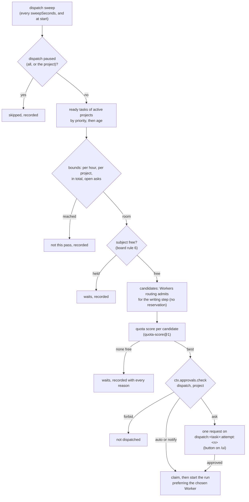

# Proposal: Dispatch by quota — System starts ready work on free Workers, chosen by quota

## Problem

A ready [board task](../design/board.md) waits until someone starts its run: the lead, with MCP `run` and `task`, or the operator, with Start on the task's card on `/ui` ([board tasks](../design/workflow-engine.md#board-tasks)). Nothing else claims a ready task: the board's `sweep(at)` makes tasks ready and never starts one.

On 2026-10-25 the operator saw 16 ready tasks and 18 free Workers at the same moment. Both Codex accounts had used 0 % of their windows, and the Claude Code accounts were busy elsewhere. The capacity the operator pays for went unused while the lead was occupied, and that lost quota does not come back: a plan window's unused share is lost at its reset ([readings from an account's usage report](../design/resources.md#readings-from-an-accounts-usage-report)).

Three things are missing:

- **Nobody starts work by themselves.** No component starts a task's attempt without a person or the lead, and no autonomy action class can express "start the next attempt without asking".
- **Routing does not read quota.** Routing orders admitted Workers by tier, quota class, load, the priority list, and id ([algorithm](../design/routing.md#algorithm)). It reads whether a pool is *available*, not how much of each window is left or when it resets. Two free accounts, one at 0 % with a reset in 40 minutes and one at 85 % used, are ordered by load alone.
- **No bound on starting by itself.** Nothing caps how many runs start without a person, per account, per project, or per hour, and nothing keeps a share of a plan for the operator's own interactive use.

## Goals

1. **System starts ready work.** A sweep takes the ready tasks of active projects in order
   (priority, then age) and starts an attempt when a free Worker can take its writing step. A new
   action class, `dispatch`, decides whether that start asks. The shipped studio policy asks, so
   the operator approves with one button; a project's policy may give `auto`.
2. **The Worker is chosen by quota.** Among the Workers routing admits for the step, a pure,
   versioned score ranks each Worker's pool on its current windows. Every choice is a recorded
   decision with a reason on every candidate
   ([INV-13](../architecture/invariants.md#inv-13-every-decision-is-an-artifact)).
3. **Parallel work, bounded.** Several tasks run at once: at most so many per account, per project,
   and in total. Tasks with no write subject run in parallel, and tasks on one subject run one at
   a time (board rule 6).
4. **Visible.** The Workers tab says what each Worker works on and whether dispatch started it.
   Home lists what started by itself and what waits for the operator's button.
5. **Stoppable.** Starts are capped per hour. Dispatch can be paused per project or entirely. A
   window or budget that closes mid-run stops the run at its next step boundary.

## Non-goals

- **Moving a running turn.** Once a turn starts on a Worker it stays there
  ([routing](../design/routing.md#assigned-accounts)). Dispatch chooses only before a start.
- **Rotating around limits.** An assigned account at its limit still holds its group's work
  ([assigned accounts](../design/routing.md#assigned-accounts), D24). Dispatch never picks a
  sibling of an assigned account because that account is at its limit.
- **Estimating quota.** The score reads the ledger's recorded readings only. A missing reading is
  missing ([resources rule 3](../design/resources.md#fail-closed-rules)).
- **Proposing, accepting, or landing work.** Dispatch starts an attempt of a task already
  `ready`. Readiness, acceptance, and the `merge` approval
  ([ADR-0060](../decisions/adr/0060-an-accepted-result-lands-on-the-operators-merge-approval.md))
  are unchanged.
- **A model in the loop.** Order and choice are code over recorded facts, never a model's view.
- **Changing an invariant.**

## Evidence and research

- **Operator observation (2026-10-25):** 16 ready tasks and 18 free Workers at once. Both Codex
  accounts were at 0 % of their windows while the Claude Code accounts were busy elsewhere. The
  operator asked for System to assign ready work to free Workers by itself, choosing by quota.
- **Design facts this builds on:** board rule 6 (one task holds write authority over a subject,
  [fail-closed rules](../design/board.md#fail-closed-rules)); a worktree and branch per run
  ([ADR-0058](../decisions/adr/0058-a-run-worktree-is-set-up-offline-before-its-agent-starts.md));
  a result lands only on the operator's `merge` approval, bound to the base and head SHAs
  (ADR-0060, D56); each account's own usage report keeps its windows fresh
  ([ADR-0059](../decisions/adr/0059-quota-readings-from-each-accounts-own-usage-report.md),
  `limitReadSeconds` 600); per-account concurrency, `load`, and `reserve`
  ([PROP-0012](0012-agent-accounts.md#per-account-concurrency-load-cooldowns-affinity-siblings));
  the roster's `work` and `pools` ([roster](../design/roster.md#one-workers-entry)).

## Proposed design

The rule is [ADR-0036](../decisions/adr/0036-guarantee-core-and-capability-plugins.md)'s: the
core decides *that* an attempt starts, and capability plugins only bring facts. The dispatcher is
part of the runner (the workflow engine), which already owns a task's run on the board. It decides
nothing a model says. The score is a pure library function pinned by version, as `livenessOf` is.

### 1. Who dispatches, and when

**The dispatcher** is a pass of the workflow engine, the board's run owner. It reaches the board,
the router, the ledger, and the queue only through their seams. It holds no state in memory that
a restart would lose. Every pass reads the board, the Workers, the ledger, its own recorded
decisions, and the queue again, so **a restart is a pass, not a replay**
([INV-4](../architecture/invariants.md#inv-4-restart-is-reconciliation-not-replay)).

- **When.** Every `dispatch.sweepSeconds` (default 60), once at start after the engine has
  reconciled its runs, and right after the board's sweep makes a task ready (an event, read as a
  hint to pass early, never as state).
- **Which tasks.** Tasks `ready` in an `active` project (paused, proposed, and closed projects
  start nothing: [the operator's project moves](../design/board.md#the-operators-project-moves)),
  that name a template the engine serves, with an attempt left. They are ordered by `priority`
  (new optional field, below; higher first, and a task without one has the default), then
  `createdAt` (oldest first), then task id. The order is total, so two passes over the same state
  pick the same task.
- **How many per pass.** At most `dispatch.maxPerPass` (default 2) starts or asks per pass, each
  within the bounds of [section 4](#4-bounds-and-stops).
- **Taking the task** follows the engine's existing protocol
  ([board tasks](../design/workflow-engine.md#board-tasks)): claim as `workflow:<runId>`, write
  the run `starting`, have the board record `start`, then schedule. A lead's or the operator's own
  start of the same task races only at `claim`, which the board fences by lease, so the loser is
  refused and records why. Dispatch adds no second path to start a run.

**The action class `dispatch`.** Starting a task's attempt with no person or lead asking for it is
an action of its own, judged per project by
[the autonomy policy](../design/approvals.md#the-autonomy-policy):

| Mode | What dispatch does |
|---|---|
| `ask` (the shipped studio policy) | opens one approval request per chosen start. The operator approves it with a button on `/ui` (the queue, and the task's card on Home) or with MCP `approvals_decide`. The run starts on approval |
| `notify` | starts, and Home and [notifications](../design/notifications.md) show what started |
| `auto` | starts, recorded and shown on Home |
| `forbid` | never dispatches in that project. The lead and the operator still start runs by hand |

- **Per project.** The effective mode is the stricter of the studio's and the project's, as for
  every class. So a project's policy can make dispatch `auto` only where the studio policy allows
  it. The shipped studio policy gives `dispatch: ask`, so making one project `auto` means a
  studio rule that allows it plus that project's rule. Each policy change goes through a
  `policy-change` approval
  ([ADR-0041](../decisions/adr/0041-policy-changes-through-the-approval-queue.md)). `dispatch` is
  not in `ALWAYS_ASK`: starting an attempt is reversible (the run can be stopped, its worktree is
  its own, and nothing lands without `merge`).
- **The request** is on the subject `dispatch:<taskId>:attempt:<n>`, where `n` is the attempts
  already made. Its version names the exact choice: `<workerId>:<scoreVersion>:<sha256 of the
  candidates' inputs>`. Its summary says which task, which Worker and account, why that one
  (the score's reason), and what it will draw on ("5 h: used 0 %, resets 14:20"). An open request
  on the same subject is adopted, so a pass repeated after a crash asks once
  ([a request](../design/approvals.md#a-request)).
- **An approval binds the choice** ([INV-5](../architecture/invariants.md#inv-5-exact-subject-binding)).
  When the approval is applied, the dispatcher starts the run only when the task is still `ready`
  at the attempt the subject names, and the chosen Worker is still admitted and free. It may wait
  for that Worker up to `dispatch.approvedHoldMinutes` (default 30). Past that, or once the task
  has moved on, the approval is used for nothing: the dispatcher withdraws nothing already
  resolved, records why, and makes a new choice, which asks again under `ask`. An approval never
  starts a different Worker or a different attempt than the one it names.
- **Two gates, not one.** The board's own gate on the task's class (`workspace-write`, say) still decides whether the attempt may become ready ([where the tables leave room](../design/board.md#where-the-tables-leave-room)). `dispatch` decides only whether System may start it without a person. An attempt the operator approved through the board's gate counts as its `dispatch` approval (D62).
- **Fail closed** ([INV-2](../architecture/invariants.md#inv-2-fail-closed)). With `ctx.approvals`
  unavailable, nothing is dispatched (board rule 7). With `ctx.resources` or `ctx.workers`
  unavailable, no Worker can be shown free, so nothing is dispatched. A policy older than the class
  names no rule for it and takes the stricter `default`, which is `ask` or `forbid`.

### 2. Choosing the Worker by quota

**Which step.** A task's run has several steps on different Workers (for `algorithm-development`: `develop:1`, `review:1`, `validate:1`). The dispatcher chooses the Worker of the run's **writing step**: the first step that writes (`develop:1`), or the first step when none writes. That step holds an account longest. Its work requirement (capabilities, kind, tier, data, `writes`) is the one the engine would build from the admitted spec, never from model text ([INV-6](../architecture/invariants.md#inv-6-authority-comes-from-trusted-envelopes)). The other steps are routed by the same score (D3, [ADR-0066](../decisions/adr/0066-every-route-orders-workers-by-their-accounts-quota-headroom.md)).

**Candidates.** The router gains `candidates(requirement, options)`. It runs the admission checks
`route` runs, in the same order and under the same lock (restriction, exclusion, diversity,
capability and [work kind](../design/routing.md#work-kinds), cooldown,
[assignment](../design/routing.md#assigned-accounts), input, locality, state, tier). It returns
every Worker with its result and reserves none. A Worker it rejects keeps the router's reason. So
dispatch never admits a Worker routing would refuse: the kind of work, tier, role (an agent
Worker is account × role, [PROP-0012](0012-agent-accounts.md#role-templates-and-workers--account--role)),
and the assigned-account rule are routing's.

**Free.** An admitted candidate is *free* for dispatch when all of these hold:

- its state is `ready`, with no step on it and its account's `load` (running, queued, pending)
  below `dispatch.maxRunningPerAccount`
  ([section 3](#3-parallel-work));
- its account's pool is available ([pools and availability](../design/resources.md#pools-and-availability));
- every window of that pool has headroom above its reserve (below).

A Worker that is admitted but not free is ranked anyway, so the decision says why it lost, but it
is never chosen.

**The score** (`quotaScoreOf`, `quota-score@1`, in `libs`, pure, tested over a table). For each
candidate it reads the ledger's `pools()` for the candidate's account, once per pass, at the
pass's time. For each window of the pool it computes:

| Value | From the window's latest reading | Meaning |
|---|---|---|
| `known` | a reading whose `observedAt` is within `quota.staleReadingSeconds` (default 1800), with `state` `ok` and a `used` share | the window's state is known now |
| `headroom` | `100 − used − reservePercent`, in percent | what dispatch may draw. The reserve is kept for the operator's own use |
| `resetsIn` | the later of `resetsAt` and `cooldownUntil`, minus now | how soon the window's unused share is lost |

The pool's **binding window** is the one with the least headroom. Candidates are ordered by these
keys, each compared only when every key before it is equal:

1. **Tier**, lowest admissible first (routing's own rule: spend intelligence where it matters).
2. **Quota class**, by `budget.preferQuota`, then `quotaPreference`. **Metered pools come last**,
   and are candidates at all only inside a cap ([below](#metered-pools)).
3. **Known before unknown.** A pool whose windows are all `known` comes before one with any window
   unknown or stale ([INV-2](../architecture/invariants.md#inv-2-fail-closed): missing telemetry is
   not capacity). A pool the ledger lists as available only because it is configured
   `unknown: available` (a local model) ranks after every pool with known windows of its class,
   and is never read as having headroom. A pool with an unknown window and no such configuration
   is not available at all ([pools and availability](../design/resources.md#pools-and-availability)),
   so it is not free.
4. **Use it before it resets.** A pool whose window that resets soonest does so within
   `quota.useSoonMinutes` (default 90), with at least `quota.minHeadroomPercent` (default 10)
   headroom in its binding window, comes first. Among such pools, the earlier reset comes first.
   Unused quota of a window about to reset is lost; that of a weekly window is not.
5. **Headroom**, the binding window's, highest first, in buckets of
   `quota.headroomBucketPercent` (default 5). Readings a few points apart then do not reorder
   candidates on every pass.
6. **Load, the priority list, and id**, routing's own order
   ([ADR-0033](../decisions/adr/0033-least-busy-routing.md)).

In the operator's case, the Codex Worker that takes the step's kind is chosen, with the reason "free, 5 h: used 0 %, resets 14:20, headroom 80"; each Claude Code Worker is not chosen, with "busy 1 of 1".

**The reserve.** `quota.reservePercent` (default 20, 0 to 90) is kept free of dispatched work in every window, for the operator's own interactive use of the same plan. A pool template may set its own (`reservePercent` on a template of the resources row). The reserve gates only what dispatch starts. A run the lead or the operator starts is routed as today and may use it. A dispatched run that crosses into the reserve keeps going (D63).

#### Metered pools

Metered pools (quota class `metered`: an API key, a credit) are candidates for dispatch only when `quota.metered.allow` is true. They come after every other
class, and only when the task's project has a ledger cap on that pool in the unit it bills
(`usd` or `tokens`). The ledger enforces that cap before each step
([counting](../design/resources.md#counting)), and its refusal stops the run as any refused
reservation does. With no such cap, a metered pool is rejected for dispatch ("metered, and the
project has no cap on it").

#### Every choice is a decision

Per INV-13, a pass records:

- an `admission` decision (rule `dispatch.select`, version 1). Its candidates are the ready tasks
  it looked at, each `selected` or not with why: the project paused, dispatch paused, a bound
  reached, the subject held by another task, no free Worker, an ask already open, or a lower
  place in the order;
- for each selected task, a `route` decision (rule `dispatch.choice`, `quota-score@1`). Its inputs
  are the `candidates` admission decision and the readings it read, and it lists every Worker with
  its keys ("tier standard, agent-plan, known, resets in 40 min, headroom 80, load 0 of 1") or its
  rejection;
- the `autonomy` decision for `dispatch` that `ctx.approvals.check` records.

The run's own first decision, `workflow.task-admission`, names these, so `system explain` on the
run shows why it started and on what.

#### The run prefers the chosen Worker

The start passes `prefer: { node, worker, decision }`. When
the engine routes that node, it first routes with `restrict` to that Worker. If that admission
fails (its state changed between the pass and the route), it routes again without the
restriction, and records both. The preference never burns an attempt: a refused preference is a
normal route.

### 3. Parallel work

| Bound | Default | Validated range | Counts |
|---|---|---|---|
| `dispatch.maxRunningPerAccount` | 1 | 1 to the account's `maxConcurrentRunsPerAccount` | dispatched runs whose writing step is on Workers of that account |
| `dispatch.maxRunningPerProject` | 2 | 1 to 16 | dispatched runs of the project not finished |
| `dispatch.maxRunning` | 8 | 1 to `maxActiveRuns − dispatch.leaveRunsFree` | dispatched runs not finished |
| `dispatch.leaveRunsFree` | 4 | 0 to `maxActiveRuns − 1` | active runs kept for the lead's and the operator's own starts |
| `dispatch.maxOpenAsks` | 4 | 1 to 32 | open `dispatch` requests, so the queue is not flooded |

- **Counted from records, not memory.** "Dispatched" is a run whose `workflow.task-admission` decision names a `dispatch.select` decision. Counts come from the engine's run table at each pass, so a restart counts the same.
- **Subjects** (board rule 6, [INV-15](../architecture/invariants.md#inv-15-one-writer-per-subject)). A task that `writes` a subject is not selected while another task holding the same subject (type and ref) is `claimed`, `running`, or in `review`; the admission decision names the holder. Tasks without a write subject run in parallel within the bounds above, each in its own worktree and branch ([ADR-0058](../decisions/adr/0058-a-run-worktree-is-set-up-offline-before-its-agent-starts.md)). A conflict between two results is caught at landing, where a moved base is asked again ([landing an accepted result](../design/workflow-engine.md#landing-an-accepted-result)).
- **Assigned accounts.** Parallel use across accounts of one provider stays as PROP-0012 allows. An account at its limit holds its group's work through routing's `assignment` check, which `candidates` applies, so dispatch never sends that work to a sibling.

**What the operator sees.**

- **Workers tab** ([roster](../design/roster.md#surfaces)): each Worker's `work` says *Working on "\<title\>"*. Each entry gains `startedBy` (`dispatch`, `lead`, or `operator`, from the run's admission decision), and the card says "started by itself" with a link to the choice's decision. An account header shows its reserve beside each window's bar.
- **Home**: a *Started by itself* list (the dispatched runs of the last 24 h, newest first, at most 32, each with its task, Worker, why that Worker in one line, and its state), and a *Waiting for your go* list: the open `dispatch` requests, each with Approve and Reject buttons, which are the queue's verdicts. When dispatch is paused, Home says so and since when.
- **MCP and CLI**: `system dispatch status` (MCP `dispatch_status`, client scope) gives the last pass's decision, the bounds and how much of each is used, and the pauses.

### 4. Bounds and stops

- **Per hour** ([INV-9](../architecture/invariants.md#inv-9-everything-is-bounded)): at most `dispatch.maxPerHour` (default 6, 0 to 120) dispatched starts in any rolling hour, and `dispatch.maxPerHourPerProject` (default 3). They are counted from recorded `dispatch.choice` decisions that led to a start, so a restart does not reset them. An ask counts when its run starts. `0` dispatches nothing.
- **A window that closes mid-run.** A dispatched run is a run like any other once started. The turn in flight runs to its own end ([routing](../design/routing.md#assigned-accounts)), and the next step is routed under the pool's new state. A limited pool admits nothing ([resources rule 2](../design/resources.md#fail-closed-rules)); on an assigned account the step waits for the reset, bounded by `maxLimitWaitHours` ([waiting for an account's limit](../design/workflow-engine.md#waiting-for-an-accounts-limit)). The dispatcher adds two rules: it starts nothing more on that account until a fresh reading shows headroom, and it withdraws every open `dispatch` request that names a Worker of that account.
- **A budget that closes mid-run.** A task's budget stops its run before the next step ([ADR-0047](../decisions/adr/0047-a-run-stops-at-a-boundary-once-its-task-budget-is-spent.md)). A project cap on a metered pool refuses the next reservation the same way. Dispatch never asks for funding; a `budget-spent` task waits on the operator as today ([funding a spent budget](../design/board.md#funding-a-spent-budget)).
- **Pause.** `system dispatch pause [<project>]` and `resume` (MCP `dispatch_pause`, `dispatch_resume`, operator scope only) stop dispatch entirely or for one project. The lead's and the operator's own starts are unaffected. Each is a `gate` decision (rule `dispatch.pause`) stored on a durable row that every pass reads and that survives restarts. A paused project's open `dispatch` requests are withdrawn. The project's own pause ([the operator's project moves](../design/board.md#the-operators-project-moves)) stops all its starts, as today.
- **Off.** `dispatch.enabled: false` turns the pass off. Nothing is asked or started, and the bounds are unused.

### Configuration

Every threshold is a validated value of the `workflow` row (`dispatch`) or of the `resources` row
(`quota`), checked when the row loads. A value outside its range refuses the row with its path.

| Key | Default | Range |
|---|---|---|
| `dispatch.enabled` | `true` | — |
| `dispatch.sweepSeconds` | 60 | 10 to 3600 |
| `dispatch.maxPerPass` | 2 | 1 to 16 |
| `dispatch.maxPerHour`, `maxPerHourPerProject` | 6, 3 | 0 to 120, 0 to `maxPerHour` |
| `dispatch.maxRunning`, `maxRunningPerProject`, `maxRunningPerAccount`, `leaveRunsFree` | 8, 2, 1, 4 | [above](#3-parallel-work) |
| `dispatch.maxOpenAsks` | 4 | 1 to 32 |
| `dispatch.approvedHoldMinutes` | 30 | 1 to 240, below the `dispatch` class's wait |
| `quota.reservePercent` (and per template) | 20 | 0 to 90 |
| `quota.useSoonMinutes` | 90 | 0 to 1440 (`0`: no use-soon key) |
| `quota.minHeadroomPercent` | 10 | 1 to 100 |
| `quota.headroomBucketPercent` | 5 | 1 to 25 |
| `quota.staleReadingSeconds` | 1800 | 60 to 86400, at least the agent providers' `limitReadSeconds` |
| `quota.metered.allow` | `false` | — |
| studio policy rule `dispatch` | `ask` | `ask`, `notify`, `auto`, `forbid` |
| `priority` on a task | 3 | 1 to 5 |

### Seams and records touched

| Seam (class) | Change | Additive |
|---|---|---|
| `approvals` (core: gate) | action class `dispatch` (`common@1` `actionClass`, `autonomy-policy`); the studio rule `dispatch: ask` | yes: an enum value; a policy written before it takes its `default`; an ADR |
| `board` (core: work state machine) | optional `priority` on a task (`board-task@1.2`; `board_propose` and `board_update`, `mcp-board` minor) | yes, an optional field |
| `workers` (core: gate) | `candidates(requirement, options)`: admission without a reservation; later (increment 3) a quota key in the order | the first is an optional method; the second needs an ADR |
| `workflow` (core: runner) | the dispatch pass; `prefer` on a start; the decisions above; `dispatch_status`, `dispatch_pause`, `dispatch_resume`; durable pause rows | rules that apply only when the pass is on; an ADR |
| `resources` (core: resource ledger) | `reservePercent` on a template; `quota` settings read by the score | yes, configuration |
| `libs` | `quotaScoreOf` (`quota-score@1`), pure | yes |
| roster ([`gateway-core`](../../packages/gateway-core/README.md)), `web-ui` (surface) | `work[].startedBy`, the reserve on each window (`mcp-roster@1.6`); Home's two lists | yes |
| `notify` (surface) | `dispatch.started` (on `notify`), `dispatch.paused` | yes |

### Invariants and requirements

- **No invariant changes.** The design applies [INV-2](../architecture/invariants.md#inv-2-fail-closed) (unknown or stale readings are never headroom; with a seam down nothing starts), [INV-4](../architecture/invariants.md#inv-4-restart-is-reconciliation-not-replay) (every pass reads recorded state and counts from records), [INV-5](../architecture/invariants.md#inv-5-exact-subject-binding) (an approval binds the task, the attempt, and the Worker), [INV-6](../architecture/invariants.md#inv-6-authority-comes-from-trusted-envelopes), [INV-9](../architecture/invariants.md#inv-9-everything-is-bounded), [INV-11](../architecture/invariants.md#inv-11-no-tool-lock-in) (the score names no vendor), [INV-13](../architecture/invariants.md#inv-13-every-decision-is-an-artifact), and [INV-15](../architecture/invariants.md#inv-15-one-writer-per-subject).
- **Requirements** ([SRS](../requirements/SRS.md)), proposed on acceptance:
  - new REQ-WF-14: a ready task of an active project is started without a person only under its project's `dispatch` mode, in priority then age order, within recorded bounds per account, per project, in total, and per hour;
  - new REQ-WRK-12: the Worker of a dispatched task's writing step is chosen among the Workers routing admits, by a versioned score over each pool's known windows. Headroom is counted above the operator's reserve, a window about to reset comes first, unknown or stale readings rank after known ones, and metered pools are last and only inside a cap. Each choice records a reason on every candidate;
  - REQ-WRK-8 (quota order) and REQ-HOST-8 (the roster) are extended by the above.

## Increments

D1 and D2 are built, and D3 is built as [ADR-0066](../decisions/adr/0066-every-route-orders-workers-by-their-accounts-quota-headroom.md) decides it. D4 (metered pools) is not built (D65).

**ADRs on acceptance:** System starts ready work under the `dispatch` class, within recorded bounds (D1, D2); quota-aware ordering in routing (D3).

## Alternatives considered

1. **The lead dispatches** (a loop in the lead's prompt calling `run` and `task`). It spends the lead's turns on a mechanical choice, and it stops when the lead is busy, which is the problem. Rejected.
2. **The board starts runs in its own sweep.** Two components would start runs; the runner starts runs. Rejected.
3. **Reuse the task's own action class** (`workspace-write: auto` means "start it too"). It mixes "may this attempt run" with "may System start it without a person". Rejected in favour of a class of its own.
4. **Least-busy routing only** (ADR-0033). It would pick an account at 95 % over one at 0 % whenever both are idle, and never uses a window before its reset. Rejected as the whole answer; kept as the score's last keys.
5. **A weighted sum** (headroom × urgency). Hard to explain, and a weight is a hidden constant. Rejected for a lexicographic order whose every key is shown.
6. **Treat an unknown reading as half full.** It would estimate quota (a non-goal) and break INV-2. Rejected.
7. **Dispatch every step, not only the writing one.** The later steps' state is unknown before the run starts. Rejected; D3 puts the score into each step's route instead.

## Validation plan

- **`quotaScoreOf`** over a table: every key alone and in ties; stale and unknown windows; reserve at 0 and 90; use-soon at and past its bound; the same inputs giving the same order.
- **Dispatch pass** (engine, over fakes): order by priority, then age, then id; each bound reached and recorded; `ask` opens one request, and a repeated pass adopts it; an approval starts exactly the named Worker and attempt; `forbid` dispatches nothing.
- **Crash suite:** a crash after `claim`, after the run is written `starting`, after the request is opened, and after approval and before the start.
- **Live, short first:** D1 on the live host with one project for a working day, every start by button. Then D2 `auto` on one project with `maxPerHour` 2.

## Rollout and rollback

- D1 ships on, with the studio policy at `ask`: nothing starts without the operator's button.
  `dispatch.enabled: false` or `system dispatch pause` turns it off at once.
- D2's `auto` is the operator's per project, through a `policy-change` approval. Reverting is a
  policy change back to `ask`.
- D3 changes every route's order. It ships behind `quota.routeOrder` (off until its ADR is
  accepted). Off, routing orders exactly as today.
- Records already written stay readable. A run dispatched before a rollback is a run like any
  other.

## Observability and operations

- `system explain` on a run shows its `dispatch.select`, `dispatch.choice`, and `autonomy` decisions first; on a pass it shows every task's reason.
- `status` and health show the last pass, the bounds in use, the pauses, and a failed pass (a seam down) as `dispatch` degraded.
- **Runbooks:** let System start a project's work (the policy change); pause and resume dispatch; "why did it not start my task"; "why that Worker".

## Security and privacy

- Dispatch widens no Worker's sandbox, tools, or egress. A dispatched run is briefed, gated, and
  checked exactly as a run the lead starts.
- Only the operator pauses, resumes, approves, or changes the policy. The lead reads status.
  Model text never chooses a task or a Worker.
- The reserve protects the operator's own use of a personal plan. Assigned accounts keep D24's
  rule that work never moves around a limit.

## Compatibility and migration

`common@1` gains an enum value, and readers in decision paths refuse unknown values, so every
reader of an autonomy policy is updated in D1. `board-task@1.2` and `mcp-roster@1.6` are minor.
A policy that names no `dispatch` rule takes its `default`. No migration.

## Open questions

Answered in the [decision](#decision):

1. **Two buttons for one attempt:** D62, the board's approval counts as the `dispatch` approval.
2. **The reserve:** D63, 20 % of every window, gating starts only.
3. **One repository, many tasks:** D64, at most 4 at a time per repository.
4. **Metered pools:** D65, dispatch never starts work on one by itself.
5. **Choosing among assigned accounts by quota:** D66, by headroom for new work; routing's `assignment` hold still applies.
6. **Priority:** D66, five levels, set by the lead or the operator.

## Decision

Accepted by the operator on 2026-10-25, each answer as the proposal recommends:

- **D61:** PROP-0014 is accepted, and increment D1 is built: ask to start, chosen by quota
  ([ADR-0064](../decisions/adr/0064-system-starts-ready-work-under-the-dispatch-action-class.md),
  accepted with it). D2 to D4 each start on the operator's go-ahead.
- **D62** (open question 1): an attempt the operator already approved through the board's gate
  counts as its `dispatch` approval, recorded as such (a `gate` decision naming that approval).
- **D63** (open question 2): the reserve is 20 % of every window, a validated setting of the
  `resources` row (`quota.reservePercent`); it gates starts only, and a dispatched run that crosses
  into it keeps going.
- **D64** (open question 3): tasks with no write subject on one repository run in parallel, at most
  4 at a time per repository (`dispatch.maxRunningPerRepository`, configuration).
- **D65** (open question 4): dispatch never starts work on a metered pool by itself. D4 and
  `quota.metered.allow` are not built.
- **D66** (open questions 5 and 6): among assigned accounts, dispatch chooses by quota headroom for
  new work, which keeps D24 (routing's `assignment` hold still applies); a task's priority (five
  levels) may be set by the lead or the operator, in D2. D1 orders by age.

The proposal's new REQ-WF-14 is REQ-WF-16: REQ-WF-14 was taken since by ADR-0061, and REQ-WF-15 by ADR-0063.

## Implementation

D1 is built as [ADR-0064](../decisions/adr/0064-system-starts-ready-work-under-the-dispatch-action-class.md) decides it; D2 and D3 are built as the canonical documents record: [workflow engine](../design/workflow-engine.md#dispatch-starting-ready-work-by-itself), [routing](../design/routing.md#candidates-without-a-reservation), [resources](../design/resources.md#quota-settings), and [approvals](../design/approvals.md#the-autonomy-policy). Where the text above differs from them, those documents hold.

- `candidates` records no `admission` decision of its own: a look changes nothing, and the `dispatch.choice` decision lists every Worker with routing's checks.
- A pass that takes no task records no decision; its reason for each task is kept as the last pass (`dispatch_status`, Home).
- The request's version is `<score version>:<sha256 of the Worker and the score's inputs>`, since a Worker id does not fit a subject version.
- A denied or unanswered request is not asked again for that attempt; the lead or the operator still starts it by hand.
- D2 is built, as the operator's go-ahead D70 directed: `auto` and `notify` per project, the hourly bounds, the per-project pause, `startedBy`, and Home's *Started by itself* list. Not built: `board-task@1.2` `priority` (the pass still orders by age) and the withdrawal of open asks whose Worker's pool closed.
- D3 is built ([ADR-0066](../decisions/adr/0066-every-route-orders-workers-by-their-accounts-quota-headroom.md)): one headroom function in `libs`, `quota-score@2`, and quota in every route. It ships on, not behind `quota.routeOrder`. Not built: the reserve shown on each window of the Workers tab.

