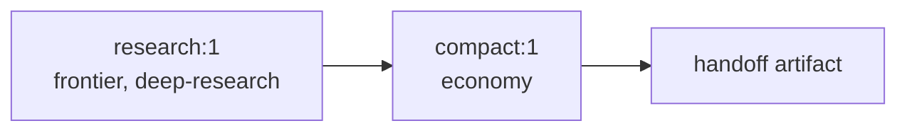

# Release scope: MVP → Beta → Base → Production-ready

This document is the canonical definition of **what each release stage must
deliver** and how its exit is judged. The order of the work lives in the
[roadmap](../proposals/roadmap.md). The full target architecture lives in
[architecture](../architecture/README.md); production-ready (v1.0) is its lean core, hardened
([ADR-0086](../decisions/adr/0086-production-is-the-lean-core-judged-by-reliability-targets.md)).

Because everything is a plugin, each stage is a set of plugins (rows of the
`system` bundle) on the seams in the
[seam catalog](../architecture/plugin-model.md#seam-catalog). Moving to the next
stage adds plugins. It does not rewrite the earlier ones. Package names below are
the directories under `packages/` and `packages/plugins/`.

## Overview

| Stage | One-line goal | How clients use it |
|---|---|---|
| **MVP** (v0.1) | prove the four [purposes](purpose.md) end to end with the thinnest durable slice | Claude Code and Codex call `system` **tools over MCP**; operator CLI |
| **Beta** (v0.5) | durable multi-Worker workflows and teams; Claude Code and Codex also as Workers | MCP + CLI + Web UI |
| **Base** (v0.8, folded into v1.0) | the closed core ([ADR-0036](../decisions/adr/0036-guarantee-core-and-capability-plugins.md)), Claude Code as the first Worker, every record and seam specified ([ADR-0037](../decisions/adr/0037-schema-and-protocol-first.md)), proven on one multi-day project | MCP (board, approvals, resources) + CLI + Web UI |
| **Production-ready** (v1.0) | the lean core, hardened, operated, and judged by measured reliability targets | MCP + CLI + Web UI |
| **1.x** | the rest of the target architecture, one decided item at a time | adds the Responses and Anthropic Messages gateways and the DSH bundle |

## MVP (v0.1)

### Goal

A single operator, working inside **Claude Code or Codex**, can delegate research
and reasoning to ChatGPT Web. The delegated work runs on the website's separate
quota (P1), uses Deep Research and web search (P2), never ships local data
without permission (P3), and runs cheap steps on a cheap tier (P4). All of this
is crash-safe.

### Why MCP first

Decided in [ADR-0011](../decisions/adr/0011-mvp-integration-via-mcp.md). MCP is
the one integration that **both** Claude Code and Codex already support.
It satisfies ADR-0009 (both clients) and ADR-0008 (tool-agnostic) at the lowest
cost. The local agent stays the local Worker for code and data, which gives P3
for free. The Responses and Messages gateways, which make `system` look like a
*model*, are the more complex integration and are deferred to production-ready.

### Included plugins

| Layer | Packages |
|---|---|
| host | DSH core rows only (timer, credentials, webserver; no `dsh-base`; one pinned version), `system-bundle`, `cli`, `libs` |
| kernel | `store` (system tables on `node:sqlite`), `event-log`, `leases`, `artifacts`, `credentials-vault` |
| provider | `display-virtual`, `browser-patchright`, `accounts`, `login` (remote login over noVNC, credential login), `providers`, `provider-chatgpt-web`, `turn-receipts`, and the `provider-core` library (scheduler, completion, reconciliation) |
| website Workers | `turns`: the website Worker runtime (durable turns) |
| routing | `egress`, `workers` and the `workers-core` definition (capabilities, tiers, egress policy, quota exclusion) |
| orchestration | `workflow`, MVP subset: static DAG, input-hash reuse, receipts, recovery; no graph growth, teams, or lineage invalidation yet |
| edge | `mcp-server` (Streamable HTTP on the DSH webserver, loopback and token), `cli` |

### Included requirements

| Area | Requirements |
|---|---|
| Platform | Linux x64 only; macOS and Windows are out of scope (PROP-0004) |
| Accounts | REQ-ACC-1..9 (ChatGPT Web accounts; multiple accounts; opt-in credential login with local TOTP) |
| Provider turns | REQ-PRV-1..6 (`reason`, `web-search`, `deep-research`) |
| Routing | REQ-WRK-1..4, REQ-WRK-7 (egress), REQ-WRK-8 (quota exclusion), REQ-WRK-9 (tiers: website modes as `economy`, `standard`, and `frontier`) |
| Gateways | REQ-GW-3 (MCP tools: `ask`, `research`, `status`, `result`), REQ-GW-4 (CLI: `account login`, `ask`, `research`, `result`, `usage`, `explain`) |
| Sessions | REQ-SES-1 (`SessionId` bound to the ChatGPT conversation; `ask` and `research` accept a `sessionId` to continue the same session), REQ-SES-8 (`research` returns at once; Deep Research runs for tens of minutes, longer than MCP tool-call timeouts) |
| Workflows | REQ-WF-1, REQ-WF-3, REQ-WF-4, REQ-WF-6, REQ-WF-10 (static DAGs only) |
| Artifacts and schemas | REQ-ART-1..5 (decision artifacts for admission, route, tier, egress, acceptance, reconciliation; `system explain` in the CLI) |
| Host | REQ-HOST-1, REQ-HOST-2, REQ-HOST-4, REQ-HOST-5 |

The MVP research flow is a **static two-node DAG** that runs on the real engine.
It is a subset of the engine, not separate code
([ADR-0012](../decisions/adr/0012-dag-execution-model.md), INV-1). The name `research` now belongs
to the scientific-research procedure, whose `deep` variant reviews with Deep research:

Each node has input and output receipts and decision artifacts, so retries and
restarts never resend or recompute a completed step.

### Delivery order: slice 1 first

The MVP ships in two slices. **Slice 1 (`ask` + `research`)** is the first
usable build:

| Slice 1 includes | Detail |
|---|---|
| MCP tools | `ask`, `research`, `status`, `result`. `ask` and `research` take an optional `sessionId`. `research` returns a `runId` and `SessionId` at once. `ask` waits up to `waitSeconds` (≤ 55 s) and otherwise returns its `runId`. `result` long-polls a `runId` ([contract](../design/provider-turns.md#runtime-mvp-slice-1)) |
| CLI | `account login`, `account list`, `account save`, `ask`, `research`, `result`. Accounts are declared in the operator's profile patch; `account add` and `account remove` are planned |
| Platform | **Linux x64 only** |
| Browser | invisible headed Chrome on Xvfb (`virtual`); remote login over noVNC through an SSH tunnel, ported from tsuuanmi/internet ([browser runtime](../design/browser-runtime.md#login-flows)) |
| Accounts | provider-agnostic vault; one or more ChatGPT accounts; saved state survives restarts; optional credential login (email, password, local TOTP) with fallback to the remote view; `system account code <id> <code>` |
| Reliability | turn receipts and reconciliation, two-clock completion, per-account scheduler |
| Routing | minimal: the first `ready` account in configured priority that proves the capability; tier = the selected ChatGPT mode; route and tier decision artifacts recorded |
| Execution | each call is a one-node DAG on the engine core |

Demo scenario: the [motivating example](purpose.md#a-motivating-example-from-building-system-itself),
a reuse survey over the DSH plugin catalog delegated from Claude Code to ChatGPT
Web Deep Research.

Slice 1 exit criteria:

1. From both Claude Code and Codex, `ask` answers and `research` returns a
   Deep Research report, using a saved account and with no browser window
   visible to the operator.
2. Killing the host during a `research` run, then restarting, recovers the
   result without sending the prompt twice.
3. With two saved accounts, marking one `reauth-required` routes new work to the
   other, and the decision artifact shows why.
4. On a Linux server with no display, an operator can sign in through
   `ssh -L` and the noVNC page. An account with credential login re-authenticates
   with TOTP after a forced sign-out, and an email-code challenge falls back to
   the remote view.

**Slice 2** completes the MVP: the `compact` economy node (a two-node DAG), the
egress policy, quota exclusion, `explain`, usage reports, and the remaining exit
criteria below.

### Explicitly out of MVP

Gemini, teams, graph growth and profiles, agent-runtime Workers,
connectors (`connector:*`), API and local model providers, the Responses and
Messages gateways, the operator Web UI, and packaged installers.

### MVP exit criteria

1. From **both** Claude Code and Codex, the two-node research flow (MCP `run`
   with the `deep-research` template) returns a cited, compacted synthesis
   produced by ChatGPT Web Deep Research.
2. Killing the host at every reconcile point (before submit, after submit, during
   generation, after completion) never produces a duplicate provider turn. Every
   case resolves to WAIT, RECOVER, RESUBMIT, or AMBIGUOUS.
3. An egress test shows that a request referencing `local-private` artifacts is
   refused for the website Worker unless policy permits it.
4. The compaction step runs on the `economy` tier, and the research step on
   `frontier`. Both are visible in the event log.
5. A usage report shows, per request, which quota class and tier served it.
   `system explain` shows the full decision chain (route, tier, egress,
   acceptance) for any result.
6. Every record written by the MVP validates against its schema in `schemas/`.
   CI compiles the schemas in strict mode and validates the examples.
7. With fake providers, every seam passes its conformance suite in CI. The
   account-bound checklist passes manually.

## Beta (v0.5)

Adds, as plugins:

- **Orchestration:** the full `workflow` engine, `worker-sessions`, and
  `profile-software-development` (REQ-WF-1..11, REQ-TEAM-1, 2, 4..8,
  REQ-SES-1..8). A team is the `team` option of a workflow node, which the
  engine unrolls; its members are durable sessions that propose, vote, and
  debate on prompts the engine composes ([teams](../design/teams.md)).
- **Workers:** `agent-runtimes`, `agent-workers`, `runtime-claude-agent-sdk`,
  `runtime-codex-sdk`, `runtime-acp`, `runtime-antigravity-cli` (REQ-WRK-5..6). Claude Code and Codex become
  Workers as well as clients.
- **Providers:** `provider-gemini-web`, connectors as capabilities (REQ-PRV-7), and
  an economy-tier model provider for API or local models (P4).
- **Edge:** `web-ui`, the operator page at `/ui`: runs, steps, decision chains,
  and answers; approve or reject a plan, stop, and continue. Remote login stays
  on the `login` plugin's noVNC page.

Beta exit criteria:

1. The full software-development cycle (research team → local implementation →
   validation → exact-head review → bounded remediation) runs across mixed
   Workers. Killing the host mid-workflow never repeats a completed node.
2. A two-member team uses two provider families on distinct accounts, and its
   independent-first proposals are proven by test. Worker sessions exchange
   direct messages, and killing the host mid-conversation loses or duplicates
   no message.
3. A long-running session (several hours, past the compaction threshold) survives
   a host restart, keeps its `SessionId`, and continues from its handoff summary.
4. Agent-runtime Workers pass probe, run, resume, cancel, and sandbox-enforcement
   smoke tests.

## Base (v0.8)

Design: [PROP-0010](../proposals/0010-base-version.md). Base is the version after which `system`
evolves by plugins only. It is not released on its own: its exit criteria are part of v1.0's, and
its pilot runs inside v1.0's measuring window
([ADR-0086](../decisions/adr/0086-production-is-the-lean-core-judged-by-reliability-targets.md)).

### Goal

The operator hands a multi-day project to `system` with a charter, follows it on a board and
in digests, answers approvals in batches, and sees what every run cost. The work runs on
Claude Code Workers under the operator's Claude Max plan.

### Adds, as plugins

| Area | Adds |
|---|---|
| Specification | a schema for every new record and payload, MCP tool input and output included; a definition, a protocol, and a conformance suite for every new seam; conformance suites for the existing guarantee seams (ADR-0037) |
| Core | `resources` (usage records, limit states), `board` (projects with charters, board tasks), `approvals` (autonomy policy, batched queue), plugin manifests with a recorded lifecycle state (REQ-HOST-7), a board task's budget reserved before each step of its run ([ADR-0047](../decisions/adr/0047-a-run-stops-at-a-boundary-once-its-task-budget-is-spent.md)), the crash suite at every reconcile point |
| Workers | Claude Code Workers on by default: a workspace per writing task, remediation through the gate, every agent's credential directories hidden, commands confined to the workspace (`validate`), token usage in `agent-result@1.2`, briefs (`brief@1.0`) |
| Families | `digest@1.0` by a read-only Claude Code Worker, and a second digest provider to replace it by configuration (exit criterion 6); the `algorithm-development` template |
| Surface | MCP tools `board_*`, `approvals_*`, `resources_*`, `digests_*`, and `report`; the board and the queue on `/ui`; a weekly investor report |

### Rows the pilot turns on

The default composition keeps some rows off ([turn an off row back
on](../operations/runbooks.md#turn-an-off-row-back-on)). The Base pilot (exit criterion 3) needs
one of them: **`profile-software-development`**, which contributes the
`algorithm-development` template (and `agent-review`). A pilot that validates or reviews on Codex
Workers, as the `system` project's does ([pilot](../operations/pilot.md)), also turns on
`runtime-codex-sdk` ([Codex Workers](../operations/runbooks.md#codex-workers)). The operator turns it on in the profile
patch (`- id: profile-software-development`, `disabled: false`), with the Workers, the pool, and
the policy the [pilot runbook](../operations/pilot.md#name-the-repository-and-the-workers) names;
the checks of the [release checklist](../validation/release-checklist.md) marked *only with
`profile-software-development` on* therefore apply to Base. Every other row the pilot uses is on by
default (the agent rows, `board`, `approvals`, `resources`, `digest`, `report`). The alternative
digest provider `digest-extractive` is off too, and the pilot does not need it; exit criterion 6
swaps it in on its own.

Base ships `profile-software-development` **off by default**. Off, no install offers a writing template until the operator names a repository;
on, every install would offer templates that need an agent Worker configured on a repository, and
their runs would fail at the first step until one is. The pilot's patch turns it on
([pilot runbook](../operations/pilot.md#name-the-repository-and-the-workers)).

### Not in Base

Deep Research, which is future work; new work on website Workers and on API or local model
Workers, which follows Base; Codex and ACP Workers (beyond Codex validating and reviewing in the
pilot, exit criterion 3); decision-assisted routing (PROP-0002); the
knowledge family; RTK, Serena, context-mode; automated shadow and canary runs.

### Base exit criteria

1. **Core.** Each core component has its seam definition, schemas with valid examples, a
   protocol document, and a conformance suite that passes in CI, with a fake provider and the
   real one.
2. **Crash.** Killing the host at every reconcile point, including board transitions, approval
   verdicts, and the start of an agent run, produces no duplicate effect.
3. **Pilot.** One algorithm-development project chosen by the operator runs from charter to
   close over at least five working days, through at least one restart. Claude Code Workers write
   every change; other agent Workers (Codex) may validate and review. The board shows progress
   without reading a transcript.
4. **Attention.** Every approval goes through the queue, in batches, and interruptions stay
   under the threshold set in the charter.
5. **Resources.** Every run has a usage record taken from the runtime's own usage fields. The
   Claude Max windows are tracked, and every limit hit is recorded with its cooldown.
6. **Evolution.** The digest provider is replaced (for example by another model) through its
   manifest without a core change, with metrics before and after. Verified by replacing `digest`
   with `digest-extractive` through the operator's patch alone: in CI, the bundle's evolution test
   on fixed fixtures and the end-to-end swap through the real launcher; live, on the pilot's
   Worker ([release checklist](../validation/release-checklist.md),
   [replacing the provider](../design/digests.md#replacing-the-provider)).
7. **Baseline.** The same kind of task done by Claude Code alone and through `system` is
   reported: cost per accepted result and operator interventions
   ([PROP-0008](../proposals/0008-studio-operating-model.md#validation-plan)).

## Production-ready (v1.0)

Production-ready means **the lean core, hardened**: what
[PROP-0022](../proposals/0022-lean-core.md) keeps, operated on the live install and judged by
measured reliability targets, not by a list of features
([ADR-0086](../decisions/adr/0086-production-is-the-lean-core-judged-by-reliability-targets.md)).
It is a per-user deployment on Linux (CON-6). New features wait until v1.0 is reached; a change
that directly moves a target below may be granted by the operator as an exception.

### What v1.0 holds

| Part | What it must do |
|---|---|
| Routing | each step reaches the right Worker by capability, tier, egress, and quota; website, agent, and model Workers are routed alike |
| Handoff | every input, result, decision, and handoff is an artifact, so another Worker continues an unfinished task from them ([P5](purpose.md#p5-any-worker-can-continue-unfinished-work)) |
| Durable runs | a run survives a restart by reconciliation, never by blind replay ([INV-4](../architecture/invariants.md#inv-4-restart-is-reconciliation-not-replay)) |
| Review and checks | one independent review and the required checks on the exact tree before landing |
| Accounting | usage and quota figures match the providers' own records |
| Board and approvals | routine actions inside an approved boundary run unasked; the operator decides in batches ([P7](purpose.md#p7-the-person-decides-only-what-matters)) |

### Operational readiness

| Concern | Requirement for v1.0 |
|---|---|
| Observability | event log queryable by turn, node, and lease; usage and tier reports; health of each account and plugin; alerts for provider UI drift (fixture or live probe failure) |
| Operations docs | `docs/operations/` with runbooks (login, account re-auth, backup and restore, upgrade with drain, retention cleanup) and playbooks (stuck turn, AMBIGUOUS reconciliation, quota exhaustion, provider UI change) |
| Data safety | store backup and restore tested; versioned, tested migrations; upgrade path from every v0.x release |
| Security | every control in the [threat model](../security/threat-model.md) implemented and tested; secrets audit; `pnpm audit` clean; egress policy covered by tests |
| Validation | `docs/validation/` with acceptance criteria per requirement of the parts above, traceability from requirement to test, and the recorded manual release checklist |
| Reference | `docs/reference/` with the MCP tool contracts, configuration catalog generated from plugin `Config` schemas, and the seam definitions |
| Reliability | crash-injection suite across every reconcile point passes repeatedly with zero duplicate effects; every bound in INV-9 configured and tested |
| Platforms | Linux supported, with the `virtual` display and noVNC remote login; macOS and Windows are out of scope (PROP-0004); packaged distribution with checksum-verified artifacts |

### Production-ready exit criteria

Each target is measured by `system metrics` on the live install over 14 consecutive days of the operator's real work,
from the store's own records. The baseline is the week of 2026-10-25 that PROP-0022 measured.

| Target | Measure | Baseline | v1.0 |
|---|---|---|---|
| R1 Restart survival | share of runs in flight at a host restart that reach a terminal state with no operator repair, and duplicate effects | not recorded | at least 99 %; zero duplicate effects |
| R2 Unattended work | share of accepted tasks with no operator touch between the charter and the merge batch | 6.5 % | at least 50 % |
| R3 Right figures | the ledger's usage per account against the provider's own record | about 3.9 times too high | within 10 % |
| R4 Few decisions | operator decisions a day on the `system` project | about 116 | at most 10 |
| R5 Any workflow | the [`research`](../reference/workflow-templates.md#research) template, a workflow outside code, run end to end on live Workers with no engine change | not recorded | at least 3 accepted runs |

Beside the targets, v1.0 also needs:

1. Quality held: escaped defects, reverts, and failed required checks after landing at or below
   the baseline week ([PROP-0022 goal 5](../proposals/0022-lean-core.md#goals)).
2. The manual release checklist passes on live accounts, and a skipped item blocks the release.
   Deep Research checks are future work and do not gate v1.0
   ([PROP-0010](../proposals/0010-base-version.md#non-goals)).
3. The [Base exit criteria](#base-exit-criteria) hold; the pilot's five working days and its
   restart fall inside the 14-day window.

Task time and cost per accepted result are reported beside the targets and do not gate.

## After v1.0 (1.x)

Each item needs the operator's go-ahead after v1.0; none gates it:

- `gateway-responses` and `gateway-anthropic`, which share the `gateway-turns` library: the text
  tool protocol ([ADR-0022](../decisions/adr/0022-text-protocol-tool-calls-for-website-models.md)),
  conversation threads, and the guard (REQ-GW-1, REQ-GW-2, REQ-GW-5), with journaled client
  configuration edits (REQ-HOST-3). They are built and off by default; their smoke tests against
  real Codex and Claude Code binaries move here.
- Publication of the `system` bundle (`dsh-plugin` topic), so DSH users can mount `system`
  plugins in their own profiles.
- A2A, when the first peer appears that `system` does not drive
  ([ADR-0006](../decisions/adr/0006-protocol-introduction-gates.md)).
- The feedback loop's F3 to F7 ([PROP-0011](../proposals/0011-feedback-loop.md)).
